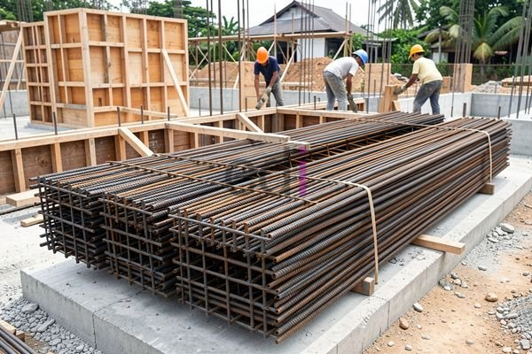

**Besi Rangka Bangunan: Panduan Lengkap Pemilihan, Fungsi, dan Estimasi Biaya 2026** - Hai Mitra CDI! Pernahkah terpikir bagaimana sebuah bangunan berdiri kokoh, menahan berbagai beban dan tantangan cuaca? Jawabannya seringkali tersembunyi di dalam struktur, yaitu besi rangka bangunan. 

Besi ini adalah fondasi kekuatan konstruksi. Mulai dari rumah minimalis di (not detected) hingga gedung pencakar langit, tanpa besi yang andal, bangunan akan rentan terhadap kerusakan. Artikel ini hadir untuk memberikan pemahaman mendalam mengenai peran, jenis, cara memilih, dan perkiraan biaya besi rangka bangunan. Mari kita bahas bersama!

## Mengapa Besi Rangka Bangunan Sangat Penting?

Besi rangka bangunan tidak sekadar elemen penambah berat; ia adalah tulang punggung kekuatan sebuah konstruksi. Beton, meskipun kuat menahan beban tekan, memiliki kelemahan saat menerima gaya tarik. Di sinilah besi mengambil peran sentral. Kekuatan tarik yang dimiliki besi memungkinkan struktur menahan beban hidup (orang, perabot), beban mati (berat bangunan), serta tekanan eksternal seperti angin kencang atau getaran gempa di (not detected).

Selain itu, besi berperan krusial dalam mendistribusikan beban secara merata. Ini mencegah titik-titik lemah yang berpotensi menyebabkan retakan atau kegagalan struktur. Memilih besi yang tepat, dengan jenis dan ukuran yang sesuai, sangat menentukan umur dan keselamatan bangunan Anda. Untuk proyek di (not detected), Kami sangat menyarankan konsultasi dengan ahli struktur untuk mendapatkan rekomendasi yang optimal.

## Mengenal Ragam Jenis Besi Rangka Bangunan

Ada beberapa pilihan besi yang bisa digunakan sebagai rangka bangunan, masing-masing memiliki keunggulan dan aplikasi yang berbeda. Berikut adalah beberapa jenis yang paling sering ditemui:

*   **Besi Beton Polos (Reinforcing Steel Bars - Rebar):** Ini adalah jenis yang paling umum dalam dunia konstruksi. Bentuknya berupa batang besi dengan berbagai ukuran diameter (6mm sampai 32mm atau lebih). Fungsinya adalah sebagai tulangan utama untuk menahan gaya tarik yang bekerja pada struktur beton.
*   **Besi Beton Ulir (Deformed Rebar):** Hampir serupa dengan besi beton polos, namun permukaannya bertekstur ulir. Uliran ini sangat penting karena meningkatkan daya rekat antara besi dan beton, sehingga struktur menjadi lebih kuat dan kokoh. Biasanya digunakan untuk struktur yang membutuhkan kekuatan ekstra seperti kolom, balok, atau fondasi bangunan di (not detected).
*   **Besi Hollow:** Berbentuk seperti pipa dengan berbagai dimensi dan ketebalan. Lebih sering digunakan untuk konstruksi rangka atap, pagar, atau elemen dekoratif karena ringan dan mudah dipasang. Walaupun tidak sekuat besi beton, fleksibilitas desainnya menarik bagi banyak proyek.
*   **Besi Siku:** Bentuknya menyerupai huruf "L". Biasanya digunakan untuk memperkuat sambungan atau sebagai penyangga pada struktur baja ringan. 

## Panduan Memilih Besi Rangka Bangunan yang Berkualitas

Memilih besi rangka bangunan yang tepat membutuhkan pertimbangan matang. Berikut faktor-faktor yang perlu Anda perhatikan:

*   **Mutu Besi:** Kualitas besi ditunjukkan melalui angka (misalnya, besi beton mutu 400). Angka ini mewakili kekuatan tarik minimum besi tersebut. Semakin tinggi angkanya, semakin kuat besi itu. Untuk proyek rumahan atau komersial sederhana, mutu besi 400 atau 500 biasanya sudah memadai.
*   **Diameter Besi:** Ukuran diameter besi harus disesuaikan dengan perhitungan beban yang akan ditanggung oleh struktur. Diameter yang terlalu kecil akan melemahkan konstruksi, sementara ukuran yang terlalu besar dapat membuang materi.
*   **Jenis Besi:** Sesuaikan jenis besi dengan fungsi dan lokasinya. Besi beton polos ideal untuk tulangan, besi beton ulir untuk struktur kuat, besi hollow untuk rangka ringan, dan besi siku untuk penyambungan.
*   **Standar SNI:** Selalu pastikan besi yang Anda beli telah memenuhi Standar Nasional Indonesia (SNI). Sertifikasi SNI menjamin kualitas dan keamanan bahan bangunan untuk proyek Anda di (not detected).

## Perkiraan Biaya Besi Rangka Bangunan di Tahun 2026

Mengetahui perkiraan biaya besi rangka bangunan penting untuk perencanaan anggaran proyek Anda. Biaya ini sangat fluktuatif, dipengaruhi oleh luas bangunan, desain struktur, jenis besi yang dipilih, dan harga material di pasaran (termasuk di (not detected)). Sebagai gambaran awal, berikut adalah perkiraan biaya per meter persegi berdasarkan jenis konstruksi:

| Jenis Konstruksi | Estimasi Biaya (Rp/m²) |
|---|---|
| Rumah Tinggal Sederhana (1 lantai) | Rp 250.000 – Rp 400.000 |
| Rumah Tinggal Menengah (2 lantai) | Rp 400.000 – Rp 600.000 |
| Gedung Bertingkat | Rp 700.000 – Rp 1.200.000 |

Perlu diingat bahwa perkiraan biaya ini bersifat dinamis dan dapat berubah sewaktu-waktu. Untuk mendapatkan penawaran harga yang paling akurat dan sesuai dengan kebutuhan proyek Anda, silakan hubungi Kami.  Kami siap membantu Anda menghitung anggaran secara rinci.

Jangan sungkan untuk menghubungi Kami melalui tombol **WhatsApp** atau **Telepon** yang tersedia di halaman ini jika Anda memiliki pertanyaan lebih lanjut atau ingin berkonsultasi dengan tim ahli Kami. [Besi Diameter 8: Aplikasi, Kelebihan, Kekurangan, dan Estimasi Harga 2026](/blog/besi-diameter-8/) — untuk informasi lebih lanjut terkait spesifikasi besi, bisa Anda lihat di artikel Kami sebelumnya. [Besi untuk Pondasi Rumah: Jenis, Ukuran, dan Estimasi Biaya Terbaru 2026](/blog/besi-untuk-pondasi-rumah/) — untuk pertimbangan pemilihan besi pondasi, Kami juga memiliki artikel yang bisa Anda jadikan referensi.