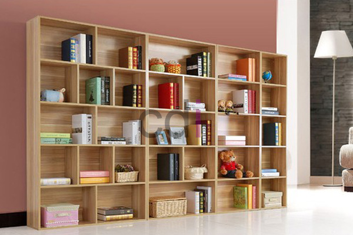

**Besi Siku Rak Buku: Pilihan Terbaik untuk Interior Rumah Anda** - Hai Mitra CDI! Mencari penyangga kuat untuk rak buku kesayangan? Atau mungkin sedang merencanakan rak buku gantung yang stylish? Besi siku adalah jawabannya! Komponen kecil ini punya peran besar dalam menentukan kekuatan dan keamanan rak buku Anda. Yuk, simak panduan lengkap memilih besi siku rak buku yang tepat untuk rumah Anda di (not detected).

## Kenapa Investasi pada Besi Siku Rak Buku Itu Penting?

Besi siku bukan sekadar tambahan, melainkan penentu stabilitas rak buku Anda. Bayangkan, rak buku penuh buku berat – tanpa penyangga yang memadai, rak bisa melengkung, bahkan ambruk! Besi siku berfungsi sebagai penguat sambungan antara rak dan dinding, atau antara rak dengan tiang penyangga. Terutama untuk material seperti kayu, MDF, atau komposit, besi siku adalah investasi yang bijak. Lebih dari sekadar fungsi, besi siku juga bisa jadi elemen dekoratif yang mempercantik tampilan rak buku Anda. Ada banyak model dan finishing yang bisa dipilih agar serasi dengan desain interior rumah di (not detected) Anda.

Kekuatan besi siku bergantung pada beberapa hal: ketebalan material, ukuran, dan kualitas besi. Untuk rak buku yang memuat banyak buku tebal, Kami sarankan memilih besi siku dengan ketebalan minimal 2mm dan ukuran yang pas dengan dimensi rak Anda. Informasi harga besi siku rak buku bisa bervariasi, tergantung spesifikasi. Untuk mengetahui harga terkini sesuai kebutuhan proyek Anda, silakan hubungi Kami melalui tombol **WhatsApp** atau **Telepon** yang tersedia di halaman ini.

## Mengenal Berbagai Jenis Besi Siku Rak Buku

Memilih jenis besi siku yang tepat akan memaksimalkan fungsi dan estetika rak buku Anda. Berikut beberapa jenis yang umum digunakan, masing-masing dengan keunggulan uniknya:

*   **Besi Siku L:** Pilihan paling populer dan mudah ditemukan. Bentuknya menyerupai huruf "L", ideal untuk menyambungkan rak dengan dinding atau tiang penyangga. Tersedia dalam beragam ukuran dan ketebalan.
*   **Besi Siku Plat:** Memiliki permukaan lebih luas dari besi siku L, sehingga memberikan daya tahan ekstra. Sangat cocok untuk rak buku yang harus menopang beban berat.
*   **Besi Siku Sudut:** Dirancang khusus untuk menyambungkan dua permukaan dengan sudut 90 derajat. Cocok untuk desain rak buku yang unik dan artistik.
*   **Besi Siku Adjustable:** Fleksibilitas adalah keunggulan utama jenis ini. Anda bisa menyesuaikan sudut dan ketinggian rak buku sesuai kebutuhan. Sangat ideal untuk rak buku yang sering diubah-ubah susunannya.

Berikut tabel perbandingan yang bisa menjadi acuan Mitra CDI:

<table class="table">
  <caption>Perbandingan Jenis Besi Siku Rak Buku</caption>
  <thead>
    <tr><th>Jenis Besi Siku</th><th>Kekuatan</th><th>Fleksibilitas</th><th>Harga (Estimasi)</th><th>Aplikasi Umum</th></tr>
  </thead>
  <tbody>
    <tr><td>L</td><td>Sedang</td><td>Sedang</td><td>Rp 15.000 - Rp 25.000</td><td>Rak buku standar, rak dinding</td></tr>
    <tr><td>Plat</td><td>Tinggi</td><td>Rendah</td><td>Rp 25.000 - Rp 40.000</td><td>Rak buku berat, rak industri</td></tr>
    <tr><td>Sudut</td><td>Sedang</td><td>Rendah</td><td>Rp 20.000 - Rp 30.000</td><td>Rak buku desain unik</td></tr>
    <tr><td>Adjustable</td><td>Sedang</td><td>Tinggi</td><td>Rp 30.000 - Rp 50.000</td><td>Rak buku fleksibel, rak display</td></tr>
  </tbody>
</table>

## Creative Design Interior: Solusi Lengkap untuk Kebutuhan Rak Buku di (not detected)

Kami di Creative Design Interior menyediakan berbagai jenis besi siku rak buku berkualitas, dengan harga yang bersaing. Tak hanya besi siku, Kami juga spesialis dalam layanan custom furniture, termasuk pembuatan rak buku sesuai desain impian Mitra. Dengan pengalaman lebih dari 10 tahun di bidang kitchen set, furniture interior, dan pengadaan material bangunan, Kami siap membantu Anda.

Kami menyadari bahwa setiap proyek unik. Oleh karena itu, Kami menawarkan konsultasi gratis untuk membantu Anda menentukan besi siku yang paling tepat. Kami juga memberikan opsi harga *all-in-one* yang mencakup material, pengiriman, dan pemasangan. Nikmati juga promo gratis ongkir untuk wilayah tertentu di (not detected). Untuk detail lebih lanjut tentang produk dan layanan Kami, kunjungi halaman Daftar Harga atau langsung hubungi Kami melalui tombol **WhatsApp** atau **Telepon** di halaman ini. Tim Kami siap melayani Mitra dengan sistem penjadwalan yang teratur, memastikan pengerjaan tepat waktu dan kualitas terjamin. Produk bisa ditukar jika ditemukan cacat atau tidak sesuai spesifikasi (syarat dan ketentuan berlaku). Jangan sungkan untuk berkonsultasi — Kami senang membantu Mitra CDI mewujudkan rak buku impian di (not detected)!

[[[PLACEHOLDER_N]]]

Butuh bantuan lebih lanjut? Hubungi Kami melalui tombol **WhatsApp** atau **Telepon** yang tersedia. Kami siap menjawab pertanyaan Anda! [Contoh Rak Buku Gantung: Hemat Ruang, Desain Modern untuk Rumah Anda](/blog/contoh-rak-buku-gantung/) — temukan inspirasi desain rak buku gantung yang bisa memaksimalkan ruang di rumah Anda.