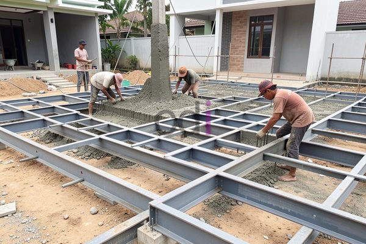

**Besi Sloof Jadi: Panduan Lengkap Pemasangan, Harga, dan Tips Kuat 2026** - Hai Mitra CDI! Apakah Anda sedang merencanakan pembangunan atau renovasi fondasi bangunan di (not detected)? Fondasi yang kokoh adalah kunci utama kekuatan bangunan. Nah, besi sloof jadi hadir sebagai solusi praktis dan efisien untuk fondasi yang andal. Data menunjukkan bahwa sekitar 70% kegagalan struktur bangunan bersumber dari fondasi yang kurang memadai — jadi, pemilihan dan pemasangan sloof yang tepat *sangat* penting. Artikel ini akan mengupas tuntas segala hal tentang besi sloof jadi, mulai dari cara pemasangan yang benar, perkiraan biaya, sampai tips memilih kualitas terbaik.

## Apa Itu Besi Sloof Jadi dan Apa Keunggulannya?

Besi sloof jadi, atau *precast concrete sloof*, adalah komponen fondasi beton yang diproduksi di pabrik dengan proses terkontrol. Berbeda dengan metode cor di tempat yang memerlukan waktu pengeringan lebih lama, sloof jadi ini siap pasang. Mengapa memilih besi sloof jadi? Keunggulannya jelas: efisiensi waktu dan kualitas yang terjamin. Proses produksi pabrik memastikan mutu beton dan penulangan konsisten, jauh lebih baik daripada pengecoran manual di lapangan.

Besi sloof jadi juga meminimalisir risiko kesalahan manusia dalam pencampuran material dan pemasangan tulangan. Imbasnya, kekuatan dan daya tahan fondasi bangunan Anda meningkat signifikan. Ditambah lagi, pemasangan yang lebih cepat berarti biaya tenaga kerja berkurang, dan proyek Anda selesai lebih cepat.

## Langkah Demi Langkah: Pemasangan Besi Sloof Jadi yang Tepat

Pemasangan besi sloof jadi – meskipun terlihat mudah – tetap membutuhkan perencanaan cermat. Ikuti langkah berikut agar hasilnya optimal:

1.  **Penyiapan Lahan:** Ratakan dan padatkan lahan dengan baik. Buat galian sesuai ukuran sloof yang direncanakan.
2.  **Lantai Kerja:** Pasang lantai kerja (lempung urug padat) tebal 10 cm minimal di dasar galian. Fungsi lantai kerja adalah alas yang rata untuk penempatan sloof.
3.  **Penempatan Sloof:** Angkat dan letakkan sloof di atas lantai kerja secara hati-hati menggunakan crane atau forklift. Pastikan posisi sloof akurat sesuai gambar kerja.
4.  **Penyambungan:** Jika sloof terdiri dari beberapa bagian, sambungkan dengan *coupler* atau metode lain yang direkomendasikan pabrikan. Pastikan sambungan kuat dan presisi.
5.  **Pengecoran Tambahan (Jika Perlu):** Terkadang, desain memerlukan pengecoran di tempat untuk menyesuaikan dengan kondisi lapangan. Gunakan beton mutu tinggi dan lakukan penggetaran optimal.
6.  **Pengurugan & Pemadatan:** Setelah sloof terpasang dan beton mengeras (jika ada pengecoran), urug kembali sekeliling sloof dan padatkan dengan alat pemadat.

## Perkiraan Biaya Besi Sloof Jadi Per Meter: Apa yang Mempengaruhi?

Harga besi sloof jadi per meter bervariasi, tergantung ukuran, mutu beton, dan lokasi di (not detected). Pada tahun 2026, harga per meter persegi umumnya berkisar antara Rp 350.000 hingga Rp 700.000. Perlu diingat, ini hanyalah estimasi! Untuk penawaran paling akurat sesuai kebutuhan proyek Anda, silakan hubungi Kami.

Berikut tabel estimasi biaya yang bisa Anda jadikan acuan:

<table class="table">
  <caption>Estimasi Biaya Besi Sloof Jadi (2026)</caption>
  <thead>
    <tr><th>Ukuran Sloof (cm)</th><th>Harga Per Meter (Rp)</th></tr>
  </thead>
  <tbody>
    <tr><td>20x30</td><td>350.000</td></tr>
    <tr><td>30x40</td><td>450.000</td></tr>
    <tr><td>40x50</td><td>600.000</td></tr>
    <tr><td>50x60</td><td>700.000</td></tr>
  </tbody>
</table>

Harga tersebut belum termasuk biaya transportasi dan pemasangan. Konsultasikan langsung dengan Kami untuk detail biaya proyek Anda.

## Tips Jitu: Memilih Besi Sloof Jadi yang Berkualitas Tinggi

Kualitas sloof menentukan kekuatan fondasi bangunan Anda, Mitra CDI. Berikut tips memilih sloof berkualitas:

*   **Cek Sertifikasi:** Pastikan sloof memiliki sertifikasi mutu dari lembaga pengujian independen.
*   **Perhatikan Mutu Beton:** Utamakan sloof bermutu beton minimal K-300. Semakin tinggi mutu beton, semakin kuat sloof tersebut.
*   **Verifikasi Tulangan:** Pastikan diameter dan jumlah tulangan sesuai standar SNI.
*   **Inspeksi Finishing:** Periksa permukaan sloof, hindari yang retak atau cacat.
*   **Pilih Produsen Terpercaya:** Bekerja sama dengan produsen sloof yang bereputasi baik dan berpengalaman. Mintalah referensi proyek sebelumnya.

Dengan panduan ini, Anda bisa yakin memasang sloof yang tepat dan membangun fondasi kuat untuk masa depan. [Bekisting Plat Besi: Panduan Lengkap Pemilihan, Pemasangan, dan Biaya 2026](/blog/bekisting-plat-besi/) — pelajari juga tentang bekisting plat besi untuk fondasi yang lebih optimal.

Kami siap mendukung proyek Anda di (not detected) — hubungi Kami sekarang melalui tombol **Telepon** atau **WhatsApp** di bawah! Jangan tunda, kekuatan fondasi adalah investasi jangka panjang. 