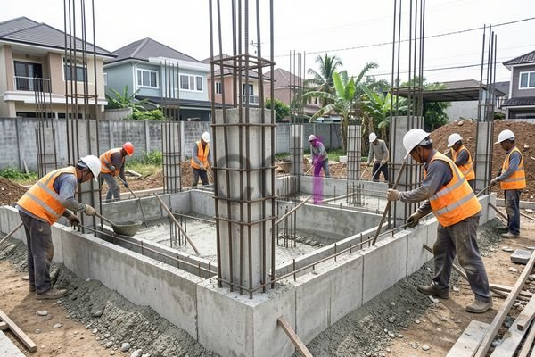

**Besi untuk Pondasi Rumah: Jenis, Ukuran, dan Estimasi Biaya Terbaru 2026** - Halo Mitra CDI! Pembangunan rumah yang kokoh dimulai dari pondasi yang andal. Tahukah Anda bahwa pondasi yang berkualitas dapat menyumbang hingga 30% dari total biaya konstruksi? Nah, besi beton adalah elemen penting dalam memastikan kekuatan dan umur panjang fondasi hunian Anda. Artikel ini akan memandu Anda memahami jenis, ukuran, serta perkiraan biaya besi yang dibutuhkan untuk pondasi rumah impian Anda di (not detected).

## Mengapa Besi Beton Sangat Vital untuk Pondasi?

Besi beton berperan sebagai tulang punggung struktur beton pada pondasi. Beton memang kuat dalam menahan beban tekan, tapi kurang mampu menghadapi tarikan. Di sinilah besi beton berperan – ia memberikan kekuatan tarik yang esensial. Tanpa besi beton, pondasi berisiko retak, bahkan runtuh, terutama jika terpapar pergerakan tanah, beban bangunan berlebih, atau aktivitas seismik. Kami selalu menekankan pentingnya memilih besi beton bersertifikasi SNI untuk menjamin kualitas dan keamanan bangunan Anda.

Pondasi yang dirancang dengan tepat dan menggunakan besi beton yang memadai akan mendistribusikan beban bangunan secara merata ke lapisan tanah di bawahnya. Ini mencegah penurunan atau pergeseran pondasi yang bisa menimbulkan masalah struktural serius. Untuk memahami lebih jauh tentang material pendukung pondasi, yuk simak artikel kami tentang Batu Cor Pondasi: Pilihan Terbaik untuk Konstruksi Rumah Kokoh.

## Jenis Besi Beton yang Umum Digunakan

Ada beberapa jenis besi beton yang sering digunakan dalam konstruksi pondasi rumah. Memilih jenis yang tepat tergantung pada desain pondasi dan kebutuhan spesifik bangunan. Berikut adalah beberapa opsi yang paling populer:

*   **Besi Beton Polos (Reinforcing Bars):** Memiliki permukaan halus dan berfungsi menahan gaya tarik dalam beton.
*   **Besi Beton Ulir (Deformed Bars):** Permukaannya bergelombang atau memiliki ulir, memberikan daya rekat yang lebih kuat dengan beton. Jenis ini seringkali menjadi pilihan utama untuk pondasi karena kemampuannya menahan beban yang lebih besar.
*   **Besi Beton Spiral:** Berbentuk spiral dan umumnya digunakan untuk membuat kolom beton bertulang. Walaupun jarang digunakan langsung pada pondasi tapak, besi spiral sering ditemukan pada konstruksi pondasi tiang pancang.

Untuk kebanyakan proyek rumah tinggal, besi beton ulir berdiameter antara 10 mm hingga 16 mm merupakan pilihan yang umum. Tetapi, untuk bangunan yang lebih besar atau kondisi tanah yang kurang stabil, mungkin diperlukan diameter yang lebih besar.

## Panduan Memilih Ukuran Besi Beton yang Tepat

Menentukan ukuran besi beton yang ideal membutuhkan perhitungan cermat, mempertimbangkan beban bangunan, karakteristik tanah, dan desain pondasi. Berikut adalah panduan umum berdasarkan jenis pondasi:

*   **Pondasi Batu Kali:** Besi beton diameter 8 mm hingga 10 mm dengan jarak antar besi antara 20 cm – 30 cm.
*   **Pondasi Plat (Footing):**  Besi beton diameter 10 mm hingga 12 mm dengan jarak antar besi sekitar 20 cm – 25 cm.
*   **Pondasi Menerus (Slab-on-Grade):** Besi beton diameter 10 mm hingga 12 mm dengan jarak antar besi sekitar 20 cm – 25 cm.
*   **Pondasi Tiang Pancang:** Besi beton diameter 16 mm hingga 20 mm atau lebih, disesuaikan dengan beban dan kedalaman tiang.

Sebagai contoh, bayangkan Anda membangun pondasi plat untuk rumah berukuran 10m x 8m dengan beban total 100 ton (100.000 kg). Menggunakan besi beton ulir diameter 12 mm dengan mutu 400 MPa, kekuatan tarik setiap batang besi beton sekitar 400 MPa dikalikan luas penampang (πr²). Perhitungan kebutuhan total besi memerlukan analisis struktur yang lebih mendalam, sebaiknya dilakukan oleh tenaga ahli.

## Perkiraan Biaya Besi Beton untuk Pondasi Rumah di (not detected)

Harga besi beton akan bervariasi dipengaruhi jenis, ukuran, dan merek produk. Di tahun 2026, harga besi beton polos berkisar antara Rp 7.000 – Rp 10.000 per kilogram. Sedangkan besi beton ulir kira-kira dibanderol Rp 10.000 – Rp 15.000 per kilogram.

Untuk pondasi rumah tipe 45 dengan luas sekitar 40 meter persegi, perkiraan kebutuhan besi beton sekitar 1 ton hingga 1,5 ton. Dengan harga rata-rata Rp 12.000 per kilogram, biaya total besi beton untuk pondasi rumah tipe 45 bisa berkisar Rp 12.000.000 – Rp 18.000.000. **Perlu diingat:** Ini hanyalah estimasi, dan harga dapat berubah sewaktu-waktu. Untuk penawaran harga terbaru dan sesuai dengan kebutuhan proyek Anda di (not detected), segera hubungi kami!

Untuk mendapatkan perkiraan kebutuhan besi yang lebih akurat, konsultasikan dengan ahli struktur bangunan. Selain besi beton, ada biaya lain yang perlu Anda pertimbangkan, seperti penggalian, bekisting, dan upah tenaga kerja. Jangan ragu untuk membaca panduan lengkap kami tentang Berapa Besi yang Dibutuhkan untuk Membangun Rumah? Panduan Lengkap & Perhitungan untuk memahami lebih jauh.

Butuh informasi lebih lanjut? Jangan sungkan untuk memanfaatkan tombol **Telepon** atau **WhatsApp** di bawah ini, tim kami dengan senang hati akan membantu Anda. Kami juga menyediakan berbagai jasa desain interior dan material bangunan berkualitas di (not detected).