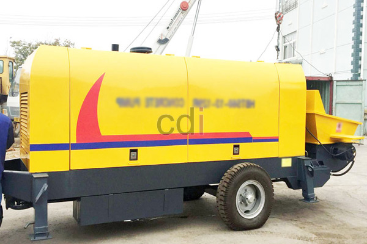

**Beton 20 MPa: Panduan Lengkap Kekuatan, Aplikasi, dan Estimasi Biaya** - Hai Mitra CDI! Sedang merencanakan konstruksi dan bingung memilih jenis beton yang tepat? Jangan khawatir! Artikel ini hadir untuk memberikan panduan lengkap mengenai beton 20 MPa – mulai dari kekuatannya, beragam aplikasinya, hingga perkiraan biayanya. Ayo, simak bersama!

Pemilihan mutu beton yang pas itu krusial banget, lho. Kekuatan beton yang sesuai akan menjamin kualitas dan keamanan bangunan Anda. Beton 20 MPa sering jadi pilihan populer, tapi apa sih sebenarnya beton 20 MPa itu? Dan proyek apa saja yang cocok menggunakan beton dengan kekuatan ini? Kami akan membahas tuntas di sini.

## Membedah Lebih Dalam Mengenai Beton 20 MPa

Beton 20 MPa menunjukkan kekuatan tekan beton setelah 28 hari masa pengujian. Angka 20 MPa itu artinya beton mampu menahan tekanan sebesar 20 MegaPascal (N/mm²). Biar lebih mudah dibayangkan, 1 MPa sama dengan 10 kg/cm². Jadi, beton 20 MPa ini kuat menahan beban sekitar 200 kg per sentimeter persegi.

Kekuatan ini membuatnya ideal untuk konstruksi ringan hingga menengah. Komposisinya sendiri terdiri dari semen, pasir, kerikil, dan air yang dicampur dengan proporsi yang tepat. Perbandingan yang pas memastikan beton punya kekuatan dan daya tahan sesuai standar. Di Indonesia, standar untuk mutu beton ini diatur dalam SNI 03-1999 tentang Spesifikasi Beton.

## Di Mana Saja Beton 20 MPa Bisa Digunakan?

Karena kuatnya memadai untuk beban yang tak terlalu berat, beton ini sangat pas untuk:

*   **Pondasi Rumah Tinggal:** Ideal untuk pondasi rumah 1 atau 2 lantai.
*   **Lantai Kerja:** Sering dipakai sebagai lantai dasar sebelum pengecoran lantai permanen.
*   **Trotoar dan Jalan Setapak:** Mampu menahan beban pejalan kaki sehingga cocok untuk trotoar dan jalan setapak.
*   **Pekerjaan Arsitektural:** Elemen seperti pagar atau dekorasi juga bisa menggunakan beton 20 MPa.
*   **Pelat Lantai Tipis:** Pelat lantai dengan ketebalan dan beban tertentu juga bisa memanfaatkan beton ini.

## Menghitung Kebutuhan Beton 20 MPa: Estimasi Biaya di (not detected)

Sebelum mulai proyek, hitung dulu kebutuhan beton secara akurat, ya. Perhitungan yang tepat membantu mengontrol anggaran dan menghindari sisa material yang mubazir. Contohnya, jika volume pondasi rumah Anda 5 m³, Anda bisa menggunakan rasio campuran umum untuk beton 20 MPa, yaitu 1:2:3 (semen:pasir:kerikil). 

Tapi ingat, rasio bisa berbeda tergantung jenis semen dan kerikil yang Anda pakai. Jadi, selalu konsultasikan dengan tukang bangunan atau supplier untuk rasio yang paling tepat.

Soal harga, biaya beton 20 MPa di (not detected) bisa bervariasi tergantung penyedia dan jumlah pesanan.  Untuk perkiraan biaya terbaru, silakan cek tabel harga di atas  atau hubungi Kami untuk penawaran terakurat sesuai kebutuhan proyek Anda.

## Hal Penting yang Perlu Diperhatikan Saat Menggunakan Beton 20 MPa

Meskipun ekonomis dan mudah diaplikasikan, ada beberapa hal yang perlu diperhatikan:

*   **Kualitas Material:** Pastikan semua bahan yang digunakan berkualitas baik dan memenuhi standar SNI.
*   **Proses Pencampuran:** Pencampuran beton harus dilakukan dengan benar untuk menghasilkan campuran yang homogen dan kuat.
*   **Pemeliharaan Beton:** Setelah dicor, beton perlu dirawat (curing) agar proses pengerasan berlangsung sempurna.
*   **Konsultasi Ahli:** Untuk proyek yang lebih kompleks, jangan ragu berkonsultasi dengan insinyur sipil atau ahli konstruksi.

Butuh bantuan lebih lanjut? Tim Kami siap sedia membantu! Silakan hubungi melalui tombol **Telepon** atau **WhatsApp** yang tersedia di bawah. Kami tak sabar membantu Anda mewujudkan proyek impian di (not detected) dan sekitarnya!