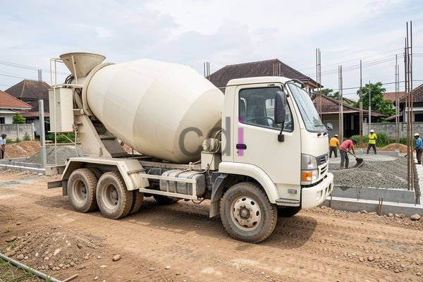

**Beton FC 25: Panduan Lengkap Kekuatan, Aplikasi, dan Biaya di Jabodetabek** - Hai Mitra CDI! Apakah Anda tengah merencanakan sebuah proyek konstruksi dan sedang mencari informasi detail mengenai mutu beton?

Memilih mutu beton yang tepat adalah hal krusial agar bangunan yang Anda impikan kokoh, tahan lama, dan tentunya aman. Nah, salah satu pilihan populer di lapangan adalah beton FC 25. Artikel ini akan mengupas tuntas segala yang perlu Anda ketahui tentang beton FC 25, mulai dari definisinya, kelebihan yang ditawarkan, berbagai aplikasinya, cara menghitung kebutuhan material, sampai perkiraan biaya di wilayah Jabodetabek. Yuk, kita mulai!

## Mengenal Lebih Dekat Mutu Beton FC 25

Secara sederhana, beton FC 25 memiliki kekuatan tekan karakteristik sebesar 25 MPa (Mega Pascal). Apa artinya? Singkatnya, angka ini menunjukkan seberapa besar beban tekan yang dapat ditahan beton tersebut setelah mencapai usia 28 hari. Beton dengan mutu ini banyak dipakai untuk beragam proyek konstruksi, dari rumah tinggal sederhana hingga bangunan yang lebih kompleks.

Standar mutu kekuatan tekan beton FC 25 ini diuji secara ketat di laboratorium, mengikuti pedoman yang ditetapkan dalam SNI 03-1999 tentang Spesifikasi Beton. Standar ini memastikan bahwa beton yang diproduksi benar-benar memenuhi persyaratan kualitas dan keamanan.

## Dimana Saja Beton FC 25 Bisa Digunakan?

Fleksibilitas beton FC 25 menjadikannya pilihan tepat untuk berbagai aplikasi konstruksi. Berikut beberapa contoh penggunaannya yang paling umum:

*   **Pondasi:** Cocok untuk pondasi sederhana seperti pondasi batu kali atau pondasi tapak yang tidak memerlukan daya dukung terlalu besar.
*   **Sloof dan Kolom Praktis:** Elemen struktur ini membutuhkan kekuatan yang memadai untuk menopang beban dari atas, dan FC 25 hadir sebagai solusi yang efektif.
*   **Lantai Kerja:** Bertindak sebagai lapisan dasar yang rata dan kuat sebelum pengecoran lantai utama.
*   **Pekerjaan Arsitektural:** Bisa digunakan untuk membuat ornamen beton, elemen dekoratif, atau bentuk-bentuk arsitektur lainnya.

Perlu diingat, untuk struktur yang menahan beban sangat berat atau terpapar kondisi lingkungan yang keras, mutu beton yang lebih tinggi seperti FC 30 atau FC 40 mungkin lebih disarankan. Jangan sungkan berkonsultasi dengan Kami untuk mendapatkan rekomendasi yang paling sesuai dengan kebutuhan proyek Anda.

## Hitung Kebutuhan Beton FC 25: Studi Kasus Sederhana

Menghitung volume beton secara akurat sangat penting untuk menghindari sisa material yang tidak perlu atau kekurangan di tengah proyek. Sebagai contoh, mari kita hitung kebutuhan beton FC 25 untuk pembuatan pondasi tapak dengan detail berikut:

*   Panjang pondasi: 8 meter
*   Lebar pondasi: 0,5 meter
*   Tinggi pondasi: 0,3 meter

Volume pondasi dapat dihitung menggunakan rumus sederhana: Volume = Panjang x Lebar x Tinggi

Maka, volume pondasi = 8 m x 0,5 m x 0,3 m = 1,2 m³

Jadi, Anda akan membutuhkan sekitar 1,2 meter kubik beton FC 25 untuk proyek ini. Ingat, perhitungan ini bersifat teoritis dan belum mempertimbangkan faktor-faktor seperti kehilangan material saat pemadatan atau kompleksitas bentuk pondasi. Untuk proyek yang lebih besar dan rumit, Kami sarankan menggunakan layanan perhitungan material yang lebih rinci. Mitra CDI bisa cek juga 1 m3 beton berapa m2 bekisting: Panduan Praktis Menghitung dan Mengoptimalkan untuk membantu Anda merencanakan proyek secara lebih efisien.

## Berapa Kisaran Biaya Beton FC 25 di Jabodetabek?

Biaya beton FC 25 di area Jabodetabek bisa naik turun tergantung beberapa faktor. Beberapa di antaranya adalah:

*   **Jarak Pengiriman:** Semakin jauh lokasi proyek dari pabrik beton, biaya transportasi akan bertambah.
*   **Jumlah Pesanan:** Pesanan dalam jumlah besar umumnya mendapatkan harga yang lebih kompetitif.
*   **Kualitas Bahan Baku:** Penggunaan bahan baku berkualitas tinggi akan berdampak pada harga akhir.
*   **Penyedia Layanan:** Setiap perusahaan penyedia beton memiliki kebijakan harga yang berbeda-beda.

Sebagai gambaran, perkiraan harga beton FC 25 di Jabodetabek pada tahun 2026 berkisar antara Rp 800.000 hingga Rp 1.200.000 per meter kubik. Perlu diingat bahwa angka ini hanyalah estimasi dan bisa berubah sewaktu-waktu. Untuk mendapatkan penawaran harga yang paling akurat dan sesuai dengan kebutuhan proyek Mitra CDI, langsung saja hubungi Kami. Selain itu, Anda juga bisa mempertimbangkan Adhimix Beton: Solusi Praktis untuk Konstruksi Berkualitas di Jabodetabek untuk kemudahan dan efisiensi.

Ingin konsultasi lebih lanjut atau mendapatkan penawaran harga terbaik? Klik tombol **Telepon** atau **WhatsApp** yang tersedia di bagian bawah halaman ini! Kami siap membantu Anda mewujudkan proyek konstruksi impian Anda di Jabodetabek.