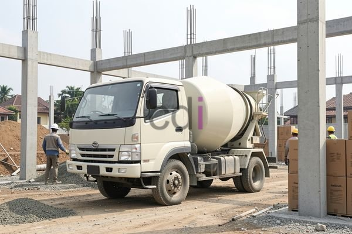

**Beton FC 30: Panduan Lengkap Kekuatan, Aplikasi, dan Biaya di Jabodetabek** - Hai Mitra CDI! Apakah Anda sedang merencanakan proyek konstruksi dan mencari material yang andal dengan harga bersaing? Inilah beton FC 30! Material ini jadi pilihan populer di berbagai pembangunan di wilayah Jabodetabek, mulai dari rumah tinggal hingga proyek komersial berskala menengah. Artikel ini akan membahas secara menyeluruh segala hal yang perlu Anda ketahui tentang beton FC 30, mulai dari definisi dasarnya, kekuatan yang dimilikinya, berbagai aplikasinya, sampai estimasi biayanya. Dengan informasi yang jelas dan akurat, Anda bisa membuat keputusan terbaik untuk kebutuhan proyek Anda.

## Mengenal Lebih Dalam: Kekuatan dan Karakteristik Beton FC 30

Beton FC 30, singkatnya, adalah beton yang memiliki kuat tekan karakteristik sebesar 30 MPa (MegaPascal). Ini berarti, secara sederhana, beton ini mampu menahan beban tekan sebesar 30 MPa. Untuk memahami lebih lanjut, penting untuk mengetahui bahwa standar mutu beton di Indonesia diatur dalam SNI 03-1999 tentang Spesifikasi Beton. Standar ini menggunakan notasi “K” untuk menunjukkan kuat tekan karakteristik beton. Jadi, beton K-30 setara dengan beton FC 30, keduanya memiliki kuat tekan 30 MPa.

Perlu diingat, angka ini diperoleh dari pengujian pada usia beton 28 hari. Beberapa faktor penting yang memengaruhi kekuatan akhir beton meliputi kualitas bahan baku (semen, agregat, air), proporsi campuran (rasio air-semen), cara pencampuran, dan perawatan beton setelah pengecoran. Kami sarankan selalu memastikan kualitas terjaga di setiap tahap untuk mencapai mutu beton yang optimal.

## Dimana Saja Beton FC 30 Bisa Digunakan?

Dengan sifatnya yang serbaguna, beton FC 30 cocok digunakan di berbagai keperluan konstruksi. Beberapa aplikasinya yang umum dijumpai antara lain:

*   **Pondasi Bangunan:** Ideal untuk pondasi bangunan dengan tinggi 1-2 lantai, karena kemampuannya menahan beban.
*   **Kolom dan Balok:** Elemen vital ini membutuhkan kekuatan yang memadai, dan beton FC 30 bisa menjadi pilihan yang tepat.
*   **Lantai:**  Memastikan lantai tahan lama dan mampu menopang beban dengan baik.
*   **Trotoar dan Jalan Kecil:**  Cocok untuk trotoar dan jalan permukiman yang tidak dilalui lalu lintas berat.
*   **Area Parkir:**  Tahan terhadap abrasi dan tekanan kendaraan, jadi cocok untuk area parkir mobil biasa.

 

Namun, jika proyek Anda membutuhkan kekuatan yang lebih tinggi – misalnya untuk gedung bertingkat atau jembatan – beton dengan mutu lebih tinggi seperti K-35 atau K-40 mungkin lebih disarankan. Sebaliknya, untuk keperluan yang kurang menuntut seperti pembuatan taman atau dekorasi, beton dengan mutu lebih rendah bisa dipertimbangkan untuk efisiensi biaya.

## Menghitung Kebutuhan dan Memperkirakan Biaya Beton FC 30

Menentukan jumlah beton yang dibutuhkan proyek Anda dimulai dengan menghitung volume masing-masing bagian struktur (pondasi, kolom, balok, lantai). Gunakan desain bangunan sebagai acuan. Setelah itu, jumlahkan semua volume untuk mendapatkan total beton yang diperlukan. Misalnya, jika sebuah pondasi berukuran 1 meter x 1 meter x 0,5 meter, volumenya adalah 0,5 m³.

Soal biaya, harga beton FC 30 di wilayah Jabodetabek dipengaruhi oleh beberapa hal: lokasi proyek, penyedia beton, dan cara pengiriman. Di tahun 2026 ini, perkiraan harga beton FC 30 *in-situ* (dicampur langsung di lokasi proyek) berkisar antara Rp 800.000 hingga Rp 1.200.000 per meter kubik. Sementara beton *ready-mix* (pesanan siap pakai dari pabrik) bisa mencapai Rp 900.000 hingga Rp 1.500.000 per meter kubik.

Perlu diingat, harga-harga ini hanyalah estimasi dan bisa berubah sewaktu-waktu. Untuk mendapatkan penawaran harga terkini dan disesuaikan dengan kebutuhan spesifik proyek Anda, jangan ragu untuk menghubungi Kami. Selain itu, jangan lupa memperhitungkan biaya tambahan seperti pengiriman, bekisting (yuk, pelajari lebih lanjut tentang 1 m3 beton berapa m2 bekisting: Panduan Praktis Menghitung dan Mengoptimalkan), dan biaya tenaga kerja.

## Tips Memilih Penyedia Beton FC 30 Terpercaya di Jabodetabek

Memilih vendor yang tepat sangat penting untuk menjamin kualitas beton proyek Anda. Berikut beberapa hal yang perlu diperhatikan:

*   **Reputasi:**  Cari penyedia dengan rekam jejak yang baik dan pengalaman yang relevan.
*   **Sertifikasi:**  Pastikan penyedia memiliki sertifikasi yang diakui secara nasional.
*   **Kontrol Kualitas:**  Tanyakan tentang prosedur pengujian mutu beton yang mereka lakukan.
*   **Pelayanan:**  Pilih yang responsif dan memberikan layanan yang memuaskan.
*   **Harga:**  Bandingkan penawaran dari beberapa penyedia untuk mendapatkan harga terbaik.

Apabila Anda masih memiliki pertanyaan atau memerlukan konsultasi lebih lanjut, silakan klik tombol **Telepon** atau **WhatsApp** di bawah ini. Tim Kami siap membantu!

Kami dari Creative Design Interior (CDI) berkomitmen untuk menyediakan material konstruksi berkualitas dan layanan terbaik bagi Mitra CDI di seluruh Jabodetabek. Jangan ragu untuk menghubungi Kami untuk informasi lebih lanjut atau permintaan penawaran. Kami siap menjadi mitra terpercaya dalam kesuksesan proyek konstruksi Anda.