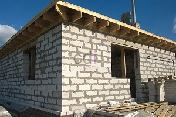

**Beton Instan Drymix K 300: Panduan Lengkap Aplikasi dan Keunggulan di Proyek Anda** - Hai Mitra CDI! Sedang mencari solusi beton yang praktis dan handal untuk proyek Anda? Pernahkah Anda mempertimbangkan beton instan *drymix* K 300? Material ini menghadirkan kemudahan aplikasi dan kualitas yang bisa diandalkan. Artikel ini akan mengupas tuntas segala hal yang perlu Anda ketahui tentang beton instan *drymix* K 300 – mulai dari keunggulannya, hingga aplikasi yang tepat, dan pertimbangan biaya. Yuk, simak selengkapnya!

## Mengenal Lebih Dekat Karakteristik dan Mutu Beton Instan Drymix K 300

Beton instan *drymix* K 300 adalah campuran beton kering siap pakai yang terdiri dari semen, pasir (agregat halus), kerikil (agregat kasar), serta aditif khusus. Angka "K 300" menunjukkan kekuatan tekan beton setelah 28 hari, yaitu 300 kg/cm², sesuai dengan standar SNI yang berlaku.

Apa yang membedakan beton instan *drymix* K 300 dengan beton konvensional? Proses pencampurannya!  Jika beton konvensional dicampur di lokasi proyek, beton instan *drymix* hanya memerlukan penambahan air sesuai takaran. Ini meminimalkan risiko kesalahan pencampuran dan menghasilkan kualitas beton yang lebih konsisten.

Penting untuk diingat, kekuatan tekan beton K 300 ideal untuk beragam aplikasi struktural, termasuk pondasi sederhana, lantai kerja, kolom praktis, dan balok kecil. Namun, untuk proyek yang menuntut kekuatan tekan yang lebih tinggi – misalnya bangunan bertingkat – beton dengan mutu lebih tinggi (K 400 atau lebih) adalah pilihan yang lebih tepat.

## Aplikasi Beton Instan Drymix K 300: Solusi untuk Berbagai Proyek Konstruksi

Fleksibilitas beton instan *drymix* K 300 menjadikannya solusi yang serbaguna untuk berbagai jenis proyek konstruksi. Berikut beberapa contoh penerapannya:

*   **Pondasi Rumah:**  Pilihan yang ekonomis dan kuat untuk pondasi rumah tinggal sederhana.
*   **Lantai Kerja:**  Menghasilkan permukaan rata dan stabil sebagai dasar pengecoran lantai utama.
*   **Kolom Praktis:**  Alternatif yang efektif untuk pembuatan kolom praktis pada konstruksi bangunan sederhana.
*   **Balok dan Sloof:**  Cocok untuk struktur balok dan sloof yang tidak memerlukan beban terlalu berat.
*   **Perbaikan Beton:**  Ideal untuk memperbaiki area beton yang mengalami retak atau kerusakan.

Jangan ragu untuk berkonsultasi dengan ahli struktur bangunan guna menentukan mutu beton yang paling sesuai dengan kebutuhan khusus proyek di Proyek Anda.

## Menimbang Biaya: Perbandingan dengan Alternatif Lain

Harga beton instan *drymix* K 300 bervariasi tergantung merek, jumlah pembelian, dan lokasi. Sebagai gambaran, harga per sak (biasanya 50 kg) berada di kisaran Rp 40.000 hingga Rp 60.000. Perlu diingat bahwa angka ini hanyalah estimasi dan dapat berfluktuasi. Untuk penawaran harga terkini dan sesuai kebutuhan Proyek Anda, silakan hubungi Kami!

Berikut ini perbandingan biaya antara beton instan *drymix* K 300 dengan opsi beton lainnya (estimasi per m³):

<table class="table">
  <caption>Perbandingan Estimasi Biaya Beton</caption>
  <thead>
    <tr><th>Jenis Beton</th><th>Biaya/m³ (Estimasi)</th><th>Keterangan</th></tr>
  </thead>
  <tbody>
    <tr><td>Beton Instan Drymix K 300</td><td>Rp 800.000 - Rp 1.200.000</td><td>Tergantung merek dan kuantitas</td></tr>
    <tr><td>Beton Konvensional K 300 (diaduk di lokasi)</td><td>Rp 700.000 - Rp 1.000.000</td><td>Termasuk biaya material dan tenaga kerja</td></tr>
    <tr><td>Beton Ready Mix K 300</td><td>Rp 900.000 - Rp 1.300.000</td><td>Termasuk biaya pengiriman</td></tr>
  </tbody>
</table>

Faktor-faktor seperti biaya transportasi, upah tenaga kerja, dan harga material setempat dapat memengaruhi total biaya proyek.

## Raih Hasil Terbaik: Tips Menggunakan Beton Instan Drymix K 300

Ingin beton instan *drymix* K 300 memberikan hasil yang optimal? Ikuti beberapa tips sederhana berikut:

*   **Takaran Air:** Tambahkan air secara perlahan dan bertahap sesuai instruksi pada kemasan. Hindari kelebihan atau kekurangan air karena dapat mempengaruhi kekuatan beton.
*   **Pencampuran:** Pastikan semua material tercampur rata. Anda bisa menggunakan pengadukan manual atau mesin molen.
*   **Kualitas Air:** Gunakan air bersih dan bebas kontaminan untuk mencegah masalah pada campuran beton.
*   **Pengecoran Segera:** Lakukan pengecoran segera setelah campuran beton siap untuk menjaga kualitasnya.

Dengan mengikuti panduan ini, Anda bisa memastikan beton yang dihasilkan memenuhi standar yang Anda harapkan. 

Jangan sungkan untuk bertanya! Tim Kami siap membantu. Gunakan tombol **Telepon** atau **WhatsApp** di bawah ini untuk berdiskusi lebih lanjut dan mendapatkan solusi terbaik untuk proyek Anda di Proyek Anda.