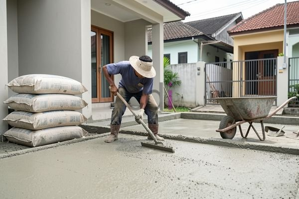

**Beton Instan K250: Panduan Lengkap Penggunaan, Keunggulan, dan Estimasi Biaya** - Hai Mitra CDI! Pernahkah Mitra CDI menghadapi tantangan dalam proyek konstruksi, seperti kualitas beton yang tidak merata atau keterlambatan karena proses pencampuran manual? Masalah-masalah ini seringkali muncul karena sulitnya menjaga konsistensi mutu beton saat dibuat secara tradisional.

Sebagai solusi, beton instan K250 semakin banyak digunakan oleh para profesional dan penggemar DIY. Tetapi, agar beton instan K250 memberikan hasil terbaik, pemahaman yang tepat tentang karakteristik dan cara penerapannya sangat penting. Artikel ini akan memandu Anda, Mitra CDI, melalui segala hal yang perlu diketahui tentang beton instan K250 – mulai dari keunggulannya, berbagai aplikasinya, langkah-langkah penggunaan yang benar, hingga perkiraan biayanya.

## Mengenal Lebih Dekat Karakteristik dan Kualitas Beton Instan K250

Beton instan K250 adalah campuran kering yang sudah dirancang siap pakai, terdiri dari semen, pasir, kerikil, serta tambahan bahan aditif khusus. Formulasi ini dirancang untuk menghasilkan kekuatan tekan khas sebesar 250 kg/cm² setelah 28 hari pengujian. Kekuatan ini sesuai dengan standar mutu K250 yang ditetapkan oleh Standar Nasional Indonesia (SNI). Perlu diperhatikan, kekuatan aktual dapat sedikit berbeda tergantung pada merk, cara pencampuran, dan bagaimana beton dirawat setelah pengecoran.

Lalu, apa yang membedakan beton instan K250 dengan beton konvensional? Keunggulan utamanya terletak pada kemudahan penggunaannya. Anda tidak perlu lagi repot menghitung dan menimbang material secara manual, serta khawatir tentang kesalahan proporsi. Cukup tambahkan air sesuai anjuran pada kemasan, aduk sampai rata, dan beton siap digunakan. Ini akan menghemat banyak waktu dan tenaga, terutama untuk proyek-proyek kecil hingga menengah.

## Di Mana Saja Beton Instan K250 Dapat Digunakan?

Fleksibilitas beton instan K250 menjadikannya pilihan tepat untuk beragam kebutuhan konstruksi. Berikut beberapa contoh yang umum:

*   **Pondasi:** Ideal untuk pondasi rumah, garasi, atau struktur sederhana.
*   **Kolom dan Balok:** Cocok untuk struktur bangunan yang tidak memerlukan daya tahan tekan ekstrem.
*   **Lantai:** Untuk membuat lantai kerja, lantai dasar, atau lantai teras.
*   **Tembok:** Bisa digunakan untuk membangun tembok dari bata ringan atau batako.
*   **Elemen Dekoratif:** Anda bisa berkreasi dengan membuat pot bunga, paving block, atau detail dekoratif lainnya.

Penting untuk diingat, K250 mungkin bukan pilihan terbaik untuk aplikasi yang membutuhkan kekuatan tekan sangat tinggi, seperti gedung bertingkat atau jembatan. Untuk struktur seperti itu, disarankan menggunakan beton dengan mutu lebih tinggi (misalnya K300 atau K350).

## Cara Menggunakan Beton Instan K250 yang Tepat

Agar mendapatkan hasil yang optimal, ikuti langkah-langkah berikut saat menggunakan beton instan K250:

1.  **Persiapan Awal:** Pastikan area kerja bersih dan bebas debu atau kotoran. Siapkan air bersih dalam jumlah yang cukup.
2.  **Proses Pencampuran:** Tuangkan beton instan ke dalam wadah yang bersih. Tambahkan air secara bertahap sambil diaduk dengan sekop atau mesin pengaduk. Selalu perhatikan rasio air dan beton yang tertera pada kemasan. Pencampuran yang terlalu banyak atau terlalu sedikit air dapat mengurangi kekuatan beton.
3.  **Tahap Pengecoran:** Tuangkan campuran beton ke dalam cetakan yang sudah disiapkan. Ratakan permukaannya dan lakukan vibrasi untuk menghilangkan gelembung udara yang terperangkap.
4.  **Perawatan yang Tepat:** Tutup permukaan beton dengan karung goni basah atau plastik minimal selama 7 hari untuk menjaga kelembapannya dan mencegah retak.

Untuk gambaran, jika 1 sak beton instan K250 (biasanya 50 kg) membutuhkan rasio air 0,45 – 0,50, maka air yang dibutuhkan berkisar antara 22,5 liter (0,45 x 50 kg) hingga 25 liter (0,50 x 50 kg).

## Perkiraan Biaya dan Perbandingan vs. Beton Konvensional

Harga beton instan K250 akan bervariasi, tergantung pada merek, lokasi, dan jumlah pembelian. Sebagai perkiraan, harga per sak (50 kg) biasanya berada di kisaran Rp 40.000 hingga Rp 60.000 — untuk informasi harga terkini dan sesuai dengan kebutuhan proyek Anda, jangan ragu untuk menghubungi Kami.

Berikut tabel yang membandingkan perkiraan biaya antara beton instan K250 dan beton konvensional (harga per m³):

<table class="table">
  <caption>Perbandingan Biaya Beton Instan K250 vs. Beton Konvensional</caption>
  <thead>
    <tr><th>Jenis Beton</th><th>Biaya per m³ (Estimasi)</th><th>Keterangan</th></tr>
  </thead>
  <tbody>
    <tr><td>Beton Instan K250</td><td>Rp 700.000 - Rp 1.200.000</td><td>Termasuk biaya material dan tenaga kerja (jika DIY). Harga bisa bervariasi tergantung volume.</td></tr>
    <tr><td>Beton Konvensional K250</td><td>Rp 650.000 - Rp 950.000</td><td>Harga hanya material. Belum termasuk biaya transportasi dan tenaga kerja.</td></tr>
  </tbody>
</table>

Walaupun harga beton instan K250 per meter kubik mungkin sedikit lebih tinggi daripada beton konvensional, Anda perlu mempertimbangkan keuntungan lain seperti kemudahan penggunaan, efisiensi waktu, dan potensi pengurangan biaya tenaga kerja. Jika Anda ingin mengetahui lebih jauh tentang [1 Sak Beton Instan Berapa M3](/blog/1-sak-beton-instan-berapa-m3/), silakan kunjungi artikel kami untuk informasi yang lebih detail.

Untuk pertanyaan atau konsultasi lebih lanjut mengenai aplikasi beton instan K250 di (not detected), jangan ragu untuk menghubungi Kami melalui tombol **Telepon** atau **WhatsApp** yang tersedia di bawah ini. Kami siap membantu setiap langkah proyek Anda! [Keunggulan Beton Instan VS Beton Konvensional](/blog/keunggulan-beton-instan-vs-beton-konvensional/) bisa jadi referensi tambahan, lho.