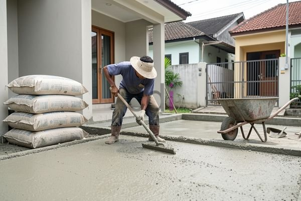

**Beton Instan K350: Panduan Lengkap Kekuatan, Aplikasi, dan Harga Terbaru** - Hai Mitra CDI! Pernahkah Anda bertanya-tanya bagaimana cara mempercepat proyek konstruksi tanpa mengorbankan kualitas? Nah, jawaban yang sering dicari sekarang ini adalah beton instan. Lebih dari 60% proyek konstruksi di Indonesia mengandalkan material ini, lho! Terutama beton instan K350, yang menawarkan solusi praktis dan andal untuk berbagai kebutuhan konstruksi. Mari kita kupas tuntas tentang beton yang satu ini.

## Apa Itu Beton Instan K350?

Beton instan K350 adalah campuran kering yang siap pakai, dirancang untuk memudahkan Anda dalam membangun. Komposisinya terdiri dari semen berkualitas, pasir halus, kerikil kasar, dan aditif khusus. Angka "K350" sendiri menunjukkan kekuatan tekan beton setelah 28 hari pengujian, yaitu mencapai 350 kPa. Ini berarti beton ini mampu menahan beban dan tekanan yang signifikan, sangat cocok untuk struktur yang membutuhkan daya tahan tinggi. 

Mengapa memilih beton instan K350? Karena kepraktisannya! Cukup tambahkan air sesuai rekomendasi, aduk hingga merata, dan beton siap digunakan. Bandingkan dengan beton konvensional yang memerlukan pencampuran manual rumit dan berpotensi menimbulkan kesalahan. Beton instan K350 diformulasikan secara presisi untuk menjamin kualitas yang konsisten dan sesuai standar.

## Dimana Saja Beton Instan K350 Bisa Digunakan?

Kekuatan dan keandalannya membuat beton instan K350 menjadi pilihan ideal untuk berbagai aplikasi. Berikut beberapa contoh pemanfaatannya:

*   **Pondasi Bangunan:** Baik pondasi batu belah, pondasi tapak, maupun pondasi menerus, K350 memastikan bangunan berdiri kokoh dan tahan lama.
*   **Kolom dan Balok:** Dalam konstruksi bertingkat, beton ini memberikan kekuatan menahan beban tekan dan lentur yang sangat dibutuhkan.
*   **Slab Beton:** Membuat slab lantai atau atap? K350 memberikan permukaan yang rata, kuat, dan berkualitas tinggi.
*   **Proyek Infrastruktur:** Jembatan, jalan layang, pelabuhan… beton instan K350 siap menghadapi beban berat dan kondisi lingkungan ekstrem.

## Membandingkan K350 dengan Kelas Kekuatan Beton Lainnya

Yuk, kita lihat bagaimana K350 bersanding dengan jenis beton instan lainnya. Dengan begitu, Anda bisa menentukan pilihan yang paling tepat untuk proyek Anda.

<table class="table">
  <caption>Perbandingan Mutu Beton Instan</caption>
  <thead>
    <tr><th>Mutu Beton</th><th>Kekuatan Tekan (kPa)</th><th>Aplikasi Umum</th></tr>
  </thead>
  <tbody>
    <tr><td>K250</td><td>250 kPa</td><td>Pekerjaan non-struktural, lantai kerja, trotoar</td></tr>
    <tr><td>K300</td><td>300 kPa</td><td>Pondasi ringan, dinding bata, lantai garasi</td></tr>
    <tr><td>K350</td><td>350 kPa</td><td>Pondasi bangunan, kolom, balok, slab beton</td></tr>
    <tr><td>K400</td><td>400 kPa</td><td>Struktur beton bertulang, jembatan, bangunan tinggi</td></tr>
  </tbody>
</table>

Penting diingat, memilih mutu beton yang tepat harus disesuaikan dengan kebutuhan proyek Anda. Jangan ragu untuk berkonsultasi dengan ahli konstruksi atau tim Kami untuk mendapatkan rekomendasi terbaik. Kami siap membantu Anda.

## Berapa Biaya Beton Instan K350? Tips Hemat Biaya Juga!

Mengenai harga, biaya beton instan K350 akan bervariasi tergantung merek, lokasi, dan jumlah yang Anda beli. Secara garis besar, harga per sak (25 kg) berada di kisaran Rp 45.000 hingga Rp 60.000. Informasi ini bersifat estimasi dan bisa berubah sewaktu-waktu. Untuk penawaran harga yang paling akurat dan sesuai dengan skala proyek Anda, hubungi Kami.

Ada beberapa cara untuk menghemat penggunaan beton instan K350:

*   **Hitung Kebutuhan dengan Cermat:** Sebelum membeli, hitung volume beton yang dibutuhkan dengan akurat. Anda bisa memanfaatkan kalkulator beton online atau meminta bantuan ahli konstruksi. Pertimbangkan juga untuk mempelajari bagaimana 1 Sak Beton Instan Berapa M3 agar tak salah perhitungan.
*   **Simpan dengan Benar:** Jaga beton instan tetap kering dan terlindung dari kelembapan. Hindari paparan sinar matahari langsung dan air hujan.
*   **Campur Sesuai Takaran:** Selalu ikuti petunjuk pencampuran yang tertera pada kemasan. Takaran air yang tepat sangat penting untuk kualitas beton yang optimal.

Butuh bantuan lebih lanjut? Jangan sungkan untuk menghubungi Kami. Klik tombol **WhatsApp** atau **Telepon** di bawah untuk berkonsultasi dan mendapatkan solusi terbaik untuk proyek Anda. Di (not detected), Kami siap membantu!