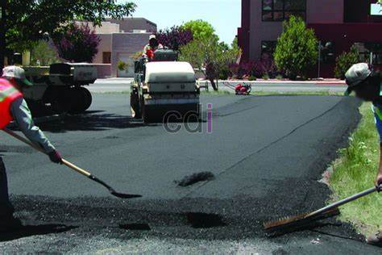

**Beton Jalan Tol: Ketahanan, Biaya, dan Spesifikasi yang Perlu Anda Ketahui** - Hai Mitra CDI! Sedang mempertimbangkan beton untuk proyek jalan tol Anda di (not detected)? Pilihan material yang tepat adalah kunci utama, lho. Keamanan, daya tahan, dan efisiensi biaya adalah pertimbangan penting. Di artikel ini, Kami akan membahas tuntas mengenai beton jalan tol – mulai dari spesifikasi detail, kelebihan yang ditawarkan, hingga perkiraan biaya yang perlu Anda perhatikan untuk proyek di (not detected).

## Mengapa Beton Unggul untuk Konstruksi Jalan Tol?

Jalan tol memerlukan material konstruksi yang mampu menahan beban berat dan lalu lintas padat. Nah, beton adalah jawabannya! Dibandingkan aspal, beton jauh lebih kuat dalam menahan deformasi permanen akibat tekanan berulang dari kendaraan. Selain itu, beton juga lebih tahan terhadap fluktuasi suhu dan serangan air. Hal ini berarti Anda akan menghemat biaya perawatan jangka panjang dan menikmati umur jalan tol yang lebih panjang. Ditambah lagi, permukaan beton memberikan cengkeraman yang lebih baik, meningkatkan keamanan berkendara, terutama saat cuaca buruk.

Beton khusus untuk jalan tol dirancang untuk mengantisipasi tekanan dan gesekan akibat lalu lintas, serta perubahan cuaca ekstrem di (not detected). Komposisi campuran yang tepat, termasuk agregat berkualitas tinggi dan proporsi semen yang sesuai, sangat menentukan kekuatan dan ketahanan jalan tol. Ingin tahu lebih lanjut tentang proses pembangunannya? Simak [5 Tahapan Kontruksi Dasar Jalan Beton](/blog/5-tahapan-kontruksi-dasar-jalan-beton/) untuk panduan lengkapnya.

## Spesifikasi Teknis Beton yang Umum Digunakan

Spesifikasi beton untuk jalan tol di Indonesia mengikuti Standar Nasional Indonesia (SNI) yang berlaku. Biasanya, mutu beton yang digunakan berkisar antara K-300 hingga K-500, disesuaikan dengan volume lalu lintas dan kondisi lingkungan di sekitar (not detected). Semakin tinggi angka ‘K’, semakin kuat beton tersebut.

Berikut rincian parameter penting dalam spesifikasi beton jalan tol:

*   **Kekuatan Tekan (f'c):** Minimal 30 MPa (K-300) hingga maksimal 50 MPa (K-500).
*   **Rasio Air-Semen (w/c):** Idealnya antara 0,4 hingga 0,45 untuk menjamin kekuatan dan durabilitas yang optimal.
*   **Agregat:** Harus memenuhi standar SNI dari segi ukuran, bentuk, dan tingkat kekerasan.
*   **Admixture:** Penggunaan *air entraining agent* dan *superplasticizer* sangat dianjurkan untuk meningkatkan ketahanan terhadap siklus beku-cair dan mempermudah proses pengerjaan beton.
*   **Ketebalan Perkerasan:** Ketebalan lapisan beton bervariasi, umumnya antara 20 cm hingga 30 cm, tergantung pada lalu lintas dan kondisi tanah dasar di (not detected).

## Perkiraan Biaya dan Faktor Penentu Harga

Biaya pembangunan jalan tol dengan beton sangat bervariasi. Beberapa faktor yang mempengaruhinya antara lain lokasi proyek di (not detected), kondisi lahan, spesifikasi beton yang dipilih, dan harga material. Sebagai gambaran, biaya per meter persegi untuk pengecoran beton jalan tol pada tahun 2026 diperkirakan berkisar antara Rp 400.000 hingga Rp 800.000. Perlu diingat, angka ini hanya estimasi dan dapat berubah sewaktu-waktu. Untuk penawaran yang lebih akurat sesuai dengan kebutuhan proyek Anda, jangan ragu untuk menghubungi Kami.

Berikut beberapa faktor yang perlu Anda perhatikan dalam menghitung biaya:

*   **Harga Material:** Harga semen, agregat, dan *admixture* bisa fluktuatif.
*   **Biaya Transportasi:** Jarak dari pabrik beton ke lokasi proyek di (not detected).
*   **Biaya Tenaga Kerja:** Upah tenaga kerja konstruksi di wilayah (not detected).
*   **Persiapan Lahan:** Biaya pembersihan lahan, perataan, dan stabilisasi tanah.
*   **Spesifikasi Beton:** Semakin tinggi mutu beton, semakin besar investasinya.

Untuk perbandingan lebih lanjut, Anda bisa membaca [Biaya Beton Jalan Per Meter: Solusi Ekonomis dan Tahan Lama untuk Infrastruktur Anda](/blog/biaya-beton-jalan-per-meter/). Artikel Harga Cor Beton Jalan Per M2: Panduan Lengkap & Estimasi Biaya 2026 juga akan memberikan informasi harga terkini yang bermanfaat.

## Perawatan dan Pemeliharaan: Kunci Umur Panjang Jalan Tol Anda

Meskipun beton dikenal dengan daya tahannya, perawatan rutin tetap penting untuk memaksimalkan umur jalan tol. Berikut beberapa langkah perawatan yang disarankan:

*   **Inspeksi Rutin:** Lakukan inspeksi visual secara berkala untuk mendeteksi kerusakan awal, seperti retak, lubang, atau kerusakan permukaan.
*   **Perbaikan Retak:** Segera perbaiki retak kecil sebelum berkembang menjadi masalah yang lebih serius.
*   **Pelapisan Ulang:** Lakukan pelapisan ulang permukaan beton secara berkala untuk melindungi dari air dan meningkatkan cengkeraman ban kendaraan.
*   **Sistem Drainase yang Efektif:** Pastikan sistem drainase berfungsi optimal untuk mencegah air meresap ke dalam struktur beton.

Dengan perawatan yang tepat, jalan tol berbahan beton dapat bertahan lebih dari 30 tahun, dengan biaya perawatan yang relatif terjangkau dibandingkan jalan aspal.

Butuh bantuan untuk mewujudkan proyek jalan tol impian Anda di (not detected)? Tim Kami siap memberikan solusi terbaik! Jangan tunda, hubungi Kami sekarang juga melalui tombol **Telepon** atau **WhatsApp** di bawah ini. Jenis Besi Beton untuk Cor Rumah dan Jalan juga bisa menjadi referensi tambahan untuk pemilihan material yang tepat.