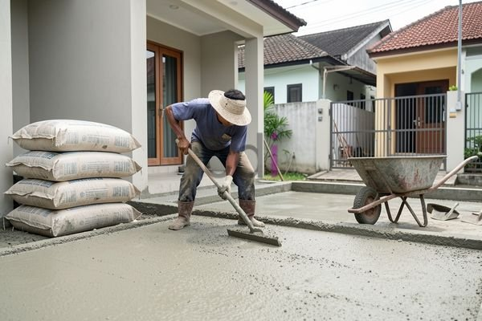

**Beton K250 Berapa MPa?** - Hai Mitra CDI! Apakah Anda sedang merencanakan pembangunan dan bertanya-tanya seberapa kuat beton yang dibutuhkan? Memilih mutu beton yang tepat adalah kunci utama keamanan dan keberlanjutan bangunan Anda. Di artikel ini, kami akan membahas tuntas mengenai beton K250, mulai dari nilai MPa-nya, aplikasi yang sesuai, hingga perkiraan biayanya di (not detected). Yuk, simak penjelasannya!

## Memahami Kekuatan Beton K250: MPa dan Konversinya

Mitra CDI, "K250" adalah penanda mutu beton yang menunjukkan kekuatan tekan karakteristiknya. Artinya, beton ini mampu menahan beban tekan sebesar 250 kilogram per sentimeter persegi (kg/cm²) pada usia 28 hari. Nah, dalam dunia teknik modern, kekuatan beton seringkali dinyatakan dalam satuan MegaPascal (MPa).

Supaya lebih jelas, ingatlah bahwa 1 kg/cm² sama dengan 9.81 MPa. Jadi, kekuatan tekan beton K250 setara dengan 250 kg/cm² x 9.81 MPa/kg/cm² = 2452.5 MPa. Penting untuk diingat, angka ini adalah kekuatan *karakteristik* – kekuatan rata-ratanya bisa sedikit lebih tinggi. Namun, untuk desain struktur yang aman, kita selalu mengacu pada kekuatan karakteristik. Standar SNI juga menetapkan toleransi variasi kekuatan beton, jadi hasil uji laboratorium di (not detected) mungkin sedikit berbeda dari nilai teoritis.

## Di Mana Saja Beton K250 Cocok Digunakan?

Beton K250 adalah pilihan yang banyak digunakan, terutama untuk konstruksi bangunan dengan tinggi rendah hingga menengah. Beberapa aplikasinya meliputi:

*   **Pondasi:** Ideal untuk pondasi batu kali, pondasi tapak, dan *sebagian* pondasi cakar ayam (tergantung beban bangunan).
*   **Kolom dan Balok:** Sangat cocok untuk kolom dan balok pada rumah tinggal, ruko, maupun bangunan komersial skala kecil.
*   **Slab Lantai:** Digunakan untuk pengecoran slab lantai pada bangunan dua hingga tiga lantai.
*   **Tembok:** Bisa digunakan untuk membuat tembok beton bertulang, namun untuk struktur yang lebih tinggi, mutu beton yang lebih tinggi mungkin lebih disarankan.

Penting, ya—pemilihan beton K250 sebaiknya didasarkan pada perhitungan struktur yang teliti oleh tenaga ahli. Mereka akan mempertimbangkan beban hidup dan beban mati bangunan, serta faktor keamanan yang berlaku.

## Estimasi Biaya Beton K250 per m³ di (not detected)

Mitra CDI, pertanyaan yang sering muncul adalah: berapa ya harga beton K250 per meter kubik (m³)? Biaya ini bisa bervariasi, tetapi secara umum, di tahun 2026, estimasinya berkisar antara Rp 800.000 hingga Rp 1.200.000 per m³.  Ingat, ini hanyalah perkiraan—harga yang sebenarnya bisa berubah sewaktu-waktu. Untuk mendapatkan informasi harga terkini dan sesuai dengan kebutuhan proyek Anda di (not detected), silakan hubungi Kami. Beberapa faktor yang memengaruhi harga meliputi:

*   **Lokasi:** Biaya beton di wilayah Jabodetabek umumnya lebih tinggi dibandingkan daerah lain, karena biaya transportasi dan operasional yang lebih besar.
*   **Jarak Pengiriman:** Semakin jauh jarak dari pabrik beton ke lokasi proyek, semakin tinggi biaya pengirimannya.
*   **Volume Pemesanan:** Biasanya, pemesanan dalam jumlah besar akan mendapatkan harga yang lebih kompetitif.
*   **Kualitas Bahan:** Penggunaan semen, pasir, split, dan bahan aditif berkualitas tinggi akan berpengaruh pada harga.
*   **Penyedia Jasa:** Setiap penyedia beton memiliki kebijakan harga yang berbeda.

Untuk mendapatkan penawaran terbaik, Kami sarankan membandingkan harga dari beberapa penyedia beton terpercaya di (not detected). Perhatikan juga reputasi mereka dalam hal kualitas beton dan ketepatan waktu pengiriman.

## K250 Dibandingkan dengan Mutu Beton Lainnya: Mana yang Tepat?

Agar Mitra CDI bisa menentukan mutu beton yang paling sesuai, berikut adalah perbandingan singkat antara beton K250 dengan mutu beton lainnya:

<table class="table">
  <caption>Perbandingan Mutu Beton</caption>
  <thead>
    <tr><th>Mutu Beton</th><th>Kekuatan Tekan (MPa)</th><th>Aplikasi Umum</th></tr>
  </thead>
  <tbody>
    <tr><td>K200</td><td>2000</td><td>Pekerjaan non-struktural, lantai kerja</td></tr>
    <tr><td>K250</td><td>2452.5</td><td>Pondasi, kolom, balok bangunan rendah</td></tr>
    <tr><td>K300</td><td>2943</td><td>Kolom, balok, slab bangunan menengah</td></tr>
    <tr><td>K350</td><td>3433.5</td><td>Struktur tinggi, jembatan, pabrik</td></tr>
  </tbody>
</table>

Ingatlah, pemilihan mutu beton *selalu* harus berdasarkan perhitungan struktur yang akurat dan rekomendasi dari ahli konstruksi. Beton yang terlalu rendah kekuatannya bisa berbahaya, sedangkan beton yang terlalu tinggi bisa menyebabkan pemborosan biaya.

Percayakan kebutuhan beton dan material konstruksi Anda kepada Kami! Tim Kami siap memberikan solusi terbaik untuk proyek Anda di (not detected)—hubungi melalui tombol **Telepon** atau **WhatsApp** yang tersedia di bawah. [Beton 20 MPa: Panduan Lengkap Kekuatan, Aplikasi, dan Estimasi Biaya](/blog/beton-20-mpa/) — untuk informasi lebih lanjut mengenai mutu beton yang lebih rendah. Jangan ragu untuk berkonsultasi dengan ahlinya!