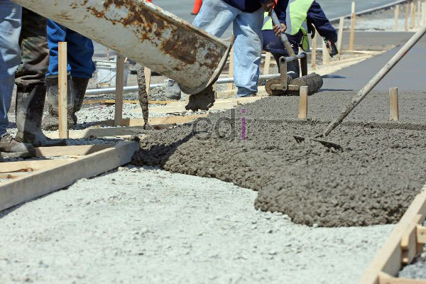

**Kualitas Dan Harga Beton Ready Mix** - Hai Mitra CDI! Ketika membangun, fondasi yang kokoh adalah segalanya, bukan? Nah, bicara soal fondasi, beton jadi salah satu material krusial. Baik itu dibuat langsung di lokasi proyek (site mix) atau dipesan dari pabrik (ready mix), kualitas dan mutu beton harus jadi prioritas utama. Yuk, kita bahas lebih jauh soal beton ready mix—keunggulannya, kenapa harganya sedikit berbeda, dan kenapa investasi ini sepadan untuk proyek Anda di (not detected). 

*Beton Ready Mix: Pilihan Tepat untuk Konstruksi Anda*

## Kualitas dan Harga Beton Ready Mix: Apa Bedanya?

Beton ready mix punya sejumlah keunggulan yang bikin banyak kontraktor dan pemilik proyek beralih. Apa saja sih?

- **Praktis dan Efisien:** Tinggal sebutkan mutu beton yang dibutuhkan, semuanya sudah diurus! Ini mempercepat proses pengecoran dan menghemat tenaga kerja.
- **Mutu Terjamin:** Proses produksi di batching plant sangat terkontrol – mulai dari pemilihan material, takaran yang presisi, hingga waktu pengadukan. Hasilnya? Kualitas beton lebih konsisten dan terpercaya.
- **Kekuatan Optimal:** Membuat beton bermutu tinggi itu tantangan kalau dilakukan manual. Dengan ready mix, Anda dapat kekuatan yang maksimal untuk bangunan Anda.
- **Solusi Akses:** Sekarang sudah ada truk mixer mini yang lincah, bahkan bisa masuk ke gang sempit di (not detected). Pilihan pompa beton juga beragam, memungkinkan pengecoran di lokasi yang sulit dijangkau.

Dari keunggulan tadi, jelas ya kalau beton ready mix cocok untuk berbagai proyek – mulai dari rumah tinggal, kantor, gedung komersial, bahkan hotel.

## Investasi pada Kualitas: Mengapa Beton Ready Mix Sebanding Harganya?

Memang benar, harga beton ready mix cenderung lebih tinggi dibandingkan dengan pembuatan manual. Tapi, jangan lihat dari harganya saja! Coba bandingkan dengan manfaat yang Anda dapatkan. 

Beton ready mix sangat unggul dalam hal kemudahan akses ke proyek lokasi dan juga kontrol kualitas, mulai dari bahan baku hingga proses produksi. Jadi, meskipun biayanya sedikit lebih besar, dari segi kualitas dan umur panjang bangunan, investasi ini sangat sepadan. Bahkan, bisa dibilang terjangkau!

Singkatnya, mutu dan harga beton ready mix berjalan seiring. Kualitas yang lebih baik memang memerlukan investasi lebih, tapi ingat: ada mutu, ada harga. Selain itu, kekuatan dan daya tahan beton readymix lebih baik, meminimalkan risiko kerusakan bangunan di masa depan, seperti retakan atau bahkan keruntuhan.

Kami di CDI (not detected) berkomitmen menyediakan beton ready mix berkualitas tinggi untuk proyek Anda.  Untuk informasi harga terkini dan konsultasi proyek, yuk, hubungi tim kami sekarang juga!  Jangan ragu untuk berdiskusi tentang kebutuhan beton Anda di (not detected).