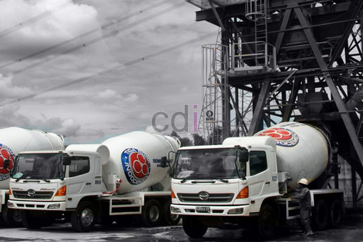

**Beton Readymix Bogor: Solusi Konstruksi Praktis dan Efisien di Jabodetabek** - Hai Mitra CDI! Pernahkah Anda membayangkan bagaimana proses pembangunan bisa lebih cepat, lebih hemat, dan tetap berkualitas tinggi? Di tengah gairah pembangunan yang terus meningkat di Jabodetabek, khususnya Bogor, mencari solusi konstruksi yang efisien menjadi kunci. Data menunjukkan lonjakan proyek konstruksi sebesar 18% di tahun 2024, dan beton *readymix* hadir sebagai jawaban atas tantangan tersebut. Yuk, kita ulas lebih jauh bagaimana beton *readymix* bisa mengoptimalkan proyek Anda!

## Mengapa Beton Readymix Pilihan Tepat untuk Proyek Anda?

Mitra, beton *readymix* adalah beton yang diproduksi secara sentral di *batching plant* dan langsung dikirim ke lokasi proyek dalam kondisi siap cor. Apa yang membuatnya begitu unggul? Pertama, kualitas yang terjamin! Karena diproduksi dalam lingkungan terkontrol dengan pengawasan mutu ketat, konsistensi beton terjaga. Kedua, efisiensi yang signifikan — Anda menghemat waktu dan tenaga karena tidak perlu lagi repot mencampur material di lokasi. Ketiga, fleksibilitas! Beton *readymix* tersedia dalam beragam mutu dan spesifikasi, menyesuaikan persis dengan kebutuhan proyek Anda. Kami di Creative Design Interior menyediakan pilihan mutu beton *readymix* dari K100 hingga K300, disesuaikan dengan kebutuhan struktur bangunan Anda.  

Sebagai ilustrasi, untuk pembangunan fondasi rumah tipe 45, kebutuhan beton *readymix* biasanya berada di kisaran 8-10 meter kubik dengan mutu K225.  Pemanfaatan beton *readymix* berpotensi mempersingkat waktu pengerjaan fondasi hingga 30% dibandingkan cara konvensional. Ditambah lagi, penggunaannya menjamin kekuatan dan ketahanan fondasi bangunan Anda.

## Memilih Pemasok Beton Readymix di Bogor: Apa yang Perlu Diperhatikan?

Memilih pemasok beton *readymix* yang dapat diandalkan adalah langkah krusial bagi kesuksesan proyek Anda. Pertimbangkan beberapa hal penting: reputasi perusahaan, kualitas produk, cakupan layanan, dan tentu saja, harga. Pastikan pemasok memiliki sertifikasi mutu yang valid, seperti SNI, dan mampu menyediakan beton sesuai standar yang berlaku.  Creative Design Interior sudah lama menjadi mitra terpercaya dalam menyediakan beton *readymix* berkualitas tinggi di wilayah Bogor, Depok, Tangerang, dan Bekasi. Kami berkomitmen pada konsistensi mutu dan pengiriman yang tepat waktu.

Berikut tabel perbandingan mutu beton *readymix* dan aplikasinya untuk membantu Anda menentukan pilihan yang tepat:

<table class="table">
  <caption>Perbandingan Mutu Beton Readymix dan Aplikasinya</caption>
  <thead>
    <tr><th>Mutu Beton</th><th>Kekuatan Tekan (MPa)</th><th>Aplikasi Umum</th></tr>
  </thead>
  <tbody>
    <tr><td>K100</td><td>10</td><td>Lantai Kerja, Pondasi Kolom Praktis</td></tr>
    <tr><td>K225</td><td>22.5</td><td>Fondasi Rumah, Kolom, Balok</td></tr>
    <tr><td>K250</td><td>25</td><td>Struktur Beton Bertulang, Lantai, Tangga</td></tr>
    <tr><td>K300</td><td>30</td><td>Pondasi Gedung Tinggi, Jembatan, Jalan</td></tr>
  </tbody>
</table>

Mengenai harga beton *readymix* di Bogor, perlu diingat bahwa harga bisa bervariasi tergantung mutu, volume pesanan, dan jarak pengiriman. Sebagai gambaran, harga beton *readymix* K225 dimulai dari Rp 850.000 per meter kubik. Untuk informasi harga terkini dan penawaran yang sesuai dengan kebutuhan proyek Anda, silakan hubungi Kami.

## Apa Saja yang Mempengaruhi Biaya Pengadaan Beton Readymix?

Biaya pengadaan beton *readymix* tidak hanya ditentukan oleh harga per meter kubik, lho Mitra. Beberapa faktor lain turut berperan, seperti biaya transportasi, biaya penggunaan *concrete pump* (jika diperlukan), dan potensi kehilangan material. Jangan lupa juga memperhitungkan biaya pengecoran dan perataan.  Kami di Creative Design Interior menawarkan layanan pengecoran beton profesional yang akan membantu Anda menghemat waktu dan biaya.

Jarak pengiriman memegang peranan penting dalam menentukan biaya. Semakin jauh jaraknya, semakin tinggi biaya transportasinya. Maka dari itu, memilih pemasok dengan jangkauan layanan yang luas dan efisien sangatlah penting. Kami memiliki armada truk molen yang siap melayani pengiriman beton *readymix* ke seluruh wilayah Jabodetabek.

## Creative Design Interior: Solusi Konstruksi Lengkap untuk Anda

Kami di Creative Design Interior hadir bukan hanya sebagai penyedia beton *readymix* berkualitas, tetapi juga sebagai mitra solusi konstruksi terpadu. Kami melayani desain interior, fabrikasi *furniture custom*, penyediaan material bangunan, dan jasa pengecoran. Dengan memilih layanan terpadu Kami, Anda akan menghemat waktu, biaya, dan tenaga.  Kami juga menyediakan konsultasi gratis untuk membantu Anda merencanakan dan melaksanakan proyek konstruksi secara optimal. Jual Beton Cor Readymix Screening adalah salah satu layanan unggulan yang banyak diminati klien Kami di Jabodetabek.

Apabila Anda memiliki pertanyaan lebih lanjut mengenai beton *readymix* atau layanan Kami, jangan ragu untuk menghubungi Kami melalui tombol **Telepon** atau **WhatsApp** di bawah halaman ini. Kami siap membantu! [Adhimix Beton: Solusi Praktis untuk Konstruksi Berkualitas di Jabodetabek](/blog/adhimix-beton/) — temukan bagaimana beton *adhimix* dapat meningkatkan efisiensi proyek Anda.