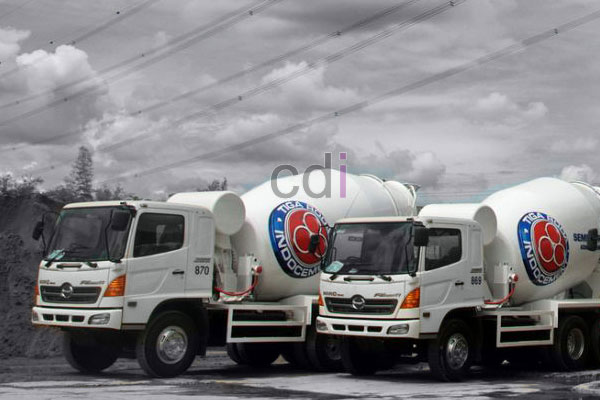

**Beton Readymix Surabaya: Fondasi Kuat untuk Kesuksesan Proyek Anda** - Halo Mitra CDI! Punya proyek konstruksi di Surabaya dan mencari solusi beton yang praktis, berkualitas, dan terpercaya? Nah, beton *readymix* adalah jawabannya! Di tengah dinamika pembangunan kota ini, kebutuhan akan material konstruksi yang efisien semakin meningkat. Kami dari Creative Design Interior (CDI) hadir sebagai mitra terpercaya untuk menyediakan beton *readymix* berkualitas tinggi yang disesuaikan dengan spesifikasi proyek Anda.

Mengapa beton *readymix* menjadi pilihan utama di industri konstruksi modern? Simpelnya, karena beton ini menawarkan kombinasi ideal antara kualitas terjamin, efisiensi waktu, dan fleksibilitas penggunaan. Terutama di (not detected) yang berkembang pesat, beton *readymix* memungkinkan proyek berjalan lebih lancar dan terkontrol. Simak ulasan lengkapnya di artikel ini!

## Mengapa Beton Readymix Surabaya dari CDI Adalah Pilihan Terbaik

Apa yang membedakan beton *readymix* Surabaya dari CDI dibandingkan dengan metode konvensional? Pertama dan terpenting, kami menjamin kualitas yang konsisten. Proses pencampuran di pabrik kami diawasi ketat oleh tim ahli, memastikan proporsi material sesuai standar dan menghasilkan beton dengan kekuatan optimal. Ini krusial untuk memastikan bangunan Anda kokoh dan tahan lama. Kedua, efisiensi waktu dan biaya. Dengan beton *readymix*, Anda hemat waktu dan tenaga karena tidak perlu lagi menyiapkan peralatan dan tenaga kerja untuk mencampur di lokasi.

Ketiga, kami menawarkan fleksibilitas tinggi. Kami menyediakan berbagai pilihan mutu beton, mulai dari K-100 hingga K-600, sesuai kebutuhan spesifik proyek Anda. Pemesanan pun bisa disesuaikan dengan volume yang dibutuhkan, sehingga tidak ada pemborosan material. Keempat, minimnya risiko kesalahan. Ketidakakuratan dalam pencampuran manual dapat berakibat fatal pada kekuatan beton. Dengan beton *readymix*, risiko ini hampir tidak ada.

## Panduan Memilih Mutu dan Jenis Beton Readymix yang Tepat

Memilih mutu beton yang sesuai sangat penting agar bangunan Anda kuat dan aman. Mutu beton dinyatakan dalam satuan K (Kilogram per centimeter persegi) – semakin tinggi angkanya, semakin kuat betonnya. Beton K-225 cocok untuk pondasi rumah tinggal, sedangkan K-300 atau K-350 ideal untuk bangunan bertingkat atau infrastruktur yang membutuhkan kekuatan lebih besar.

Selain mutu, ada berbagai jenis beton *readymix* yang bisa Anda pilih. Kami menyediakan beton normal, beton mutu tinggi, beton ringan, dan beton *self-compacting*. Jenis beton yang dipilih harus sesuai dengan desain struktural dan kebutuhan proyek. Misalnya, beton ringan bisa mengurangi beban pada struktur bangunan karena beratnya yang lebih rendah. [Adhimix Lenteng Agung: Solusi Praktis untuk Fondasi Kuat dan Proyek Konstruksi Anda](/blog/adhimix-lenteng-agung/) bisa menjadi referensi tambahan.

## Perkiraan Biaya dan Faktor yang Mempengaruhi Harga Beton Readymix Surabaya

Harga beton *readymix* Surabaya dipengaruhi oleh beberapa faktor. Mutu beton adalah penentu utama – semakin tinggi mutu, semakin tinggi pula biayanya. Volume pemesanan juga berpengaruh; pesanan dalam jumlah besar biasanya mendapatkan harga yang lebih kompetitif. Jarak dari pabrik ke lokasi proyek juga perlu diperhitungkan karena akan ada biaya transportasi.

Untuk gambaran, harga beton K-225 standar di (not detected) saat ini kisaran Rp 700.000 hingga Rp 850.000 per meter kubik. Harga ini bersifat estimasi dan dapat berubah seiring waktu.  Untuk mendapatkan penawaran harga terbaru dan paling akurat yang sesuai dengan kebutuhan proyek Anda, silakan hubungi Kami melalui tombol **Telepon** atau **WhatsApp** di bawah ini. Kondisi pasar material dan fluktuasi harga semen juga dapat mempengaruhi harga akhir.

## Beragam Aplikasi Beton Readymix Surabaya untuk Proyek Anda

Beton *readymix* Surabaya sangat serbaguna dan dapat digunakan dalam berbagai jenis proyek konstruksi. Kami telah berpengalaman menyediakan beton *readymix* untuk proyek perumahan, gedung komersial, infrastruktur jalan, jembatan, hingga proyek industri di (not detected) dan sekitarnya. Untuk pondasi, K-225 atau K-250 umumnya menjadi pilihan yang tepat. Sedangkan untuk kolom dan balok, K-300 atau K-350 lebih disarankan.

Proyek infrastruktur seperti jalan dan jembatan seringkali membutuhkan beton dengan mutu lebih tinggi, misalnya K-350 hingga K-600, agar mampu menahan beban berat dan lalu lintas padat. Kami juga menyediakan beton *readymix* minimix untuk proyek-proyek kecil atau area yang sulit dijangkau oleh truk molen besar.  Jangan ragu untuk mengkonsultasikan kebutuhan proyek Anda dengan tim ahli kami. Untuk pemahaman lebih mendalam mengenai komposisi material, Anda bisa membaca artikel Kompsisi Jenis Material Pada Beton Readymix.

Apabila Anda masih memiliki pertanyaan, tim kami siap membantu. Silakan hubungi Kami melalui tombol **Telepon** dan **WhatsApp** di bawah ini untuk konsultasi gratis dan penawaran terbaik!