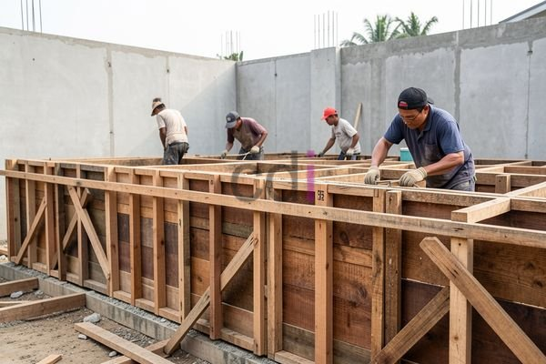

**Biaya Bekisting Per M2: Panduan Lengkap & Estimasi 2026** - Hai Mitra CDI! Bingung gimana menghitung biaya bekisting yang tepat untuk proyek Anda di (not detected)? Jangan khawatir, kami siap membantu! Bekisting adalah komponen penting dalam konstruksi beton, dan memahami biayanya krusial untuk perencanaan anggaran yang akurat. Yuk, simak panduan lengkap ini!

## Faktor-Faktor yang Mempengaruhi Biaya Bekisting Per M2

Biaya bekisting per m2 itu dinamis, lho. Ada beberapa hal yang mempengaruhinya: jenis material yang dipilih, rumitnya desain struktur, lokasi proyek Anda di (not detected), dan tingkat kesulitan pemasangannya. Secara garis besar, ada beberapa opsi bekisting yang populer. Bekisting kayu sering menjadi pilihan hemat, terutama untuk proyek kecil atau desain sederhana. Sayangnya, daya tahannya terbatas dan bisa mengembang jika terkena lembab. 

Sebagai alternatif, ada bekisting baja yang lebih kuat dan bisa dipakai berulang kali. Walaupun investasi awalnya lebih besar, ini seringkali lebih ekonomis untuk proyek besar yang butuh banyak coran. Lalu, ada juga bekisting plastik (polypropylene) yang ringan, mudah dipasang, dan tahan karat. Tapi, kekuatannya mungkin kurang jika dibandingkan baja, jadi lebih cocok untuk aplikasi tertentu. Nah, kalau Anda butuh kecepatan dan efisiensi, bekisting sistem (prefabricated) bisa jadi pilihan utama, meski biayanya paling tinggi.

## Perkiraan Biaya Bekisting Per M2 Berdasarkan Material

Berikut ini perkiraan biaya bekisting per m2 berdasarkan material yang banyak digunakan di wilayah (not detected) dan sekitarnya pada tahun 2026. Perlu diingat, angka ini hanya estimasi dan bisa berubah tergantung kondisi pasar serta detail proyek Anda. Untuk informasi harga yang lebih akurat dan sesuai dengan kebutuhan spesifik proyek Anda, hubungi kami! Kami akan dengan senang hati membantu.

<table class="table">
  <caption>Estimasi Biaya Bekisting Per M2 (2026)</caption>
  <thead>
    <tr><th>Jenis Bekisting</th><th>Rentang Harga (Rp/m2)</th><th>Keterangan</th></tr>
  </thead>
  <tbody>
    <tr><td>Kayu</td><td>50.000 – 120.000</td><td>Pilihan ekonomis untuk proyek kecil</td></tr>
    <tr><td>Baja</td><td>150.000 – 300.000</td><td>Kuat, tahan lama, dan bisa digunakan berulang kali</td></tr>
    <tr><td>Plastik (Polypropylene)</td><td>80.000 – 200.000</td><td>Ringan, mudah dipasang, dan tahan korosi</td></tr>
    <tr><td>Sistem (Prefabrikasi)</td><td>350.000 – 600.000</td><td>Cepat, efisien, tapi investasi awal tinggi</td></tr>
  </tbody>
</table>

Selain harga material, jangan lupa pertimbangkan biaya tenaga kerja untuk pemasangan dan pembongkaran, biaya transportasi, dan mungkin biaya sewa jika Anda memilih bekisting sistem. 1 m3 beton berapa m2 bekisting: Panduan Praktis Menghitung dan Mengoptimalkan bisa membantu Anda memahami hubungan antara volume beton dan luas area bekisting yang dibutuhkan.

## Hal-Hal Penting Lain yang Perlu Dipertimbangkan

Saat menghitung biaya bekisting per m2, ada beberapa hal tambahan yang perlu diperhatikan. Kompleksitas desain struktur bisa menambah biaya pemasangan. Semakin rumit bentuknya, semakin banyak potongan bekisting yang diperlukan, yang artinya lebih banyak waktu kerja dan material. 

Lokasi proyek di (not detected) juga berpengaruh. Proyek di daerah terpencil atau sulit dijangkau bisa memakan biaya transportasi lebih mahal. Kondisi tanah juga penting; tanah yang kurang stabil mungkin memerlukan bekisting yang lebih kuat, sehingga menambah biaya material. Pastikan Anda melakukan survei lokasi yang teliti sebelum memulai proyek untuk mengidentifikasi potensi masalah yang bisa memengaruhi biaya bekisting. Apa Itu Bekisting Beton? Panduan Lengkap untuk Fondasi Kokoh akan memberikan pemahaman mendalam tentang peran penting bekisting dalam membangun fondasi yang kuat.

## Percayakan Jasa Bekisting Profesional kepada Creative Design Interior

Di Creative Design Interior, kami paham betapa pentingnya perencanaan anggaran yang tepat untuk setiap proyek konstruksi. Dengan pengalaman bertahun-tahun dalam menyediakan jasa bekisting di wilayah (not detected), kami dapat membantu Anda menghitung biaya bekisting per m2 secara akurat dan efisien. Kami menawarkan berbagai solusi bekisting yang disesuaikan dengan kebutuhan dan anggaran proyek Anda. Mulai dari bekisting kayu sederhana hingga sistem prefabrikasi modern, kami punya solusi yang tepat. Anda juga bisa mempelajari lebih lanjut tentang bekisting balok dan plat melalui [Bekisting Balok dan Plat: Panduan Lengkap Material, Perhitungan, dan Biaya 2026](/blog/bekisting-balok-dan-plat/).

Jangan ragu untuk berkonsultasi dengan tim ahli kami! Silakan gunakan tombol **Telepon** atau **WhatsApp** di bawah ini untuk menghubungi Kami dan mendapatkan penawaran terbaik.