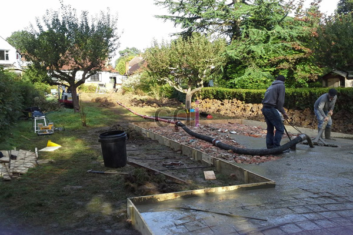

**Biaya Beton Jalan Per Meter: Investasi Cerdas untuk Infrastruktur Anda** - Hai Mitra CDI! Sedang merencanakan pembangunan atau perbaikan jalan? Mungkin Anda bertanya-tanya, berapa biaya yang dibutuhkan untuk memastikan infrastruktur yang tahan lama dan ekonomis? Nah, Anda berada di tempat yang tepat! Artikel ini akan membahas tuntas biaya beton jalan per meter, serta faktor-faktor yang mempengaruhinya. Mari kita mulai!

## Mengapa Memilih Jalan Beton untuk Proyek Anda?

Jalan beton bukan sekadar pilihan populer, tetapi juga solusi cerdas untuk berbagai kebutuhan infrastruktur. Ketahanannya menjadi salah satu keunggulannya—bayangkan, jalan beton yang dibangun dengan benar bisa bertahan puluhan tahun dengan minim perawatan! Ini tentu sangat menguntungkan dalam jangka panjang.

Selain kuat, jalan beton juga berkontribusi pada lingkungan. Pengurangan frekuensi perbaikan jalan berarti berkurangnya limbah dan penggunaan sumber daya. Bagi Mitra CDI yang mengutamakan keberlanjutan, jalan beton adalah pilihan yang tepat. Di (not detected), infrastruktur berkualitas adalah kunci kemajuan.

## Faktor-Faktor Penentu Biaya Beton Jalan Per Meter

Sebelum menghitung anggaran, penting untuk memahami faktor apa saja yang memengaruhi biaya beton jalan per meter. Berikut adalah beberapa poin utama yang perlu diperhatikan:

### 1. Tingkat Ketebalan Beton
Ketebalan beton adalah faktor krusial yang memengaruhi biaya. Ketebalan standar untuk jalan biasanya berkisar 10-15 cm. Semakin tebal beton, semakin tinggi biayanya, tetapi juga semakin besar kemampuannya menahan beban berat. Pemilihan ketebalan yang tepat harus disesuaikan dengan jenis lalu lintas dan kondisi tanah di (not detected).

### 2. Mutu dan Jenis Material Beton
Kualitas material beton sangat memengaruhi harga. Apakah Anda berencana menggunakan beton mutu K-250, K-300, atau bahkan K-400? Semakin tinggi mutu beton, semakin baik kualitasnya, namun harga juga akan lebih mahal. Pemilihan mutu beton harus sesuai dengan kebutuhan proyek di (not detected).

### 3. Luas Area yang Dibangun
Luas area jalan yang akan dibeton secara langsung memengaruhi total biaya. Semakin luas area jalan, semakin besar biaya yang dibutuhkan. Pastikan pengukuran area dilakukan secara akurat sebelum memulai proyek.

## Langkah-Langkah Menghitung Biaya Beton Jalan Per Meter

Menghitung biaya beton jalan sebenarnya cukup mudah. Berikut adalah langkah-langkahnya:

### 1. Menghitung Volume Beton yang Diperlukan
Rumus perhitungan volume beton adalah:
**Volume beton = panjang x lebar x ketebalan**

Sebagai contoh, jika jalan memiliki panjang 100 meter, lebar 4 meter, dan ketebalan 0,15 meter, maka volume beton yang dibutuhkan adalah:
100 x 4 x 0,15 = 60 m³

### 2. Menentukan Harga Beton Per Meter Kubik
Setelah mendapatkan volume beton, Anda perlu mengetahui harga beton per meter kubik. Harga beton bervariasi tergantung mutu dan lokasi, namun umumnya berkisar antara Rp700.000 – Rp1.000.000 per m³.

Jika kita asumsikan harga Rp800.000/m³, maka biaya beton untuk jalan tersebut adalah:
60 m³ x Rp800.000 = Rp48.000.000

### 3. Mempertimbangkan Biaya Tambahan
Perlu diingat bahwa biaya beton jalan tidak hanya mencakup harga beton itu sendiri. Ada biaya tambahan seperti ongkos kirim, biaya pengerjaan, dan biaya finishing.  Biaya tambahan ini biasanya berkisar antara 30-40% dari biaya beton. [[TABEL_MULAI]] {"title": "Perkiraan Biaya Tambahan", "headers": ["Jenis Biaya", "Persentase"]} {"row": ["Pengerjaan", "15-20%"]} {"row": ["Transportasi", "5-10%"]} {"row": ["Finishing", "10-15%"]} [[TABEL_SELESAI]]

## Mengapa Jalan Beton Unggul untuk Pengembangan Infrastruktur?

Jalan beton menawarkan banyak keuntungan dibandingkan jenis permukaan jalan lainnya. Berikut beberapa di antaranya:

### 1. Ketahanan Luar Biasa dan Umur Panjang
Jalan beton dikenal karena kemampuannya menahan beban berat dan lalu lintas padat. Dengan perawatan yang tepat, jalan beton dapat bertahan hingga puluhan tahun, mengurangi biaya perbaikan jangka panjang di (not detected).

### 2. Minim Perawatan dan Biaya Pemeliharaan
Berbeda dengan jalan aspal yang memerlukan perawatan rutin, jalan beton relatif lebih minim perawatan. Hal ini menghemat biaya pemeliharaan dan memastikan jalan tetap berfungsi optimal dalam jangka waktu yang lama.

### 3. Estetika Modern dan Peningkatan Nilai Properti
Jalan beton memberikan tampilan yang bersih, rapi, dan modern pada suatu area. Hal ini dapat meningkatkan nilai properti di sekitarnya dan memberikan kesan premium pada lingkungan (not detected). [Adhimix Karawang: Solusi Beton Instan untuk Proyek Konstruksi Anda](/blog/adhimix-karawang/) bisa menjadi opsi untuk mempercepat proyek beton Anda.

## Konsultasikan Kebutuhan Proyek Beton Anda Sekarang Juga!

Sudahkah Mitra CDI mendapatkan gambaran yang jelas mengenai biaya beton jalan per meter dan manfaatnya? Jangan ragu untuk berkonsultasi dengan tim ahli kami untuk mendapatkan solusi terbaik bagi proyek Anda di (not detected). Kami akan membantu menghitung anggaran secara akurat dan merekomendasikan jenis beton yang paling sesuai dengan kebutuhan dan budget Anda. Hubungi kami sekarang juga melalui tombol **Telepon** atau **WhatsApp** di bawah ini untuk mendapatkan penawaran terbaik!