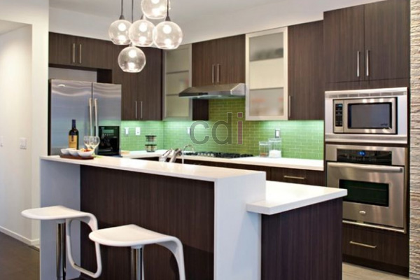

**Biaya Bikin Kitchen Set: Estimasi, Material, dan Tips Hemat di Jabodetabek** - Hai Mitra CDI! Merencanakan renovasi dapur di Jabodetabek? Bagus sekali! Data terbaru menunjukkan sekitar 25% anggaran renovasi rumah dialokasikan untuk dapur, khususnya penggantian *kitchen set*. Ini berarti perencanaan yang cermat sangat krusial untuk mewujudkan dapur idaman tanpa membebani kantong.

### Faktor-Faktor Penentu Biaya Kitchen Set
Sebelum melangkah lebih jauh, yuk pahami dulu apa saja yang memengaruhi biaya pembuatan *kitchen set*. Ukuran dapur jelas menjadi pertimbangan utama. Dapur luas membutuhkan lebih banyak material dan waktu pengerjaan, otomatis biaya membengkak. Pemilihan material juga sangat berpengaruh. Kayu solid, HPL, *multipleks melamine*, dan *stainless steel* masing-masing punya harga yang berbeda.

Nah, kompleksitas desain juga berpengaruh lho! Semakin rumit desainnya – misalnya banyak laci, sudut khusus, atau fitur tambahan – semakin tinggi biaya yang dibutuhkan. Terakhir, lokasi proyek di area Jabodetabek turut memengaruhi, karena biaya transportasi material dan tenaga kerja bisa bervariasi.

### Rincian Biaya Kitchen Set Berdasarkan Pilihan Material
Setelah kita memahami faktor-faktor penentu biaya, mari kita bahas estimasi biaya berdasarkan material yang umumnya digunakan. Ingat ya, harga ini sewaktu-waktu bisa berubah — untuk penawaran akurat sesuai kebutuhan proyek Anda, silakan hubungi Kami.

Berikut ini perkiraan biaya per meter persegi untuk beberapa material *kitchen set*:

*   **HPL (High-Pressure Laminate):** Rp 800.000 – Rp 1.500.000 per meter persegi. HPL menawarkan harga yang ramah di kantong dengan pilihan warna dan motif yang variatif. Cocok untuk Anda yang cari solusi ekonomis.
*   **Multipleks Melamine:** Rp 1.000.000 – Rp 1.800.000 per meter persegi. *Multipleks* dengan lapisan *melamine* adalah pilihan seimbang antara harga dan kualitas.
*   **Kayu Solid (Meranti, Jati Belanda):** Rp 2.000.000 – Rp 4.000.000 per meter persegi.  Untuk kesan mewah dan tahan lama, kayu solid adalah jawabannya. Hanya saja, perlu diingat harganya relatif lebih mahal.
*   **Stainless Steel:** Rp 2.500.000 – Rp 5.000.000 per meter persegi. Jika Anda menginginkan dapur modern dan higienis, *stainless steel* adalah pilihan tepat. Tapi siapkan budget lebih ya!

Misalnya, dapur Anda seluas 3 meter persegi dan Anda memilih HPL seharga Rp 1.000.000 per meter persegi. Maka, estimasi biaya *kitchen set* Anda adalah Rp 3.000.000. Perlu diingat, angka ini belum termasuk biaya pemasangan, aksesoris (engsel, rel laci), dan biaya tambahan lainnya.

### Tips Jitu Menghemat Biaya Pembuatan Kitchen Set
Ingin mewujudkan dapur impian dengan budget terbatas? Tenang saja, ada beberapa trik yang bisa Anda terapkan. Pertama, pilih material yang lebih ekonomis seperti HPL atau *multipleks melamine*. Kedua, sederhanakan desain *kitchen set*. Desain yang ringkas akan menghemat biaya material dan tenaga kerja. Ketiga, maksimalkan ruang vertikal dengan rak gantung untuk menambah ruang penyimpanan tanpa menambah biaya besar.

Keempat, pertimbangkan untuk menggunakan kembali peralatan dapur yang masih layak pakai. Kelima, selalu bandingkan penawaran dari beberapa vendor sebelum memutuskan. Jangan ragu meminta penawaran dari beberapa perusahaan desain interior atau tukang *kitchen set* untuk mendapatkan harga terbaik. Buat Anda yang berlokasi di [Harga Custom Kitchen Set Di Babelan Bekasi](https://creativedesigninterior.co.id/kitchen/harga-custom-kitchen-set-di-babelan-bekasi/), Kami punya penawaran khusus!

### Material Alternatif dan Hal Penting Lainnya
Selain pilihan material di atas, ada beberapa alternatif lain yang bisa Anda pertimbangkan. *MDF* (Medium-Density Fiberboard) menawarkan harga terjangkau dan mudah diproses, namun kurang tahan terhadap kelembaban. *Blockboard* merupakan alternatif yang lebih tahan lama daripada *MDF*, tetapi dengan harga sedikit lebih tinggi.

Kualitas aksesoris seperti engsel dan rel laci juga krusial. Aksesoris berkualitas tinggi menjamin *kitchen set* Anda awet dan nyaman digunakan. Jangan pelit investasi pada aksesoris, meskipun harganya sedikit lebih mahal. Selain itu, pastikan Anda memilih vendor yang berpengalaman dan terpercaya untuk hasil yang rapi dan berkualitas. Bagi Anda yang berada di area [Harga Custom Kitchen Set Di Baktijaya Depok](https://creativedesigninterior.co.id/kitchen/harga-custom-kitchen-set-di-baktijaya-depok/), Kami siap memberikan solusi terbaik!

Tim Kami siap membantu mewujudkan dapur impian Anda di Jabodetabek — silakan hubungi melalui tombol **Telepon** atau **WhatsApp** yang tersedia di bawah.