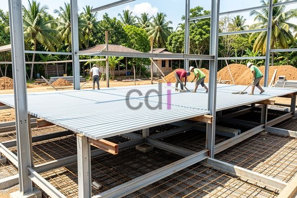

**Biaya Cor Dak Bondek Per M2: Estimasi 2026 & Faktor Penentu Harga** - Hai Mitra CDI! Punya rencana membangun atau merenovasi di (not detected)? Salah satu hal yang sering bikin pusing adalah memperkirakan biaya, terutama untuk bagian atap. Nah, artikel ini hadir untuk membantu! Kami akan membahas tuntas estimasi biaya cor dak bondek per m2 di tahun 2026, lengkap dengan faktor-faktor yang mempengaruhinya. Dengan informasi ini, Mitra bisa merencanakan anggaran proyek dengan lebih akurat dan menghindari jebakan biaya tak terduga.

## Estimasi Biaya Cor Dak Bondek Per M2 di Tahun 2026

Jadi, kira-kira berapa biaya yang dibutuhkan untuk cor dak bondek? Perlu diingat, angka ini adalah estimasi dan bisa saja berubah tergantung kondisi pasar — untuk penawaran paling akurat sesuai proyek Mitra di (not detected), jangan ragu menghubungi Kami ya! Secara umum, biaya cor dak bondek per m2 di tahun 2026 berkisar antara Rp 350.000 hingga Rp 650.000. 

Rentang harga ini dipengaruhi oleh beberapa elemen penting:

*   **Material Bondek:** Harga bondek berfluktuasi berdasarkan ketebalan dan jenisnya (galvanis atau galvalum).
*   **Material Beton:** Kualitas beton yang digunakan (K-250, K-300, dan seterusnya) berpengaruh pada harga akhir.
*   **Besi Tulangan:** Jumlah dan ukuran diameter besi yang dipakai juga menjadi faktor biaya.
*   **Upah Pekerja:** Biaya tenaga kerja pemasangan dan pengecoran bervariasi tergantung lokasi.
*   **Biaya Transportasi:** Ongkos pengiriman material ke lokasi proyek Mitra CDI di (not detected).

## Faktor-Faktor yang Mempengaruhi Biaya Cor Dak Bondek

Oke, sudah dapat gambaran estimasi biayanya. Tapi, apa saja sih yang sebenarnya bikin harga bisa naik atau turun? Pemahaman ini akan membantu Mitra membuat perencanaan anggaran yang lebih realistis untuk proyek di (not detected).

Pertama, **jenis dan ketebalan bondek** yang dipilih jadi penentu utama. Semakin tebal bondek dan semakin baik lapisan pelindungnya, harganya tentu saja akan meningkat. Kedua, **mutu beton** juga sangat penting. Semakin tinggi mutu beton, semakin kuat daknya, tapi harganya juga ikut naik. Pilih mutu beton yang sesuai dengan kebutuhan dan beban yang akan ditanggung dak tersebut.

Kemudian, **desain dan bentang dak** juga berpengaruh. Desain yang rumit dengan banyak lekukan, atau dak dengan bentang lebar, membutuhkan lebih banyak material dan tenaga kerja. Terakhir, **lokasi proyek** juga memengaruhi biaya. Perbedaan biaya transportasi dan upah pekerja antar wilayah bisa cukup signifikan.

## Cor Dak Bondek vs. Metode Konvensional: Mana Lebih Hemat?

Supaya Mitra CDI makin yakin, yuk kita bandingkan biaya cor dak bondek dengan metode konvensional. Kalau dibandingkan, cor dak bondek seringkali lebih ekonomis dalam jangka panjang, lho! Meskipun biaya awal pemasangannya mungkin sedikit lebih tinggi, teknologi ini menawarkan beberapa keunggulan yang bisa menghemat biaya pemeliharaan dan perawatan.

Berikut adalah perkiraan perbandingan biaya antara cor dak bondek dan metode konvensional:

<table class="table">
  <caption>Perbandingan Biaya Cor Dak</caption>
  <thead>
    <tr><th>Komponen</th><th>Cor Dak Bondek (Per m2)</th><th>Metode Konvensional (Per m2)</th></tr>
  </thead>
  <tbody>
    <tr><td>Material</td><td>Rp 150.000 - Rp 250.000</td><td>Rp 120.000 - Rp 200.000</td></tr>
    <tr><td>Upah Pekerja</td><td>Rp 100.000 - Rp 200.000</td><td>Rp 80.000 - Rp 150.000</td></tr>
    <tr><td>Waktu Pemasangan</td><td>Lebih Cepat</td><td>Lebih Lama</td></tr>
    <tr><td>Total Estimasi</td><td>Rp 350.000 - Rp 650.000</td><td>Rp 200.000 - Rp 350.000</td></tr>
  </tbody>
</table>

Ingat, angka ini hanyalah gambaran umum. Biaya sesungguhnya bisa bervariasi. Jika ingin informasi lebih detail, Cor Dak Bondek Vs Konvensional: Pilih yang Tepat untuk Hunian Anda bisa jadi referensi bermanfaat.

## Tips Jitu Menghemat Biaya Cor Dak Bondek

Nah, setelah tahu faktor-faktor yang memengaruhi harga, bagaimana cara berhemat? Ini dia beberapa tips untuk Mitra CDI:

Pertama, **rencana yang matang adalah kunci!** Hitung kebutuhan material dengan cermat dan hindari pemborosan. Kedua, **jangan ragu membandingkan harga.** Minta penawaran dari beberapa penyedia material dan jasa pemasangan untuk mendapatkan harga terbaik.

Ketiga, **pilih material yang tepat.** Tidak selalu yang mahal adalah yang terbaik. Pilih material berkualitas yang sesuai dengan anggaran. Keempat, **optimalkan desain dak.** Hindari desain terlalu rumit atau bentang yang terlalu lebar kalau memungkinkan.

Butuh bantuan untuk menghitung kebutuhan material atau menemukan kontraktor terpercaya di (not detected)? Jangan sungkan! Klik tombol **WhatsApp** atau **Telepon** di bawah untuk berkonsultasi dengan tim ahli Kami. Kami siap membantu Mitra CDI mewujudkan proyek impian dengan efisien dan hemat biaya.