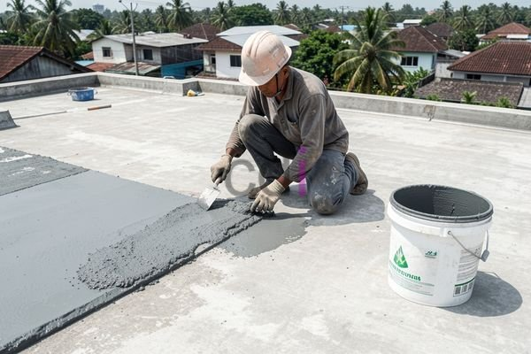

**Biaya Cor Dak Manual Per Meter: Rincian Lengkap & Estimasi 2026** - Hai Mitra CDI! Apakah Anda sedang merencanakan pembangunan atau renovasi dan ingin tahu lebih banyak tentang biaya cor dak manual? Tentu saja! Estimasi anggaran yang tepat adalah kunci utama keberhasilan proyek Anda. Artikel ini akan mengulas tuntas rincian biaya, faktor-faktor yang memengaruhinya, serta perkiraan biaya terkini untuk tahun 2026 di (not detected). Yuk, kita bahas bersama!

## Mengenal Lebih Dekat Biaya Cor Dak Manual
Metode cor dak manual masih menjadi pilihan populer, terutama untuk proyek-proyek berukuran kecil hingga menengah. Ini karena prosesnya relatif sederhana dan seringkali lebih ekonomis dibandingkan opsi lain, seperti penggunaan *bondek*. Walau demikian, memahami semua komponen biaya sangat penting agar Anda bisa mengelola anggaran proyek secara efektif. 

Komponen utama biaya cor dak manual terdiri dari biaya material, biaya tenaga kerja, dan biaya peralatan. Biaya material meliputi harga semen, pasir, kerikil, besi tulangan, dan air. Harga besi tulangan, sebagai contoh, bisa sangat dinamis – jadi penting untuk selalu memantau perkembangan harga di pasar. Untuk memahami lebih lanjut tentang kebutuhan besi, Anda bisa membaca panduan praktis Cara Menghitung Besi Untuk Cor Dak. Sementara itu, biaya tenaga kerja akan bergantung pada upah tukang di (not detected) dan tingkat kompleksitas pekerjaan. Biaya peralatan mencakup penyewaan atau pembelian alat-alat seperti *mixer*, vibrator, dan alat pemotong besi.

## Estimasi Biaya Cor Dak Manual Per Meter Persegi di (not detected)
Agar lebih jelas, berikut ini adalah perkiraan biaya cor dak manual per meter persegi untuk tahun 2026. Perlu diingat bahwa angka ini hanyalah estimasi dan bisa saja berbeda, tergantung pada spesifikasi proyek, lokasi di (not detected), dan harga material saat itu. 

Harga ini bersifat estimasi dan dapat berubah sewaktu-waktu — hubungi Kami untuk mendapatkan penawaran yang paling akurat dan sesuai dengan kebutuhan proyek Anda.

Berikut rincian perkiraan biayanya:

*   **Material:** Rp 350.000 – Rp 500.000 per meter persegi (harga bisa berbeda tergantung kualitas material dan harga pasar).
*   **Tenaga Kerja:** Rp 150.000 – Rp 250.000 per meter persegi (tergantung pada tarif tukang bangunan dan kompleksitas pekerjaan).
*   **Peralatan:** Rp 50.000 – Rp 100.000 per meter persegi (tergantung jenis alat dan lama pemakaian).

Dengan demikian, biaya total untuk cor dak manual diperkirakan antara Rp 550.000 hingga Rp 850.000 per meter persegi. Range ini sudah mencakup seluruh biaya material, tenaga kerja, dan alat. Untuk mendapatkan angka yang lebih tepat, Kami sangat merekomendasikan untuk meminta beberapa penawaran dari penyedia jasa cor dak di (not detected).

## Apa Saja yang Mempengaruhi Biaya Cor Dak Manual?
Ada beberapa faktor yang bisa memengaruhi besaran biaya cor dak manual. Memahami faktor-faktor ini akan membantu Anda dalam mengelola anggaran proyek dengan lebih efisien.

Pertama, **pilihan material** yang digunakan punya dampak besar. Menggunakan semen dengan mutu yang lebih tinggi atau besi dengan diameter lebih besar tentu akan meningkatkan biaya. Tetapi, jangan lupa pertimbangkan juga kekuatan dan daya tahan dak beton, terutama jika bangunan Anda akan menanggung beban yang berat. Kedua, **ketebalan dak** juga penting. Semakin tebal daknya, semakin banyak material yang dibutuhkan – dan otomatis biayanya akan bertambah. Biasanya, ketebalan dak standar berkisar antara 120 mm hingga 150 mm, tapi kandungan struktural bangunan bisa jadi alasan untuk penyesuaian. Ketiga, **aksesibilitas lokasi proyek** juga bisa berpengaruh pada biaya transportasi material dan tenaga kerja. Lokasi yang sulit dijangkau akan secara otomatis meningkatkan biaya logistik.

## Alternatif dan Hal Lain yang Perlu Dipertimbangkan
Sebagai alternatif, Anda juga bisa mempertimbangkan metode pengecoran dak lain, misalnya dengan menggunakan *bondek*. Anda bisa membandingkan biaya dan kelebihan kekurangannya dengan membaca artikel [Biaya Cor Dak Bondek Per M2: Estimasi 2026 & Faktor Penentu Harga](/blog/biaya-cor-dak-bondek-per-m2/). Namun, ingatlah bahwa pilihan metode cor dak terbaik harus disesuaikan dengan kebutuhan dan anggaran proyek Anda. 

Selain biaya cor dak, jangan lupa juga anggarkan biaya tambahan seperti biaya perizinan, biaya pengawasan, dan dana tak terduga. Biaya perizinan akan bervariasi tergantung peraturan daerah di (not detected). Biaya pengawasan penting untuk memastikan kualitas pekerjaan sesuai standar. Dan, sediakan dana tak terduga sekitar 5–10% dari total anggaran proyek untuk mengantisipasi kejadian yang tidak terduga.

Butuh informasi lebih lanjut? Jangan ragu untuk menghubungi Kami. Gunakan tombol **Telepon** atau **WhatsApp** yang tersedia di bawah, dan Kami siap membantu.