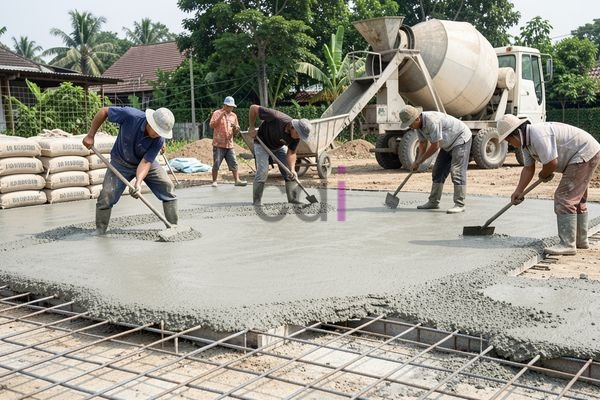

**Biaya Cor Lantai Per M2: Estimasi Terbaru dan Faktor Penentu** - Halo Mitra CDI! Pernah merasa pusing memikirkan anggaran proyek konstruksi? Terutama soal biaya cor lantai, ya? Nah, kali ini kami akan membahas tuntas estimasi biaya cor lantai per m2 di tahun 2026, lengkap dengan faktor-faktor yang memengaruhinya. Dengan pemahaman yang jelas, Mitra bisa merencanakan anggaran lebih akurat dan menghindari kejutan tak terduga selama pengerjaan.

## Estimasi Harga Cor Lantai Per M2 di Tahun 2026: Gambaran Umum

Sebagai patokan awal, biaya cor lantai per m2 di wilayah (not detected) pada tahun 2026 diperkirakan berkisar antara Rp 150.000 hingga Rp 450.000. Angka ini bisa berbeda-beda, tergantung pada beberapa hal seperti jenis material yang dipilih, ketebalan lantai yang dibutuhkan, dan lokasi spesifik proyek. Penting diingat bahwa ini hanyalah estimasi. Untuk mendapatkan penawaran paling akurat sesuai kebutuhan proyek Anda, jangan ragu untuk menghubungi Kami.

Perhitungan harga ini umumnya sudah mencakup biaya material (semen, pasir, kerikil, air), upah tenaga kerja, dan biaya transportasi material ke lokasi proyek. Biaya persiapan lahan dan pemasangan besi tulangan biasanya dihitung secara terpisah. Untuk proyek skala besar, kami sarankan untuk membandingkan beberapa penawaran dari penyedia jasa cor lantai untuk mendapatkan harga yang kompetitif.

## Apa Saja Faktor yang Mempengaruhi Biaya Cor Lantai?

Beberapa faktor kunci berperan dalam menentukan biaya cor lantai per m2. Dengan memahami faktor-faktor ini, Mitra CDI bisa lebih siap dalam merencanakan anggaran proyek.

### Jenis Material yang Dipilih

Pemilihan material adalah penentu utama biaya. Ada dua jenis material utama yang sering digunakan:

*   **Beton K-250:** Cocok untuk kebutuhan lantai rumah tinggal atau bangunan sederhana, dan umumnya lebih ekonomis.
*   **Beton K-300 atau Lebih Tinggi:** Ideal untuk lantai gudang, pabrik, atau bangunan komersial yang membutuhkan kekuatan dan daya tahan ekstra. Tentu saja, harganya akan lebih tinggi daripada beton K-250.

Selain jenis beton, kualitas material pendukung – seperti semen, pasir, dan kerikil – juga memengaruhi harga. Semakin baik kualitasnya, semakin tinggi pula biayanya.

### Ketebalan Lantai yang Dibutuhkan

Ketebalan lantai juga berpengaruh signifikan. Semakin tebal lantai, semakin banyak material yang dibutuhkan, dan biaya yang dikeluarkan pun akan meningkat. Ketebalan lantai biasanya berkisar antara 7 cm hingga 15 cm, tergantung pada beban yang akan ditanggung dan rekomendasi dari ahli struktur bangunan.

### Lokasi Proyek di (not detected) dan Sekitarnya

Lokasi proyek juga berpengaruh terhadap biaya. Biaya transportasi material akan lebih mahal jika lokasi proyek berada di area yang sulit dijangkau atau jauh dari sumber material. Selain itu, upah tenaga kerja juga bisa bervariasi tergantung pada standar upah di wilayah (not detected) dan daerah sekitarnya.

## Perbandingan Biaya: K-250 vs K-300 – Mana yang Lebih Cocok?

Supaya lebih jelas, berikut adalah perbandingan estimasi biaya cor lantai per m2 untuk beton K-250 dan K-300 di wilayah (not detected) pada tahun 2026. Ingat, harga ini bersifat estimasi dan bisa berubah sewaktu-waktu — hubungi Kami untuk penawaran terbaru dan paling akurat sesuai kebutuhan proyek Anda.

<table class="table">
  <caption>Perbandingan Biaya Cor Lantai Per M2 (Estimasi 2026)</caption>
  <thead>
    <tr><th>Jenis Beton</th><th>Ketebalan 7 cm (Rp/m2)</th><th>Ketebalan 10 cm (Rp/m2)</th><th>Ketebalan 12 cm (Rp/m2)</th></tr>
  </thead>
  <tbody>
    <tr><td>Beton K-250</td><td>160.000</td><td>200.000</td><td>230.000</td></tr>
    <tr><td>Beton K-300</td><td>220.000</td><td>270.000</td><td>310.000</td></tr>
  </tbody>
</table>

Sekali lagi, angka-angka di atas hanya sebagai panduan. Biaya aktual bisa berbeda tergantung pada kondisi lapangan dan faktor-faktor yang sudah kami bahas sebelumnya.

## Tips Menghemat Biaya Cor Lantai

Yuk, simak beberapa tips yang bisa membantu Mitra CDI mengoptimalkan biaya cor lantai:

*   **Pilih Beton yang Tepat:** Sesuaikan jenis beton dengan kebutuhan bangunan. Untuk rumah tinggal, beton K-250 seringkali sudah cukup.
*   **Perhitungan Ketebalan yang Akurat:** Konsultasikan dengan ahli struktur untuk menentukan ketebalan lantai yang optimal. Ini akan membantu menghindari pemborosan material.
*   **Bandingkan Harga dari Beberapa Penyedia Jasa:** Jangan terpaku pada satu penawaran saja. Bandingkan harga dari beberapa penyedia jasa cor lantai untuk mendapatkan yang terbaik.
*   **Manfaatkan Jasa Lokal di (not detected):** Jika proyek Anda berlokasi di (not detected), pertimbangkan untuk menggunakan jasa cor lantai lokal. Jasa Cor Lantai di Babakan Cikao Purwakarta, Balaraja Tangerang, atau Bambu Apus Jakarta adalah pilihan yang bisa dieksplorasi. Alternatifnya, Jasa Cor Lantai di Batujaya Karawang juga bisa menjadi solusi tepat.

Dengan perencanaan yang matang dan pemilihan material yang cermat, Mitra CDI dapat mengendalikan biaya cor lantai dan memastikan proyek berjalan lancar sesuai anggaran.

Butuh bantuan untuk proyek Mitra CDI? Jangan sungkan untuk menghubungi Kami melalui tombol **Telepon** atau **WhatsApp** yang tersedia di bawah ini! Kami siap memberikan solusi terbaik. [Jasa Cor Lantai di Bekasi Utara](URL) dan [Jasa Cor Lantai di Bojongmangu Bekasi](URL) juga siap membantu Anda. [Biaya Cor Dak Bondek Per M2](/blog/biaya-cor-dak-bondek-per-m2/) juga bisa menjadi pertimbangan untuk proyek Anda.