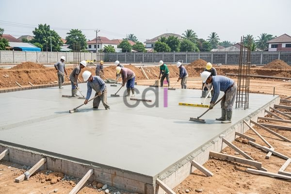

**Biaya Cor Per M2: Panduan Lengkap dan Estimasi Terbaru di Jabodetabek** - Hai Mitra CDI! Seiring pesatnya pembangunan di Indonesia, khususnya di wilayah Jabodetabek, kebutuhan akan layanan konstruksi yang handal semakin meningkat. Pengecoran menjadi salah satu aspek penting yang perlu direncanakan dengan matang. Nah, memahami perkiraan **biaya cor per m2** tentu sangat krusial, kan? Ini membantu Anda mengelola anggaran proyek secara lebih efektif.

### Faktor-Faktor yang Mempengaruhi Harga Cor

Beberapa hal utama memengaruhi harga **biaya cor per m2**. Jenis material yang dipilih, misalnya, punya dampak besar. Apakah Anda akan menggunakan beton ready mix yang praktis, menyiapkan adonan sendiri di lokasi (cor di tempat), atau bahkan mempertimbangkan beton fiber dengan karakteristik khusus? Pilihan ini tentu memengaruhi anggaran. Lalu, ketebalan cor yang dibutuhkan juga berpengaruh signifikan. Semakin tebal lapisan cor, semakin banyak material yang diperlukan.

Selain itu, lokasi proyek di area Jabodetabek juga berperan penting. Harga material dan upah tenaga kerja bisa bervariasi antara satu kota/kabupaten dengan yang lain. Sebagai contoh, biaya pengiriman beton ready mix ke Jakarta Pusat bisa berbeda dengan ke Karawang.  Aksesibilitas lokasi juga perlu diperhatikan, lho. Lokasi yang sulit dijangkau truk mixer dapat meningkatkan biaya transportasi. Terakhir, kompleksitas pekerjaan juga memengaruhi harga total. Pengecoran pondasi rumah sederhana jelas berbeda dengan pengecoran struktur bangunan bertingkat tinggi.

### Estimasi Biaya Cor Per M2 di Tahun 2026

Untuk memberikan gambaran yang lebih jelas, berikut ini adalah estimasi **biaya cor per m2** di wilayah Jabodetabek pada tahun 2026. Perlu diingat, angka-angka ini bersifat perkiraan dan dapat berubah mengikuti fluktuasi pasar dan faktor-faktor yang sudah disebutkan sebelumnya.

| Jenis Cor | Estimasi Biaya Per M2 (Rp) | Keterangan |
|---|---|---|
| Cor Lantai (Beton Ready Mix K-250) | 800.000 – 1.200.000 | Termasuk biaya material, tenaga kerja, dan alat |
| Cor Pondasi (Beton Ready Mix K-300) | 900.000 – 1.400.000 | Ketebalan standar 10-15 cm |
| Cor Kolom (Beton Ready Mix K-350) | 1.000.000 – 1.600.000 | Termasuk besi tulangan |
| Cor di Tempat (Adonan Sendiri) | 600.000 – 900.000 | Biaya material lebih rendah, tapi memerlukan tenaga kerja ahli |

Informasi harga bersifat estimasi dan dapat berubah sewaktu-waktu — untuk penawaran paling akurat, silakan hubungi Kami dan dapatkan harga terbaik yang disesuaikan dengan kebutuhan proyek Anda. Sebagai ilustrasi, jika Anda membutuhkan cor lantai seluas 100 m2 dengan ketebalan 10 cm menggunakan beton ready mix K-250, perkiraan biayanya adalah 100 m2 x Rp 1.000.000/m2 = Rp 100.000.000.  Ingat, angka ini belum memperhitungkan biaya tambahan seperti biaya pembersihan lokasi, perizinan, atau potensi biaya tak terduga lainnya.

### Memastikan Kualitas: Memilih Jasa Cor yang Tepat

Memilih penyedia jasa cor yang tepat adalah kunci untuk menjamin kualitas pekerjaan dan pengendalian anggaran. Pastikan mereka memiliki reputasi baik, pengalaman yang relevan, dan tenaga kerja terlatih. Periksa apakah mereka memiliki sertifikasi yang diperlukan dan menggunakan material berkualitas yang memenuhi standar SNI. Jangan ragu untuk membandingkan beberapa penawaran dari penyedia jasa yang berbeda untuk mendapatkan harga yang paling kompetitif.

Creative Design Interior (CDI) hadir sebagai solusi layanan cor profesional di seluruh wilayah Jabodetabek. Kami berpengalaman menangani beragam proyek cor, mulai dari pengecoran lantai, pondasi, kolom, hingga struktur bangunan kompleks. Kami mengutamakan penggunaan material berkualitas tinggi dan mengerahkan tenaga kerja ahli untuk memastikan hasil pengecoran yang kokoh, awet, dan sesuai standar.  Yuk, [konsultasikan kebutuhan proyek Anda dengan tim ahli Kami](/) sekarang juga! Kami juga menawarkan layanan terkait seperti Jasa Cor Jalan di Abadijaya Depok dan Jasa Cor Jalan di Ancol Jakarta untuk menunjang kebutuhan pembangunan infrastruktur jalan dan perumahan di Jabodetabek.

### Cara Cerdas Menghemat Biaya Cor

Ada beberapa cara yang dapat Anda terapkan untuk menekan **biaya cor per m2** tanpa mengorbankan kualitas. Pertama, rencanakan proyek dengan cermat dan hitung volume material yang dibutuhkan secara akurat. Hindari sisa material yang tidak perlu dengan memesan jumlah yang tepat. Kedua, lakukan riset harga dan bandingkan penawaran dari beberapa supplier material. Ketiga, pertimbangkan penggunaan beton ready mix jika Anda kekurangan tenaga kerja ahli untuk mencampur adonan sendiri. Keempat, pilih penyedia jasa cor yang berpengalaman dan terpercaya.

Jangan tunda lagi, wujudkan proyek impian Anda bersama Kami! Hubungi Kami sekarang melalui tombol **Telepon** atau **WhatsApp** di bawah ini untuk konsultasi gratis dan penawaran terbaik.