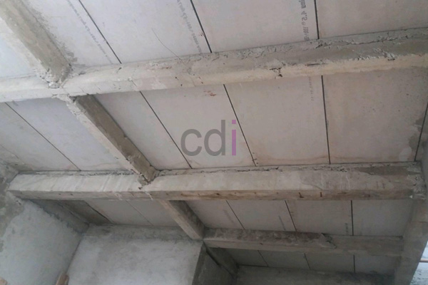

**Biaya Dak Beton: Panduan Lengkap Estimasi, Faktor, dan Tips Penghematan** - Hai Mitra CDI! Sedang merencanakan proyek pembangunan atau renovasi di (not detected)? Salah satu elemen kunci yang perlu dipikirkan matang-matang adalah biaya dak beton. Ini adalah investasi penting untuk kekuatan dan keamanan bangunan Anda. Yuk, kita bahas tuntas!

Dak beton berperan vital dalam konstruksi, baik untuk lantai atas, atap rumah, maupun area parkir. Perencanaan biaya yang tepat adalah kunci kelancaran proyek Anda. Kami hadir untuk memberikan panduan lengkap mengenai estimasi biaya dak beton, faktor-faktor yang mempengaruhinya, dan tips cerdas untuk menghemat pengeluaran.

## Membongkar Komponen Biaya Dak Beton

Agar perhitungan biaya dak beton lebih akurat, penting untuk memahami apa saja komponen yang terlibat. Secara umum, biaya ini dibagi menjadi tiga bagian utama: biaya material, biaya tenaga kerja, dan biaya-biaya tambahan lainnya.

Biaya material mencakup harga beton (baik beton *ready mix* yang praktis, atau campuran di tempat), besi tulangan yang menjadi tulang punggung kekuatan beton, bekisting (cetakan beton), dan bahan aditif beton untuk meningkatkan kualitas. Biaya tenaga kerja meliputi upah tukang, mandor, dan tenaga ahli lainnya yang terlibat dalam pengerjaan. Biaya tambahan bisa meliputi transportasi material, pembuangan limbah konstruksi, dan biaya perizinan yang mungkin diperlukan di (not detected).

Sebagai gambaran, estimasi biaya dak beton per meter persegi di tahun 2026 ini berkisar antara Rp 300.000 hingga Rp 800.000.  Perlu diingat, ini hanyalah estimasi awal. Untuk penawaran paling akurat dan disesuaikan dengan proyek Anda, silakan hubungi Kami untuk konsultasi gratis. 

## Faktor-Faktor Penentu Biaya Dak Beton

Beberapa faktor penting dapat memengaruhi biaya dak beton secara signifikan. Memahami faktor-faktor ini akan membantu Anda dalam merencanakan anggaran yang lebih realistis dan menghindari jebakan biaya tak terduga.

### Ketebalan Dak Beton: Semakin Tebal, Semakin Kuat... dan Mahal?

Ketebalan dak beton adalah salah satu elemen utama yang langsung memengaruhi biaya. Semakin tebal dak beton, semakin banyak material yang dibutuhkan, dan konsekuensinya, semakin tinggi biayanya. Umumnya, ketebalan dak beton berkisar antara 10 cm hingga 20 cm. Pemilihan ketebalan harus didasarkan pada beban yang akan ditanggung dan fungsi bangunan.

### Mutu Beton: K-xxx – Apa Artinya?

Mutu beton, yang ditandai dengan kode K-xxx (contoh: K-250, K-300, K-350), adalah indikator kekuatan dan kualitas beton. Semakin tinggi angka K, semakin kuat dan tahan lama beton tersebut, namun juga semakin mahal. Pemilihan mutu beton harus disesuaikan dengan kebutuhan desain dan standar keamanan yang berlaku. Di (not detected), pemilihan mutu beton yang tepat sangat penting untuk memastikan bangunan Anda aman dan awet.

### Spesifikasi Besi Tulangan: Ukuran dan Kualitas Penting!

Jenis dan diameter besi tulangan yang digunakan juga berpengaruh terhadap biaya. Besi tulangan berfungsi sebagai penguat beton dan menahan gaya tarik. Semakin besar diameter besi tulangan dan semakin tinggi mutu baja yang digunakan, semakin mahal biayanya.

### Sistem Bekisting: Kayu, Baja, atau Multiplex?

Sistem bekisting (cetakan beton) yang Anda pilih juga dapat memengaruhi biaya. Pilihan umumnya meliputi bekisting kayu yang relatif murah namun kurang tahan lama, bekisting baja yang lebih mahal namun kuat dan mudah dipasang, serta bekisting multiplex sebagai alternatif. Untuk memahami lebih lanjut bagaimana bekisting dibuat, Anda bisa membaca artikel Kami tentang Proses Pembuatan Cetakan Dak Beton (bekisting).

## Strategi Cerdas: Menghemat Biaya Dak Beton

Meskipun biaya dak beton tergolong besar, ada beberapa strategi efektif yang dapat Anda terapkan untuk menghemat pengeluaran tanpa mengorbankan kualitas.

### Desain Struktur yang Efisien: Minimalkan Material, Maksimalkan Kekuatan

Desain struktur yang optimal dapat mengurangi jumlah material yang dibutuhkan secara signifikan. Konsultasikan dengan arsitek dan insinyur sipil yang berpengalaman untuk memastikan desain yang efisien dan sesuai dengan kebutuhan Anda.

### Pilih Material yang Tepat: Sesuaikan dengan Kebutuhan

Pilihlah material yang sesuai dengan kebutuhan dan anggaran Anda. Jangan terpaku pada mutu beton tertinggi jika mutu yang lebih rendah sudah mencukupi untuk menahan beban yang akan ditanggung. Ingat, tujuan kita adalah mendapatkan hasil terbaik dengan biaya yang efisien.

### Survei Harga Material: Bandingkan Sebelum Membeli

Lakukan survei harga material dari beberapa supplier di (not detected) untuk mendapatkan harga yang paling kompetitif. Jangan lupa perhatikan pula kualitas material yang ditawarkan.

### Jasa Profesional: Investasi untuk Kualitas dan Efisiensi

Meskipun mungkin terasa lebih mahal di awal, menggunakan jasa profesional seperti layanan Kami dapat menghemat biaya dalam jangka panjang. Tukang yang berpengalaman akan bekerja lebih efisien, menghasilkan pekerjaan berkualitas tinggi, dan meminimalkan risiko kesalahan yang mahal untuk diperbaiki.  Selain itu, pertimbangkan untuk mempelajari Penyebab Dak Beton Bocor agar Anda dapat menghindari potensi biaya perbaikan akibat masalah kebocoran di kemudian hari.

Jangan tunda lagi! Hubungi Kami sekarang juga melalui tombol **WhatsApp** atau **Telepon** yang ada di halaman ini untuk konsultasi gratis dan penawaran terbaik untuk proyek dak beton Anda di (not detected).  Mari wujudkan bangunan impian Anda dengan aman, kuat, dan hemat biaya! 