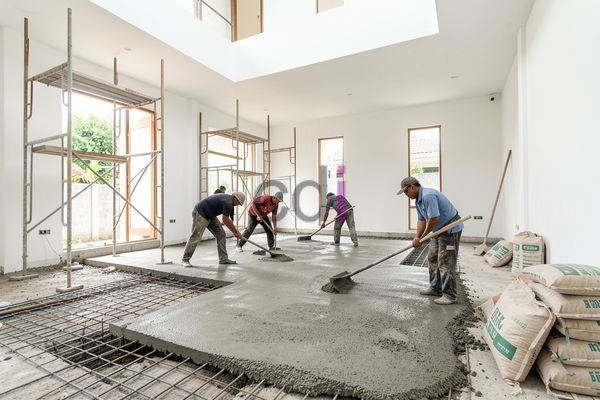

**Biaya Membuat Lantai 2: Perencanaan Anggaran dan Estimasi 2026** - Halo Mitra CDI! Apakah Anda sedang mempertimbangkan untuk memperluas rumah dengan menambah satu lantai lagi? Sebuah ide yang brilian! Tapi, sebelum mulai berkhayal tentang ruangan baru, penting sekali untuk memahami biaya yang mungkin timbul. Mari kita bahas tuntas!

Membangun lantai dua adalah investasi besar, dan perencanaan anggaran yang tepat adalah kunci keberhasilan proyek Anda. Kami dari Creative Design Interior (CDI) akan memandu Anda melalui semua aspek biaya, sehingga Anda bisa membuat keputusan yang cerdas dan sesuai dengan anggaran yang tersedia. Di (not detected), kami siap menjadi mitra terpercaya Anda.

## Memperkirakan Biaya Konstruksi Lantai 2: Gambaran Umum

Biaya pembuatan lantai 2 itu bervariasi, lho. Banyak faktor yang mempengaruhinya. Ukuran bangunan, jenis material yang dipilih, dan tingkat kesulitan desain adalah beberapa di antaranya. Untuk gambaran kasar, di tahun 2026 ini, biaya konstruksi lantai 2 baru di (not detected) berkisar antara Rp 4.000.000 – Rp 7.000.000 per meter persegi. 

Ingat ya, ini hanya estimasi. Biaya bisa naik atau turun tergantung kondisi lapangan dan pilihan material Anda. Kami sarankan untuk selalu menyiapkan dana cadangan sekitar 10-15% dari total anggaran. Ini untuk mengantisipasi pengeluaran tak terduga yang mungkin muncul selama pengerjaan.

## Rincian Biaya: Membedah Komponen-Komponen Penting

Yuk, kita bedah lebih rinci komponen biaya pembuatan lantai 2, biar lebih jelas ke mana saja uang Anda akan dialokasikan:

*   **Struktur:** Bagian ini meliputi biaya fondasi, kolom, balok, dan plat lantai. Material beton bertulang dengan mutu minimal K-300 adalah pilihan yang umum. Biaya untuk struktur ini bisa mencapai 30-40% dari total biaya konstruksi.
*   **Atap:** Pilihan material atap sangat memengaruhi biaya. Ada genteng, metal, spandek, dan lain-lain. Harga atap berkisar antara Rp 200.000 hingga Rp 600.000 per meter persegi.
*   **Dinding:** Material dinding juga berpengaruh. Bata merah adalah opsi ekonomis. Ada juga batako atau panel beton ringan yang menawarkan insulasi dan kekuatan lebih baik.
*   **Pintu & Jendela:** Biaya pintu dan jendela tergantung ukuran, material, dan desain. Pintu dan jendela aluminium atau PVC biasanya lebih mahal daripada kayu.
*   **Finishing:** Finishing mencakup pemasangan lantai, plesteran, cat, serta instalasi listrik dan plumbing. Biaya finishing bisa mencapai 20-30% dari total biaya konstruksi.

## Renovasi atau Bangun Baru: Mana yang Lebih Hemat?

Ketika memikirkan lantai 2, Anda mungkin bingung: lebih baik merenovasi bangunan yang sudah ada atau membangun lantai baru dari nol? Masing-masing ada plus minusnya.

Secara umum, renovasi seringkali tampak lebih murah, tapi jangan terburu-buru mengambil keputusan. Renovasi memerlukan penguatan struktur bangunan yang ada agar bisa menopang beban lantai 2. Biaya penguatan ini bisa cukup besar, apalagi kalau bangunan lama kondisinya kurang baik. 

Membangun lantai 2 dari awal memungkinkan Anda merancang struktur yang kuat dan efisien sejak awal. Ini bisa menghemat biaya dalam jangka panjang. Jadi, pertimbangkan dengan matang ya!

Berikut ini perbandingan estimasi biaya per meter persegi di (not detected) pada tahun 2026:

<table class="table">
  <caption>Perbandingan Biaya Renovasi vs. Membangun Baru</caption>
  <thead>
    <tr><th>Komponen</th><th>Renovasi (Estimasi)</th><th>Membangun Baru (Estimasi)</th></tr>
  </thead>
  <tbody>
    <tr><td>Struktur</td><td>Rp 1.200.000 - Rp 2.000.000</td><td>Rp 1.500.000 - Rp 2.500.000</td></tr>
    <tr><td>Atap</td><td>Rp 200.000 - Rp 500.000</td><td>Rp 200.000 - Rp 600.000</td></tr>
    <tr><td>Dinding</td><td>Rp 300.000 - Rp 700.000</td><td>Rp 300.000 - Rp 800.000</td></tr>
    <tr><td>Finishing</td><td>Rp 800.000 - Rp 1.500.000</td><td>Rp 800.000 - Rp 2.000.000</td></tr>
    <tr><td>Total (Estimasi)</td><td>Rp 2.500.000 - Rp 4.700.000</td><td>Rp 2.800.000 - Rp 5.900.000</td></tr>
  </tbody>
</table>

Harga ini hanyalah perkiraan ya. Untuk penawaran yang lebih akurat dan sesuai dengan proyek Anda di (not detected), jangan ragu untuk menghubungi Kami!

## Hemat Biaya Bikin Lantai 2: Tips Jitu!

Mau bikin lantai 2 dengan biaya yang lebih terkendali? Ini dia beberapa tips yang bisa Anda terapkan:

*   **Desain Cerdas:** Pilih desain yang sederhana dan efisien. Hindari desain rumit yang membutuhkan banyak material mahal.
*   **Material yang Tepat:** Pilih material berkualitas, tapi tetap terjangkau. Pertimbangkan material lokal yang lebih ekonomis.
*   **Anggaran Terperinci:** Buat anggaran yang realistis dan detail. Jangan lupa sediakan dana cadangan untuk hal-hal tak terduga.
*   **Kontraktor Terpercaya:** Pilih kontraktor berpengalaman dengan reputasi baik. Bandingkan beberapa penawaran harga sebelum memutuskan. [Analisa Harga Satuan Beton K 250: Panduan Lengkap dan Estimasi Biaya 2026](/blog/analisa-harga-satuan-beton-k-250/) — ini juga penting untuk dipelajari!

Butuh konsultasi lebih lanjut? Jangan sungkan untuk menghubungi Kami melalui tombol **WhatsApp** atau **Telepon** yang ada di halaman ini. Kami siap membantu mewujudkan impian Anda memiliki lantai 2 yang kokoh dan indah di (not detected)!