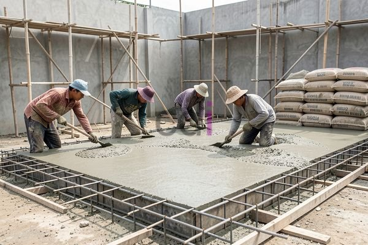

**Biaya Ngecor Per Meter: Panduan Lengkap & Estimasi Terbaru 2026** - Hai Mitra CDI! Punya rencana ngecor tapi bingung soal biayanya? Tenang, Anda nggak sendirian! Banyak yang merasa kesulitan memperkirakan anggaran yang pas untuk pekerjaan pengecoran, lho. Nah, kami dari CDI siap membantu! Artikel ini akan membahas tuntas biaya ngecor per meter, mulai dari faktor-faktor yang mempengaruhinya sampai estimasi harga terkini di tahun 2026. Yuk, simak informasinya!

## Mengulas Faktor Penentu Biaya Ngecor Per Meter

Biaya ngecor per meter itu dinamis—bisa naik atau turun tergantung beberapa hal. Bukan cuma harga material yang bikin pusing, tapi juga volume pekerjaan, lokasi proyek, dan upah tukang. Semakin tinggi mutu beton yang dipilih, misalnya, biasanya harganya juga ikut bertambah. Beton K-300 atau K-400? Pasti lebih mahal dibanding K-200.

Volume juga penting banget. Semakin besar proyeknya, biasanya biaya per meter kubik akan lebih murah karena ada efisiensi skala. Lokasi proyek juga berpengaruh, terutama biaya transportasi. Kalau proyeknya di daerah yang agak terpencil, biaya angkut material bisa lebih tinggi. Terakhir, upah tukang yang beda-beda di setiap daerah juga ikut menentukan harga akhir.

## Estimasi Biaya Ngecor Per Meter di (not detected) Tahun 2026

Oke, langsung aja kita bahas estimasi biayanya. Perlu diingat, angka di bawah ini cuma perkiraan dan bisa berubah sewaktu-waktu ya, tergantung kondisi pasar dan hasil negosiasi dengan penyedia jasa. Untuk proyek di (not detected) tahun 2026, biaya ngecor per meter untuk pekerjaan rumah tinggal diperkirakan berkisar antara Rp 400.000 sampai dengan Rp 700.000. Harga ini sudah termasuk biaya material, tenaga kerja, dan operasional.

Untuk pekerjaan yang lebih kompleks, seperti pengecoran struktur komersial atau infrastruktur, biaya per meter bisa naik jadi lebih dari Rp 800.000, bahkan sampai Rp 1.000.000 atau lebih. Nah, untuk mendapatkan penawaran yang paling akurat sesuai dengan kebutuhan proyek Mitra CDI, jangan ragu untuk menghubungi kami ya!

Sebagai gambaran, katakanlah Anda mau ngecor lantai dak rumah tipe 45 di (not detected) dengan luas 60 meter persegi dan ketebalan 12 cm. Volume beton yang dibutuhkan adalah 0,012 m³ x 60 m² = 0,72 m³.  Jika harga beton per meter kubik adalah Rp 2.800.000, biaya material betonnya sekitar Rp 2.016.000. Setelah ditambah biaya tenaga kerja dan operasional, total biaya ngecor lantai dak tersebut kemungkinan akan berada di kisaran Rp 3.500.000 hingga Rp 4.500.000.

## Membandingkan Material: Pilih yang Paling Tepat Biar Hemat

Memilih material yang tepat bisa membantu menghemat biaya ngecor per meter. Ada beberapa opsi yang bisa Anda pertimbangkan, berikut perbandingannya:

<table class="table">
  <caption>Perbandingan Material Beton</caption>
  <thead>
    <tr><th>Jenis Material</th><th>Kelebihan</th><th>Kekurangan</th><th>Estimasi Harga/m³</th></tr>
  </thead>
  <tbody>
    <tr><td>Beton K-200</td><td>Harga relatif terjangkau</td><td>Kuat tekan rendah, kurang cocok untuk struktur berat</td><td>Rp 2.400.000 - Rp 2.600.000</td></tr>
    <tr><td>Beton K-300</td><td>Kuat tekan sedang, cocok untuk berbagai aplikasi</td><td>Harga sedikit lebih mahal dari K-200</td><td>Rp 2.600.000 - Rp 2.800.000</td></tr>
    <tr><td>Beton K-400</td><td>Kuat tekan tinggi, ideal untuk struktur berat dan tahan lama</td><td>Harga paling mahal di antara ketiganya</td><td>Rp 2.800.000 - Rp 3.000.000</td></tr>
  </tbody>
</table>

Mitra CDI bisa pilih material yang paling sesuai dengan kebutuhan proyek. Kalau struktur bangunan butuh kekuatan tekan tinggi, seperti pondasi atau kolom, beton K-300 atau K-400 adalah pilihan yang lebih baik. Tapi, untuk struktur yang nggak terlalu kritis, seperti lantai dak rumah tinggal, beton K-200 mungkin sudah cukup. 

## Tips Jitu Menghemat Biaya Ngecor

Mau biaya ngecor lebih hemat? Terapkan tips-tips berikut ini:

*   **Perencanaan Matang:** Hitung volume beton yang dibutuhkan dengan akurat. Jangan sampai ada pemborosan material, ya!
*   **Bandingkan Harga:** Cek harga dari beberapa penyedia jasa dan pilih yang menawarkan harga terbaik dengan kualitas yang terjamin.
*   **Pertimbangkan *Ready Mix*:** Kalau memungkinkan, gunakan campuran beton *ready mix*. Biasanya lebih efisien dan hemat tenaga kerja.
*   **Kualitas SNI:** Pastikan material yang digunakan memenuhi standar SNI supaya struktur bangunan kuat dan tahan lama.

Dengan menerapkan tips ini, Anda bisa menghemat biaya ngecor tanpa mengorbankan kualitas bangunan. Jangan lupa, CDI hadir untuk membantu Anda merealisasikan proyek impian Anda di (not detected) dengan harga yang kompetitif dan kualitas terjamin. [Kunjungi halaman layanan pengecoran kami](URL_LAYANAN_PENGEGORAN) untuk informasi lebih lengkap.

Punya pertanyaan lain? Jangan sungkan untuk menghubungi kami! Tombol **Telepon** dan **WhatsApp** di bawah ini siap membantu Anda.