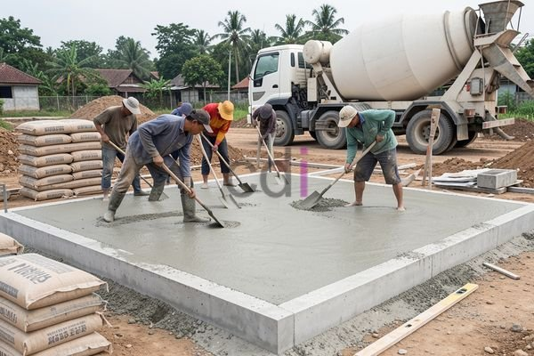

**Biaya Ngedak 3x3 Meter: Estimasi Lengkap & Cara Efisien 2026** - Hai Mitra CDI! Punya rencana ngedak rumah ukuran 3x3 meter? Seringkali, banyak pertanyaan muncul soal biaya, material yang dibutuhkan, dan bagaimana caranya agar anggaran tidak membengkak. Nah, artikel ini hadir untuk menjawab semua itu! Yuk, simak panduan lengkapnya supaya proyek ngedak Mitra berjalan lancar dan hemat.

## Mengupas Tuntas Komponen Biaya Ngedak 3x3 Meter

Pengecoran dak beton, atau yang biasa disebut ngedak, adalah bagian penting dalam membangun atau merenovasi rumah. Proses ini melibatkan beberapa tahapan: persiapan bekisting, pemasangan besi tulangan, pengecoran beton, hingga perawatan agar beton mengeras sempurna. Biaya yang dibutuhkan tak hanya bergantung pada luas area (3x3 meter dalam kasus ini), tapi juga pada kualitas material, ketebalan dak, dan kompleksitas pekerjaan.

Komponen biaya utama meliputi: harga material (semen, pasir, split, besi beton, dan aditif beton), biaya bekisting (kayu atau baja), upah tenaga kerja, serta biaya transportasi material ke lokasi proyek. Harga material bisa berbeda-beda, tergantung daerah, musim, dan supplier. Untuk ukuran 3x3 meter, volume beton yang diperlukan kurang lebih 1,5 – 2 meter kubik (tergantung ketebalan dak yang Mitra pilih). Ketebalan standar dak rumah biasanya berkisar antara 12 hingga 15 cm.

## Rincian Biaya Material & Upah Tukang: Estimasi 2026

Untuk memberikan gambaran yang lebih jelas, mari kita lihat rincian estimasi biaya ngedak 3x3 meter dengan asumsi ketebalan dak 12 cm. Harga material berikut ini adalah harga perkiraan di wilayah (not detected) pada tahun 2026.

* **Semen:** 8 sak semen (50 kg/sak) x Rp 60.000/sak = Rp 480.000
* **Pasir:** 1,5 m³ x Rp 150.000/m³ = Rp 225.000
* **Split:** 1,5 m³ x Rp 180.000/m³ = Rp 270.000
* **Besi Beton:** Diameter 10 mm (estimasi 80 kg, disesuaikan desain struktur) x Rp 16.000/kg = Rp 1.280.000
* **Bekisting:** (Kayu/Baja, estimasi) = Rp 300.000 - Rp 600.000 (tergantung bahan & tingkat kesulitan)
* **Aditif Beton (Opsional):** Rp 50.000 - Rp 100.000
* **Biaya Tenaga Kerja:** Rp 600.000 - Rp 900.000 (tergantung kompleksitas & tarif tukang)

Dengan begitu, estimasi total biaya material dan tenaga kerja berkisar antara Rp 3.205.000 – Rp 3.825.000. Ingat ya Mitra, angka ini hanya perkiraan. Untuk mendapatkan penawaran yang paling akurat sesuai dengan kebutuhan proyek di (not detected), silakan hubungi Kami. 

## Strategi Jitu: Menghemat Biaya Ngedak

Ada beberapa cara cerdas untuk menekan biaya ngedak tanpa mengurangi kualitas. Pertama, lakukan perencanaan yang detail dan hitung kebutuhan material dengan presisi. Hindari membeli material berlebihan, karena akan jadi pemborosan. Kedua, bandingkan harga material dari beberapa toko bangunan atau supplier. Ketiga, pertimbangkan penggunaan material alternatif yang lebih ekonomis, tapi tetap memenuhi standar kualitas yang baik.

Keempat, pilih jasa tukang yang sudah berpengalaman dan memiliki reputasi terpercaya. Tukang yang profesional akan bekerja efisien, meminimalkan kesalahan, dan mengoptimalkan penggunaan material. Terakhir, jangan lewatkan promo atau diskon yang sering ditawarkan oleh toko bangunan.

## Jasa Ngedak Profesional di (not detected): Pilih Creative Design Interior!

Memilih penyedia jasa ngedak yang tepat sangat penting untuk kelancaran proyek. Pastikan mereka memiliki rekam jejak yang baik, pengalaman yang sesuai, dan tenaga kerja yang handal. Selain itu, pastikan ada jaminan kualitas dan garansi jika terjadi kerusakan. 

Creative Design Interior hadir sebagai solusi bagi Mitra yang membutuhkan jasa ngedak profesional di (not detected). Kami menawarkan harga yang kompetitif dengan kualitas yang terjamin. Bukan hanya ngedak, Kami juga ahli dalam furniture custom, penyediaan material bangunan berkualitas tinggi, dan jasa pengecoran lainnya. Dengan pengalaman bertahun-tahun di (not detected), Kami siap membantu mewujudkan hunian impian Mitra.

Jangan ragu untuk berkonsultasi dengan Kami. Tombol **Telepon** dan **WhatsApp** yang tersedia di bawah halaman ini bisa langsung Mitra gunakan untuk menghubungi tim Kami. Kami siap memberikan solusi terbaik untuk proyek ngedak Mitra! [Biaya Ngedak Rumah Per Meter Persegi: Estimasi Terbaru 2026](/blog/biaya-ngedak-rumah-per-meter-persegi/)