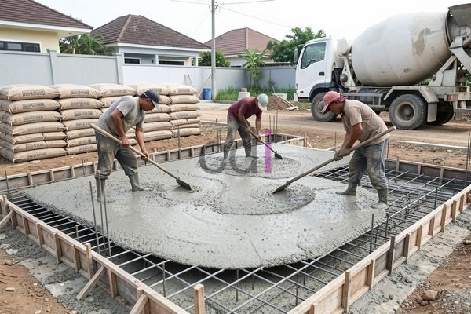

**Biaya Ngedak Rumah dengan Bondek: Estimasi 2026 & Perbandingan Material** - Halo Mitra CDI! Sedang merencanakan pembangunan atau renovasi di (not detected) dan berpikir tentang dak bondek? Pilihan material dak ini memang populer, tapi bagaimana dengan biayanya? Nah, artikel ini akan mengupas tuntas estimasi biaya ngedak rumah dengan bondek di tahun 2026, serta membandingkannya dengan alternatif lain. Kita akan bedah detailnya supaya Mitra bisa membuat keputusan yang tepat untuk proyek bangunan di (not detected).

Memilih material dak bukan cuma soal kekuatan struktural, lho. Ada banyak faktor lain yang perlu dipertimbangkan — harga, kemudahan pemasangan, bahkan tampilan akhir. Bondek hadir sebagai salah satu solusi yang menjanjikan, dengan sejumlah keunggulan yang menarik. Yuk, kita bahas lebih lanjut!

## Apa Saja Komponen Biaya dalam Ngedak dengan Bondek?

Biaya ngedak rumah dengan bondek itu tidak cuma harga bondek-nya saja. Ada beberapa pos yang perlu masuk dalam perhitungan anggaran proyek Mitra CDI, yaitu:

*   **Bondek:** Harga sangat dipengaruhi oleh ketebalan (misalnya 0.75mm, 1.0mm) dan jenis material (galvanis atau galvalum).
*   **Wiremesh:** Jaring baja ini berperan penting sebagai tulangan dak. Mutu dan ukuran wiremesh akan menentukan harganya.
*   **Beton:** Volume beton yang diperlukan tergantung pada luas area dak dan ketebalan yang direncanakan.
*   **Tulangan Utama:** Besi beton digunakan untuk memperkuat keseluruhan struktur dak.
*   **Biaya Pemasangan:** Ini mencakup upah tukang yang berpengalaman serta biaya transportasi material ke lokasi proyek di (not detected). 

Ingat, angka-angka ini hanya estimasi. Untuk mendapatkan penawaran paling akurat sesuai kebutuhan proyek Mitra CDI, jangan ragu untuk menghubungi Kami.

## Proyeksi Biaya Ngedak Rumah dengan Bondek di Tahun 2026

Berikut adalah estimasi biaya ngedak rumah dengan bondek per meter persegi di tahun 2026. Angka ini bisa jadi gambaran awal untuk perencanaan anggaran:

| Komponen          | Estimasi Biaya (Rp/m²) |
| ----------------- | ----------------------- |
| Bondek (0.75mm)   | 120.000 – 180.000       |
| Wiremesh          | 30.000 – 50.000        |
| Beton (Mutu K-250) | 450.000 – 600.000       |
| Tulangan Utama    | 50.000 – 80.000        |
| Biaya Pemasangan   | 80.000 – 120.000       |
| **Total**          | **730.000 – 1.030.000** |

Perlu diingat, biaya ini bersifat perkiraan. Faktor-faktor seperti lokasi proyek di (not detected), spesifikasi material yang dipilih, dan kompleksitas desain akan memengaruhi biaya akhir. Sebagai contoh, jika Mitra CDI menginginkan bondek dengan ketebalan 1.0mm dan menggunakan beton mutu K-300, biaya per meter persegi akan lebih tinggi.

## Bondek Dibandingkan dengan Pilihan Material Dak Lainnya

Bondek bukanlah satu-satunya opsi untuk membangun dak rumah. Berikut beberapa alternatif lain yang mungkin bisa dipertimbangkan:

*   **Dak Beton Konvensional:** Metode tradisional yang menggunakan bekisting kayu dan tulangan besi.
*   **Dak Keramik:** Memanfaatkan keramik sebagai elemen penutup dan struktur pendukung.
*   **Dak Ringan:** Menggunakan material ringan seperti *lightweight concrete* (LPC).

Mari kita lihat perbandingan singkatnya:

<table class="table">
  <caption>Perbandingan Opsi Dak Rumah</caption>
  <thead>
    <tr><th>Fitur</th><th>Bondek</th><th>Dak Beton Konvensional</th><th>Dak Ringan</th></tr>
  </thead>
  <tbody>
    <tr><td>Biaya (Rp/m²)</td><td>730.000 – 1.030.000</td><td>600.000 – 900.000</td><td>500.000 – 800.000</td></tr>
    <tr><td>Kekuatan</td><td>Tinggi</td><td>Tinggi</td><td>Sedang</td></tr>
    <tr><td>Kecepatan Pemasangan</td><td>Cepat</td><td>Lambat</td><td>Sedang</td></tr>
    <tr><td>Berat</td><td>Ringan</td><td>Berat</td><td>Ringan</td></tr>
    <tr><td>Fleksibilitas Desain</td><td>Terbatas</td><td>Fleksibel</td><td>Terbatas</td></tr>
  </tbody>
</table>

Dari tabel di atas, terlihat bahwa bondek menawarkan keseimbangan yang baik antara biaya, kekuatan, dan kecepatan pemasangan. Meskipun dak beton konvensional mungkin sedikit lebih murah, proses pemasangannya cenderung lebih lama dan membutuhkan bekisting yang menambah biaya. Sementara itu, dak ringan memang lebih terjangkau, tetapi kekuatannya mungkin tidak sebanding dengan bondek atau dak beton konvensional.  [Besi untuk Pondasi Rumah: Jenis, Ukuran, dan Estimasi Biaya Terbaru 2026](/blog/besi-untuk-pondasi-rumah/) bisa jadi referensi tambahan dalam perencanaan fondasi rumah.

## Tips Hemat Biaya Ngedak Rumah dengan Bondek

Ada beberapa cara yang bisa dilakukan oleh Mitra CDI untuk menekan biaya ngedak rumah dengan bondek:

*   **Pilih Bondek yang Sesuai:** Pertimbangkan ketebalan dan jenis bondek yang paling sesuai dengan kebutuhan struktural dan anggaran Mitra.
*   **Survei Harga Material:** Bandingkan harga dari beberapa supplier untuk mendapatkan penawaran terbaik.
*   **Gunakan Jasa Tukang Profesional:** Pemasangan yang tepat oleh tukang berpengalaman akan memastikan kekuatan dan efisiensi dak.
*   **Perencanaan Matang:** Rencanakan proyek dengan seksama untuk menghindari pemborosan material dan waktu.

Jika Anda memiliki pertanyaan lebih lanjut, jangan sungkan untuk menghubungi Kami melalui tombol **Telepon** atau **WhatsApp** yang tersedia di bawah ini. Kami siap membantu!