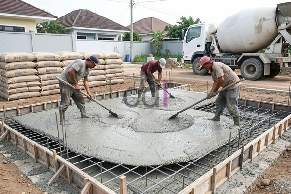

**Biaya Ngedak Rumah Per Meter Persegi: Estimasi Terbaru 2026** - Hai Mitra CDI! Punya rencana membangun atau merenovasi rumah dan sedang mencari informasi biaya ngedak? Seringkali, kita terjebak dengan perkiraan yang meleset karena kurangnya perhitungan detail. Nah, di artikel ini, Kami akan kupas tuntas biaya ngedak rumah per meter persegi, lengkap dengan faktor-faktor yang mempengaruhinya, estimasi biaya terkini, dan cara-cara pintar untuk menghemat anggaran. Yuk, simak selengkapnya!

## Mengenal Faktor Penentu Biaya Ngedak Rumah

Ada beberapa hal penting yang bikin biaya ngedak rumah berbeda-beda. Salah satunya adalah **jenis material** yang dipilih—apakah Mitra lebih suka beton bertulang yang kuat, beton ringan yang praktis, atau mungkin opsi material lain? Setiap pilihan punya harga dan keunggulan masing-masing, lho. Selain itu, **ketebalan ngedak** juga berpengaruh. Semakin tebal, tentu saja semakin banyak material yang dibutuhkan dan semakin tinggi biayanya. Ketebalan ideal sebaiknya disesuaikan dengan beban yang akan ditanggung oleh struktur tersebut.

Kondisi **lahan dan aksesibilitas lokasi** juga memainkan peran penting. Lahan yang sulit dijangkau atau butuh diratakan dulu tentunya akan menambah biaya. Belum lagi **kompleksitas desain**. Semakin rumit desainnya, semakin banyak tenaga dan waktu yang dibutuhkan, yang otomatis akan memengaruhi biaya keseluruhan. Jangan lupakan juga **upah tukang** di area (not detected) — harga bisa berbeda-beda tergantung pengalaman, keahlian, dan tren pasar setempat.

## Estimasi Biaya Ngedak Rumah Per Meter Persegi di (not detected) Tahun 2026

Agar Mitra punya gambaran yang lebih jelas, berikut ini Kami sajikan estimasi biaya ngedak rumah per meter persegi di wilayah (not detected) untuk tahun 2026. Penting diingat, angka ini bersifat perkiraan dan bisa berubah sewaktu-waktu, ya. Untuk penawaran paling akurat sesuai dengan proyek Mitra CDI, silakan hubungi Kami langsung.

| Jenis Pekerjaan | Estimasi Biaya (Rp/m²) |
|---|---|
| Persiapan Lahan (pembersihan, perataan) | 50.000 – 150.000 |
| Pembesian (rangka besi) | 100.000 – 200.000 |
| Pengecoran Beton (K-250) | 250.000 – 400.000 |
| Finishing (perataan, curing) | 20.000 – 50.000 |
| **Total Estimasi** | **420.000 – 800.000** |

Harga material beton K-250 (yang umum dipakai untuk konstruksi rumah) berkisar antara Rp 900.000 – Rp 1.200.000 per meter kubik, tergantung kualitas dan supplier. Untuk besi beton (diameter 10mm – 16mm), harganya sekitar Rp 8.000 – Rp 12.000 per kilogram. Harga-harga ini belum termasuk biaya transportasi dan pajak. Sebagai contoh, untuk proyek ngedak berukuran 3x3 meter dengan ketebalan 10 cm (0,1 meter), volume beton yang dibutuhkan adalah 0,9 meter kubik. Jika harga beton K-250 Rp 1.000.000 per meter kubik, maka biaya beton saja mencapai Rp 900.000.

## Trik Jitu Menghemat Biaya Ngedak Rumah

Tenang, Mitra! Ada beberapa cara mudah untuk menekan biaya ngedak rumah. Pertama, **lakukan perbandingan harga material** dari berbagai toko bangunan. Jangan sungkan meminta penawaran dari beberapa tempat, lalu pilih yang paling oke. Kedua, **optimalkan desain ngedak** sekalian. Desain yang simpel dan minim detail bisa menghemat penggunaan material dan tenaga kerja. Konsultasikan dengan arsitek atau desainer interior untuk mendapatkan solusi terbaik.

Ketiga, **pertimbangkan material lokal**. Biasanya, material yang diproduksi di dalam negeri harganya lebih ramah di kantong. Pastikan kualitasnya tetap terjamin dan sudah memenuhi standar SNI, ya. Keempat, **awasi pengerjaan dengan ketat**. Pastikan semua pekerjaan dilakukan sesuai spesifikasi dan kualitas yang diharapkan. Dengan pengawasan yang cermat, Kita bisa mencegah pemborosan material dan kesalahan konstruksi.  Kalau mau tahu lebih detail soal ukuran 3x3, [Biaya Ngedak 3x3 Meter](/blog/biaya-ngedak-3x3/) bisa jadi referensi yang bagus.

## Pilih Jasa Ngedak Rumah Profesional di (not detected)

Memilih jasa ngedak rumah yang terpercaya dan berpengalaman sangat krusial untuk mendapatkan hasil yang berkualitas dan menghindari masalah di masa depan. Pastikan penyedia jasa memiliki izin usaha yang lengkap dan reputasi yang baik. Mintalah referensi dari teman, keluarga, atau kenalan yang pernah menggunakan jasa mereka. Periksa juga portofolio proyek-proyek yang pernah mereka tangani. Creative Design Interior hadir sebagai solusi tepat untuk kebutuhan ngedak rumah Mitra di (not detected). Kami menyediakan jasa ngedak rumah profesional dengan tenaga ahli yang berpengalaman dan material berkualitas tinggi. Kami pun siap memberikan konsultasi gratis untuk membantu Mitra merencanakan anggaran dan memilih desain yang sesuai dengan harapan dan budget.

Butuh informasi lebih lanjut? Jangan ragu untuk menghubungi Kami melalui tombol **Telepon** atau **WhatsApp** yang tersedia di halaman ini. Tim Kami siap membantu!