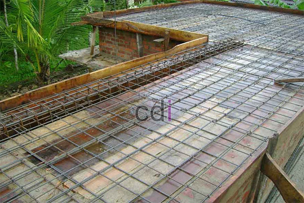

**Biaya Pembuatan Kolam Beton Per Meter** - Hai Mitra CDI! Punya rencana membangun kolam beton impian? Seringkali, kendala utama muncul saat menyusun anggaran. Banyak yang tak memperhitungkan keseluruhan biaya yang dibutuhkan, sehingga proyek bisa mandek di tengah jalan. Artikel ini hadir untuk membongkar tuntas faktor-faktor yang memengaruhi biaya pembuatan kolam beton per meter, lengkap dengan estimasi yang realistis supaya anggaran Anda lebih terarah. Yuk, simak bersama!

## Apa Saja yang Mempengaruhi Biaya Pembuatan Kolam Beton?

Biaya pembuatan kolam beton per meter itu dinamis, lho. Artinya, ada banyak hal yang bikin harganya bisa naik turun. Salah satu yang paling utama adalah **ukuran dan bentuk kolam**. Kolam dengan desain yang unik dan kompleks—misalnya yang berkelok-kelok atau punya banyak sudut—pasti butuh lebih banyak material dan tenaga daripada kolam persegi sederhana. Semakin luas pula area kolam, ya, semakin besar juga biaya yang perlu Anda siapkan.

Selain itu, **kedalaman kolam** juga berpengaruh. Kolam yang lebih dalam butuh penggalian tanah lebih banyak, plus lebih banyak beton dan material pelapis. Kemudian, **jenis material yang dipilih** menjadi penentu utama harga. Mulai dari kualitas beton (K-250, K-300, K-350), keramik dinding, sistem filtrasi, sampai pompa—semuanya punya harga yang berbeda-beda.

## Kisaran Biaya Pembuatan Kolam Beton Per Meter di (not detected) untuk Tahun 2026

Supaya Anda punya gambaran yang lebih jelas, berikut ini adalah estimasi biaya pembuatan kolam beton per meter persegi di wilayah (not detected) pada tahun 2026. Perlu diingat, angka ini hanya perkiraan dan bisa bervariasi tergantung detail proyek, lokasi spesifik di (not detected), dan penyedia jasa yang Anda pilih. Secara umum, perkiraan biayanya berada di kisaran Rp 1.500.000 sampai Rp 3.500.000 per meter persegi.

Rentang harga ini sudah mencakup biaya material (beton, besi, keramik, sistem filtrasi, pompa), upah tukang, dan biaya transportasi. Biaya tambahan mungkin muncul kalau misalnya Anda ingin menambahkan fitur-fitur seperti pemanas air, lampu kolam, atau air terjun. Harga ini bersifat estimasi dan sangat mungkin berubah, jadi jangan ragu untuk menghubungi Kami untuk mendapatkan penawaran terbaru dan paling akurat sesuai dengan kebutuhan proyek Anda.

## Kolam Beton vs. Pilihan Lain: Mana yang Lebih Hemat?

Sebelum memutuskan, ada baiknya membandingkan kolam beton dengan material lain seperti fiberglass atau vinyl. Kolam fiberglass cenderung lebih murah di awal, tapi pilihannya soal desain dan ukuran jadi terbatas. Sementara kolam vinyl memang lebih terjangkau, namun masa pakainya lebih pendek dan perawatannya lebih repot.

Berikut tabel perbandingan antara kolam beton, fiberglass, dan vinyl:

<table class="table">
  <caption>Perbandingan Kolam Beton vs. Fiberglass vs. Vinyl</caption>
  <thead>
    <tr><th>Fitur</th><th>Kolam Beton</th><th>Kolam Fiberglass</th><th>Kolam Vinyl</th></tr>
  </thead>
  <tbody>
    <tr><td>Biaya Awal</td><td>Rp 1.500.000 – Rp 3.500.000 / m²</td><td>Rp 800.000 – Rp 2.000.000 / m²</td><td>Rp 500.000 – Rp 1.500.000 / m²</td></tr>
    <tr><td>Ketahanan</td><td>Sangat Tinggi</td><td>Tinggi</td><td>Sedang</td></tr>
    <tr><td>Fleksibilitas Desain</td><td>Sangat Tinggi</td><td>Terbatas</td><td>Terbatas</td></tr>
    <tr><td>Masa Pakai</td><td>20+ Tahun</td><td>15-20 Tahun</td><td>5-10 Tahun</td></tr>
    <tr><td>Perawatan</td><td>Relatif Rendah</td><td>Sedang</td><td>Tinggi</td></tr>
  </tbody>
</table>

## Trik Jitu Menghemat Biaya Pembuatan Kolam Beton

Ingin bikin kolam beton tanpa bikin kantong bolong? Tenang, ada beberapa tips yang bisa Anda terapkan. Pertama, **pilih desain yang simpel**. Hindari desain yang terlalu rumit atau banyak lekukannya, karena ini bakal menambah biaya material dan tenaga kerja. Kedua, **survei dan bandingkan harga dari beberapa kontraktor**. Jangan langsung terpaku pada satu penawaran, pastikan Anda dapat harga terbaik dengan kualitas yang terjamin. Ketiga, **pertimbangkan material lokal**. Material yang diproduksi di dalam negeri biasanya lebih murah daripada yang impor. Juga, memahami [biaya ngecor per meter](/blog/biaya-ngecor-per-meter/) akan membantu Anda memperkirakan pos pengeluaran yang cukup besar dalam proyek ini.

Dengan perencanaan yang cermat dan pemilihan material yang cerdas, Anda bisa mewujudkan kolam beton impian tanpa menguras tabungan. Kami siap mendampingi Anda di setiap langkah, mulai dari perencanaan sampai penyelesaian proyek. Untuk konsultasi lebih lanjut, silakan gunakan tombol **Telepon** atau **WhatsApp** di bawah ini. Kami siap melayani Anda! Jangan lupa, memahami [biaya ngedak rumah per meter persegi](/blog/biaya-ngedak-rumah-per-meter-persegi/) juga bisa membantu Anda dalam proyek konstruksi yang lebih besar.