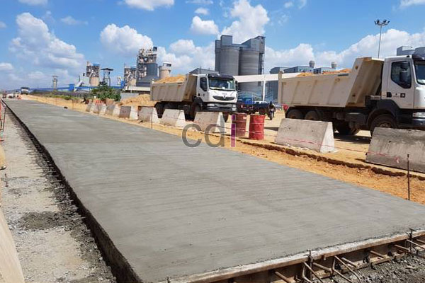

**Biaya Pengecoran Jalan Per M2** - Hai Mitra CDI! Pernahkah Anda bertanya-tanya, berapa sih biaya yang harus disiapkan untuk mengecor jalan? Pertanyaan ini wajar muncul, terutama saat merencanakan perbaikan atau pembangunan jalan baru – entah untuk keperluan pribadi di rumah, atau proyek komersial yang lebih besar. Mengetahui perkiraan biaya pengecoran jalan per meter persegi itu krusial, lho, supaya anggaran proyek tidak melambet.

Di artikel ini, kami akan membahas tuntas cara menghitung biaya pengecoran jalan, faktor-faktor yang memepengaruhinya, dan tips cerdas untuk memaksimalkan anggaran Anda. Yuk, kita mulai!

## Faktor Penentu Biaya Pengecoran Jalan Per M2

Sebelum masuk ke perhitungan, ada baiknya kita pahami dulu apa saja yang bisa bikin biaya pengecoran jalan per m2 bervariasi. Beberapa faktor penting antara lain:

### 1. Mutu Material Bangunan yang Dipilih
Beton adalah material utama pengecoran jalan. Kualitas beton yang dipilih sangat memengaruhi harga. Biasanya, kita mengenal jenis K-225 hingga K-350. Semakin tinggi angka 'K' tersebut, semakin kuat betonnya, dan tentu saja harganya juga akan lebih tinggi. Jenis pasir, kerikil, dan semen yang dipakai juga berpengaruh besar pada biaya total.

### 2. Ketebalan Cor yang Dibutuhkan
Ketebalan cor adalah penentu biaya yang signifikan. Untuk jalan kendaraan ringan, ketebalan 10–15 cm umumnya sudah cukup. Namun, jika jalan akan dilalui kendaraan berat seperti truk, Anda membutuhkan ketebalan 20 cm atau bahkan lebih. Semakin tebal cor, semakin banyak material yang dibutuhkan, dan otomatis biayanya juga meningkat.

### 3. Ukuran Area yang Akan Dicor
Luas area yang akan dicor juga berpengaruh langsung pada total biaya. Semakin luas jalan yang akan dicor, semakin banyak material dan tenaga kerja yang diperlukan. Jadi, pastikan Anda mengukur luas area dengan akurat sebelum memulai proyek.

## Langkah-Langkah Menghitung Biaya Pengecoran Jalan Per M2

Oke, Mitra CDI, setelah menyimak faktor-faktor di atas, mari kita praktikkan cara menghitung biaya pengecoran jalan per m2:

### 1. Menghitung Kebutuhan Material
Langkah pertama adalah menghitung jumlah material yang dibutuhkan, seperti semen, pasir, kerikil, dan air. Contohnya, untuk beton K-225 setebal 10 cm, perkiraan kebutuhan materialnya sekitar 0,1 m3 per m2. Jika luas area jalan yang akan dicor adalah 100 m2, maka total kebutuhan beton adalah 10 m3.

### 2. Mengalikan dengan Harga Material Terbaru
Setelah mendapatkan angka kebutuhan material, kalikan dengan harga material di pasaran. Sebagai gambaran, harga beton siap pakai (ready mix) K-225 bisa berkisar Rp850.000 per m3. Jika Anda membutuhkan 10 m3 beton, total biaya material beton adalah Rp8.500.000.

### 3. Menghitung Biaya Tenaga Kerja
Jangan lupakan biaya tenaga kerja! Rata-rata, biaya tenaga kerja untuk pengecoran jalan berkisar antara Rp50.000–Rp100.000 per m2, tergantung tingkat kesulitan pekerjaan dan lokasi di (not detected). Jika luas area adalah 100 m2 dan biaya tenaga kerja Rp75.000 per m2, maka total biaya tenaga kerja menjadi Rp7.500.000.

Dengan menjumlahkan biaya material dan biaya tenaga kerja, Anda akan mendapatkan total biaya pengecoran jalan per m2.

## Strategi Cerdas Menghemat Biaya Pengecoran Jalan

Siapa yang tidak ingin menghemat biaya, kan, Mitra CDI? Berikut beberapa tips yang bisa Anda terapkan:

### 1. Pilih Material yang Tepat Sesuai Kebutuhan
Tidak semua jalan membutuhkan kualitas beton yang sama. Sesuaikan spesifikasi beton dengan beban yang akan ditanggung oleh jalan tersebut agar bisa menghemat biaya.

### 2. Percayakan pada Jasa Pengecoran Profesional
Mungkin ada godaan untuk mengerjakannya sendiri, tapi ingat! Menggunakan jasa pengecoran jalan profesional seperti Creative Design Interior bisa menghindari kesalahan yang justru bisa merugikan di kemudian hari. Tim kami berpengalaman dan terpercaya untuk proyek pengecoran jalan di (not detected).

### 3. Bandingkan Harga Material dari Berbagai Supplier
Lakukan riset dan bandingkan harga material dari berbagai supplier sebelum membeli. Pastikan Anda mendapatkan harga terbaik tanpa mengorbankan kualitas.

## Kesimpulan

Mitra CDI, biaya pengecoran jalan per m2 memang bisa bervariasi, tergantung banyak faktor. Dengan perhitungan yang cermat dan pemilihan penyedia jasa yang tepat, proyek pengecoran jalan Anda bisa berjalan lancar dengan anggaran yang terkendali.

Jangan ragu untuk berkonsultasi dengan tim Creative Design Interior jika Anda membutuhkan bantuan untuk proyek pengecoran jalan di (not detected). Hubungi kami sekarang juga melalui tombol **Telepon** atau **WhatsApp** di bawah ini untuk mendapatkan penawaran terbaik! [1 m3 beton berapa m2 bekisting: Panduan Praktis Menghitung dan Mengoptimalkan](/blog/1-m3-beton-berapa-m2-bekisting/) 
<table class="table">
  <caption>Estimasi Biaya Material Pengecoran</caption>
  <thead>
    <tr><th>Material</th><th>Satuan</th><th>Harga (Estimasi)</th></tr>
  </thead>
  <tbody>
    <tr><td>Semen</td><td>Kg</td><td>Rp 1.200/kg</td></tr>
    <tr><td>Pasir</td><td>m3</td><td>Rp 150.000/m3</td></tr>
    <tr><td>Kerikil</td><td>m3</td><td>Rp 200.000/m3</td></tr>
    <tr><td>Air</td><td>Liter</td><td>Rp 5.000/Liter</td></tr>
  </tbody>
</table>
