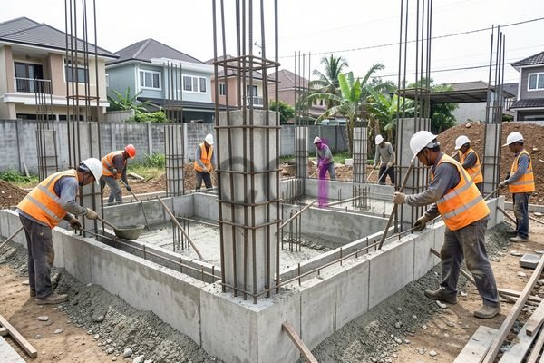

**Biaya Pondasi Rumah Ukuran 6x12: Estimasi Lengkap & Tips Hemat 2026** - Halo Mitra CDI! Membangun rumah impian tentu membutuhkan perencanaan matang, ya? Nah, salah satu hal yang sering terlupakan adalah estimasi biaya pondasi rumah ukuran 6x12 meter. Kesalahan perhitungan di awal bisa berakibat fatal pada anggaran dan kualitas bangunan secara keseluruhan. Yuk, simak panduan lengkap ini agar proyek Anda berjalan lancar!

Pondasi adalah tulang punggung rumah Anda. Kekuatan dan kestabilan bangunan bergantung padanya. Karena itu, memahami faktor-faktor yang memengaruhi biaya pondasi rumah ukuran 6x12 sangat penting. Pemilihan jenis pondasi, kualitas material, kondisi tanah, dan tarif tukang berpengaruh besar pada total biaya. Dengan perhitungan yang tepat, Anda bisa mendapatkan pondasi yang kuat dan awet tanpa menguras dompet.

## Estimasi Biaya Pondasi Rumah Ukuran 6x12 Berdasarkan Jenis Pondasi

Ada beberapa opsi pondasi yang bisa Anda pertimbangkan untuk rumah 6x12. Masing-masing punya kelebihan, kekurangan, serta biaya yang berbeda. Pilihan terbaik tergantung kondisi tanah, desain rumah, dan anggaran Anda. Beberapa yang sering digunakan antara lain pondasi batu kali, pondasi cakar ayam, dan pondasi plat lantai.

Pondasi batu kali adalah opsi paling ekonomis, namun proses pemasangannya cenderung lebih lama. Estimasi biayanya untuk rumah ukuran 6x12 berkisar antara Rp 15.000.000 hingga Rp 25.000.000, sudah termasuk material dan upah tukang. Jika Anda menginginkan kekuatan lebih, terutama untuk tanah yang kurang stabil, pondasi cakar ayam bisa menjadi pilihan. Biayanya umumnya lebih tinggi, yaitu antara Rp 30.000.000 hingga Rp 50.000.000.

Lalu, bagaimana jika tanah di lokasi Anda kurang mendukung? Pondasi plat lantai adalah solusinya! Walaupun biaya awalnya lebih mahal – sekitar Rp 50.000.000 hingga Rp 80.000.000 – pondasi ini menawarkan distribusi beban yang merata dan stabilitas bangunan yang optimal. Perlu diingat, harga-harga ini bersifat estimasi dan bisa berubah sewaktu-waktu. Jangan ragu untuk menghubungi Kami untuk mendapatkan penawaran yang paling akurat dan sesuai dengan proyek Anda di (not detected).

## Faktor-Faktor yang Memengaruhi Biaya Pondasi Rumah 6x12

Selain jenis pondasi, ada beberapa hal lain yang memengaruhi besaran biaya pondasi rumah ukuran 6x12. Kondisi tanah adalah faktor utama. Tanah lunak atau berpasir jelas memerlukan penanganan khusus, seperti pemadatan atau penambahan material, yang tentu akan menambah biaya. Ketinggian muka air tanah juga perlu diperhatikan karena pondasi yang terendam air membutuhkan sistem drainase yang baik.

Kualitas material juga sangat krusial. Memilih material berkualitas rendah memang bisa menekan biaya di awal, tapi berpotensi menimbulkan masalah di kemudian hari. Sebaiknya, gunakan material yang memenuhi standar SNI dan memiliki kekuatan yang terjamin. Jangan lupakan juga tarif upah tukang, yang bervariasi tergantung lokasi dan keahlian mereka.

## Perbandingan Biaya Material Pondasi: Batu Kali vs. Cakar Ayam

Agar lebih jelas, berikut adalah perbandingan biaya material untuk pondasi batu kali dan cakar ayam pada rumah ukuran 6x12 meter (estimasi 2026):

<table class="table">
  <caption>Perbandingan Biaya Material Pondasi</caption>
  <thead>
    <tr><th>Material</th><th>Pondasi Batu Kali (Estimasi)</th><th>Pondasi Cakar Ayam (Estimasi)</th></tr>
  </thead>
  <tbody>
    <tr><td>Batu Kali</td><td>Rp 5.000.000 - Rp 8.000.000</td><td>-</td></tr>
    <tr><td>Pasir</td><td>Rp 1.000.000 - Rp 1.500.000</td><td>Rp 1.000.000 - Rp 1.500.000</td></tr>
    <tr><td>Semen</td><td>Rp 2.000.000 - Rp 3.000.000</td><td>Rp 3.000.000 - Rp 4.000.000</td></tr>
    <tr><td>Besi Beton</td><td>Rp 3.000.000 - Rp 5.000.000</td><td>Rp 6.000.000 - Rp 10.000.000</td></tr>
    <tr><td>Upah Tukang</td><td>Rp 4.000.000 - Rp 7.000.000</td><td>Rp 6.000.000 - Rp 10.000.000</td></tr>
  </tbody>
</table>

Ingat, angka di atas hanyalah perkiraan dan bisa berbeda tergantung lokasi dan penjual. Anda bisa memperluas wawasan dengan menyimak pembahasan tentang [besi untuk pondasi rumah](https://creativedesigninterior.com/blog/besi-untuk-pondasi-rumah/) untuk informasi lebih mendalam.

## Tips Menghemat Biaya Pondasi Rumah Ukuran 6x12

Lalu, bagaimana caranya menghemat biaya pondasi rumah ukuran 6x12 tanpa mengorbankan kualitas? Pertama, lakukan survei tanah yang teliti agar Anda mengetahui kondisi tanah secara pasti. Hasil survei ini akan membantu memilih jenis pondasi yang paling tepat dan menghindari biaya tak terduga akibat perlakuan tanah yang salah. Kedua, bandingkan harga material dari berbagai toko untuk mendapatkan penawaran terbaik.

Ketiga, gunakan jasa tukang yang berpengalaman dan terpercaya. Tukang profesional akan bekerja efisien dan meminimalkan pemborosan material. Keempat, pertimbangkan penggunaan material lokal yang lebih terjangkau, asalkan tetap memenuhi standar kualitas. Untuk strategi penghematan lebih lanjut, Anda juga bisa mengeksplorasi [tips membuat campuran pondasi rumah yang kokoh](https://creativedesigninterior.com/blog/campuran-pondasi-rumah/).

Di (not detected) dan sekitarnya, Kami dari Creative Design Interior (CDI) siap membantu Anda mewujudkan pondasi rumah impian. Jangan ragu untuk menghubungi Kami melalui tombol **Telepon** atau **WhatsApp** di bawah ini jika Anda memiliki pertanyaan lebih lanjut! Kami siap memberikan solusi terbaik untuk proyek Anda.