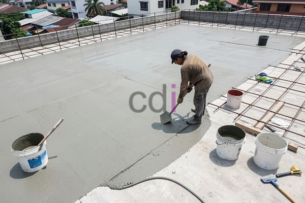

**Biaya Waterproofing Per M2: Panduan Lengkap & Estimasi 2026** - Hai Mitra CDI! Sedang merencanakan pembangunan atau renovasi di (not detected) dan khawatir soal kebocoran? Rembesan air memang masalah klasik yang bisa bikin pusing ya. Nah, di artikel ini, kita akan kupas tuntas soal biaya *waterproofing* per m2, supaya Mitra bisa menyiapkan anggaran dengan lebih baik.

Penting untuk melindungi bangunan dari kerusakan akibat air. Selain merusak struktur, air juga bisa memicu pertumbuhan jamur dan bikin tidak nyaman. Mengaplikasikan sistem *waterproofing* yang tepat adalah investasi penting, tapi berapa sih kira-kira biayanya? Jangan khawatir, Kami akan bantu jabarkan semuanya!

## Apa Saja yang Mempengaruhi Biaya Waterproofing?

Yuk, kita bahas dulu faktor-faktor yang bikin biaya *waterproofing* bisa berbeda-beda. Memahami ini penting, lho, supaya Mitra bisa memilih solusi yang paling sesuai dengan kebutuhan dan budget.

Pertama, jenis material *waterproofing* yang dipilih sangat memengaruhi harga. Ada banyak pilihan di pasaran, mulai dari pelapis membran aspal yang umum, *waterproofing* semen berbasis polimer, hingga pelapis poliuretan yang lebih canggih. Secara umum, material dengan kualitas dan daya tahan lebih tinggi cenderung lebih mahal.

Selain itu, metode aplikasi juga berpengaruh. Pengecoran *waterproofing* (sering dipakai untuk atap) biasanya lebih rumit dan butuh biaya lebih besar dibandingkan aplikasi pelapis pada dinding. Bentuk area yang akan di-*waterproofing* juga penting. Semakin banyak sudut, detail, atau sambungan, semakin banyak material dan tenaga kerja yang dibutuhkan.

## Estimasi Biaya Waterproofing Per M2 di Tahun 2026 (Not Detected)

Supaya lebih jelas, Kami sajikan estimasi biaya *waterproofing* per m2 di (not detected) berdasarkan material dan metode aplikasi yang populer:

| Jenis Waterproofing | Metode Aplikasi | Estimasi Biaya Per M2 (Rp) |
|---|---|---|
| Pelapis Semen Berbasis Polimer | Pelapisan | 80.000 – 150.000 |
| Membran Aspal | Pengecoran/Pelapisan | 120.000 – 200.000 |
| Pelapis Poliuretan | Pelapisan | 250.000 – 400.000 |
| *Waterproofing* Epoxy | Pelapisan | 180.000 – 300.000 |

Ingat ya, ini cuma estimasi! Biaya *waterproofing* bisa berubah tergantung kondisi lapangan dan spesifikasi proyek. Untuk mendapatkan penawaran harga yang paling akurat, jangan ragu untuk menghubungi Kami. Harga di atas juga belum termasuk biaya persiapan permukaan seperti membersihkan area, memperbaiki retakan, atau memberi lapisan primer.

## Memilih Solusi Waterproofing yang Tepat: Sesuaikan dengan Kebutuhan & Budget

Memilih *waterproofing* yang tepat bukan cuma soal harga, tapi juga kebutuhan bangunan Mitra CDI. Kalau budget terbatas, pelapis semen berbasis polimer bisa jadi solusi ekonomis yang cocok untuk area yang jarang terkena air, seperti dinding atau lantai dasar.

Tapi, kalau bangunan Anda butuh perlindungan maksimal, terutama di area rentan seperti atap atau kamar mandi, pelapis poliuretan atau membran aspal lebih disarankan. Meski harganya lebih tinggi, material ini menawarkan daya tahan dan perlindungan yang jauh lebih baik. Untuk area khusus yang terpapar bahan kimia atau abrasi (misalnya lantai pabrik), *waterproofing* epoxy bisa jadi pilihan ideal karena kekuatannya yang luar biasa.

## Kenapa Jasa Profesional Penting untuk Aplikasi Waterproofing?

Mungkin Mitra CDI berpikir bisa memasang *waterproofing* sendiri? Boleh-boleh saja, tapi Kami sangat menyarankan untuk menggunakan jasa profesional. Aplikasi yang salah bisa bikin *waterproofing* gagal total dan justru memperparah masalah kebocoran.

Tim profesional punya pengetahuan, pengalaman, dan peralatan yang lengkap untuk memastikan pemasangan dilakukan dengan benar dan optimal. Ini investasi yang sepadan untuk melindungi aset berharga Anda. [Bekisting Plat Lantai: Panduan Lengkap Material, Aplikasi, dan Estimasi Biaya 2026](/blog/bekisting-plat-lantai/) bisa jadi referensi tambahan untuk konstruksi bangunan yang kokoh.

Tertarik dengan layanan *waterproofing* berkualitas dari Kami? Jangan ragu untuk menghubungi Kami melalui tombol **Telepon** atau **WhatsApp** yang ada di bawah ini. Kami siap membantu mewujudkan bangunan impian Mitra CDI!