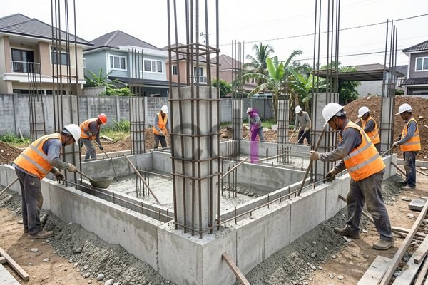

**Bikin Pondasi Rumah 2 Lantai: Panduan Lengkap, Biaya, dan Material Terbaik** - Hai Mitra CDI! Membangun rumah dua lantai adalah impian banyak orang. Tapi, tahukah Mitra bahwa kunci utama kenyamanan dan keamanan rumah impian itu terletak pada pondasi yang kokoh? Pondasi yang baik akan menopang seluruh struktur bangunan, apalagi untuk rumah bertingkat. Artikel ini hadir untuk membimbing Mitra memahami seluk-beluk pembuatan pondasi rumah 2 lantai, mulai dari perencanaan, material yang tepat, perkiraan biaya, sampai tips memilih tukang yang handal. Yuk, simak lebih lanjut!

## Merencanakan Fondasi: Jenis yang Tepat untuk Rumah 2 Lantai Anda

Sebelum memulai konstruksi, perencanaan pondasi rumah 2 lantai sangat krusial. Beberapa hal perlu dipertimbangkan: kondisi tanah di lokasi (not detected), beban bangunan, dan desain arsitektur rumah. Setiap jenis tanah membutuhkan pendekatan yang berbeda. Misalnya, untuk tanah yang relatif stabil, pondasi batu kali atau pondasi tapak bisa menjadi pilihan yang ekonomis. Sebaliknya, tanah lunak atau area dengan potensi gempa memerlukan solusi yang lebih kuat, seperti pondasi menerus, tiang pancang, bahkan pondasi apung.

Pondasi menerus umumnya cocok untuk mendistribusikan beban secara merata, sedangkan pondasi tiang pancang sangat efektif di tanah yang kurang padat. Pemilihan yang tepat akan berdampak langsung pada keamanan dan ketahanan bangunan. Sangat disarankan untuk lakukan uji tanah sebelum menentukan jenis pondasi. Hasil uji tanah akan memberikan informasi detail tentang karakteristik tanah di (not detected), sehingga Mitra bisa membuat keputusan yang paling tepat.

## Material Pondasi: Apa Saja yang Dibutuhkan?

Material pondasi yang umum digunakan meliputi batu kali, semen, pasir, besi beton, dan tentu saja, beton cor. Batu kali berfungsi sebagai agregat kasar untuk memberikan kekuatan. Semen dan pasir dicampur menjadi mortar, yang bertugas sebagai perekat antar batu kali. Besi beton berperan penting dalam memperkuat struktur pondasi dan mencegah keretakan akibat tekanan atau beban. 

Untuk mendapatkan hasil yang optimal, gunakan beton dengan mutu minimal K-250. Diameter besi beton juga perlu diperhatikan; biasanya berkisar antara 10 mm hingga 16 mm, tergantung pada perhitungan struktur bangunan. Jangan lupakan penggunaan *waterproofing* pada bagian pondasi yang bersentuhan langsung dengan tanah, ya! Ini penting untuk mencegah rembesan air yang bisa merusak struktur dari waktu ke waktu. Tertarik mengetahui lebih detail tentang material pondasi berkualitas? [Batu Cor Pondasi: Pilihan Terbaik untuk Konstruksi Rumah Kokoh](/blog/batu-cor-pondasi/) bisa menjadi referensi yang sangat berguna.

## Berapa Biaya yang Harus Disediakan?

Estimasi biaya pembuatan pondasi rumah 2 lantai bisa sangat bervariasi, tergantung jenis pondasi yang dipilih, luas bangunan di (not detected), kondisi tanah, dan harga material setempat. Berikut gambaran kasar per meter persegi:

<table class="table">
  <caption>Estimasi Biaya Pondasi Rumah 2 Lantai (Per Meter Persegi)</caption>
  <thead>
    <tr><th>Jenis Pondasi</th><th>Kisaran Biaya (Rp)</th><th>Keterangan</th></tr>
  </thead>
  <tbody>
    <tr><td>Pondasi Batu Kali</td><td>Rp 300.000 – Rp 500.000</td><td>Cocok untuk tanah stabil dan beban ringan</td></tr>
    <tr><td>Pondasi Menerus</td><td>Rp 500.000 – Rp 800.000</td><td>Ideal untuk beban merata dan tanah sedang</td></tr>
    <tr><td>Pondasi Tiang Pancang</td><td>Rp 1.000.000 – Rp 2.000.000+</td><td>Wajib untuk tanah lunak atau rawan gempa</td></tr>
  </tbody>
</table>

Perlu diingat, angka ini hanya estimasi dan bisa berubah sewaktu-waktu. Untuk mendapatkan penawaran yang paling akurat sesuai kebutuhan proyek Mitra CDI, jangan sungkan untuk menghubungi Kami. Selain biaya material dan tenaga kerja, jangan lupa masukkan biaya pengujian tanah dan perizinan ke dalam anggaran.

## Tips Cerdas Memilih Jasa Pembuatan Pondasi

Memilih jasa pembuatan pondasi rumah 2 lantai yang tepat adalah langkah krusial. Jasa yang profesional dan berpengalaman akan memastikan kualitas dan keamanan bangunan Mitra. Berikut beberapa tips yang bisa diterapkan:

*   **Lihat Hasil Kerja Mereka:** Minta portofolio proyek-proyek yang pernah mereka tangani.
*   **Pastikan Legalitasnya:** Cek apakah mereka memiliki izin usaha yang sah.
*   **Bandingkan Beberapa Penawaran:** Dapatkan beberapa penawaran harga untuk mendapatkan yang paling sesuai.
*   **Perhatikan Kualitas Material:** Tanyakan jenis material yang akan digunakan dan pastikan kualitasnya terjamin.
*   **Diskusikan dengan Ahli:** Konsultasikan dengan ahli konstruksi untuk mendapatkan perspektif yang lebih objektif.

Pilihlah jasa yang berani memberikan garansi atas pekerjaan mereka. Ini adalah jaminan kualitas yang penting bagi Mitra CDI. Jangan ragu bertanya tentang detail teknis dan mintalah penjelasan yang jelas mengenai setiap tahapan pekerjaan. Untuk informasi lebih lanjut terkait material dan biaya, [Besi untuk Pondasi Rumah: Jenis, Ukuran, dan Estimasi Biaya Terbaru 2026](/blog/besi-untuk-pondasi-rumah/) bisa menjadi sumber yang bermanfaat.

Butuh bantuan segera untuk proyek di (not detected)? Klik tombol **WhatsApp** atau **Telepon** di bawah untuk berkonsultasi dengan tim Kami. Jangan tunda lagi, pondasi yang kuat adalah investasi jangka panjang untuk rumah impian Mitra CDI.