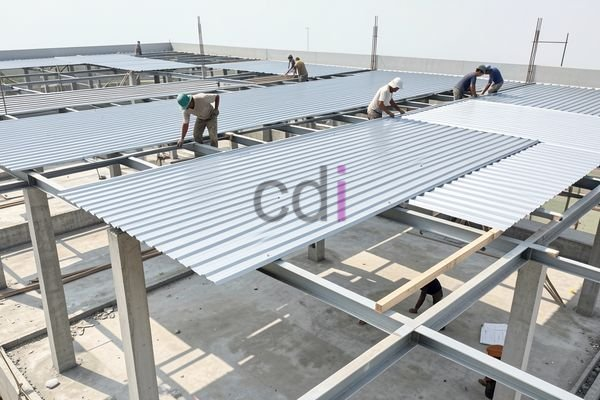

**Bondek 0.75: Ketebalan Ideal untuk Konstruksi Ringan dan Ekonomis** - Hai Mitra CDI! Sedang mencari solusi konstruksi yang efisien dan hemat biaya di (not detected)? Nah, bondek 0.75 bisa jadi jawabannya! Material ini semakin populer di kalangan kontraktor dan pemilik proyek karena keunggulannya yang praktis.

**Apa Saja Keunggulan Bondek 0.75?**

Bondek 0.75 itu apa sih? Singkatnya, ini adalah pelat baja ringan bergelombang yang digunakan sebagai pengganti bekisting kayu saat pengecoran beton. Ketebalan 0.75 mm menghadirkan kombinasi ideal antara kekuatan, bobot yang ringan, dan harga yang bersaing. Dengan menggunakan bondek, proses pengecoran jadi lebih cepat karena enggak perlu repot memasang dan membongkar perancah kayu yang memakan waktu.

Bukan cuma itu, lho! Bondek 0.75 juga menghasilkan permukaan beton yang lebih halus dan rata, meminimalkan kebutuhan finishing. Material ini juga tahan terhadap korosi, apalagi kalau sudah dilapisi galvanis atau galvalum. Bayangkan, perawatan jadi lebih mudah dan bangunan lebih awet! Bobotnya yang ringan juga bikin proses pengangkutan dan pemasangan di lokasi proyek di (not detected) jadi lebih praktis.

**Di Mana Saja Bondek 0.75 Bisa Dipakai?**

Fleksibilitas bondek 0.75 menjadikannya pilihan tepat untuk berbagai proyek konstruksi. Aplikasi utamanya adalah untuk atap atau dak bangunan rendah hingga menengah. Mulai dari rumah tinggal, gudang, pabrik, hingga bangunan komersial, semuanya bisa memanfaatkan kekuatan bondek ini. 

Selain itu, bondek 0.75 juga sering dipakai untuk lantai *mezzanine*, struktur penopang atap, bahkan pelapis dinding eksterior. Kemudahan dalam memotong dan membentuknya memungkinkan penyesuaian dengan berbagai desain arsitektur yang unik. Ingat ya, Mitra, kekuatan dan daya tahan bondek sangat bergantung pada kualitas material dan teknik pemasangan yang benar.  Mau tahu lebih banyak tentang teknik pemasangan yang tepat? Cek dulu artikel ini: [Begini Cara Memasang Bondek yang Benar](/blog/atap-bondek-cor/).

**Bandingkan Bondek 0.75 dengan Pilihan Lain**

Penting banget untuk memilih ketebalan bondek yang sesuai dengan kebutuhan proyek. Berikut ini perbandingan antara bondek 0.75 dengan ketebalan lainnya:

<table class="table">
  <caption>Perbandingan Bondek Berdasarkan Ketebalan</caption>
  <thead>
    <tr><th>Ketebalan Bondek</th><th>Kekuatan Tarik (MPa)</th><th>Berat (kg/m²)</th><th>Rentang Aplikasi</th><th>Estimasi Harga (Rp/m²)</th></tr>
  </thead>
  <tbody>
    <tr><td>0.50 mm</td><td>280</td><td>4-5</td><td>Struktur ringan, kanopi</td><td>80.000 - 120.000</td></tr>
    <tr><td>0.75 mm</td><td>350</td><td>6-7</td><td>Dak rumah, gudang kecil</td><td>120.000 - 180.000</td></tr>
    <tr><td>1.00 mm</td><td>420</td><td>8-9</td><td>Bangunan komersial, pabrik</td><td>180.000 - 250.000</td></tr>
  </tbody>
</table>

Dari tabel di atas, Mitra CDI bisa lihat kalau bondek 0.75 menawarkan kekuatan yang memadai untuk aplikasi umum seperti dak rumah atau gudang kecil, dengan berat yang masih manageable dan harga yang bersahabat.  Untuk info harga terkini dan penawaran khusus, jangan ragu untuk menghubungi Kami ya!  Karena harga sangat bergantung pada kondisi pasar dan spesifikasi proyek. Semakin tebal bondek, tentu saja kemampuannya menahan beban juga semakin besar, tapi bobot dan harganya juga ikut naik.

**Berapa Biaya yang Perlu Disiapkan?**

Biaya penggunaan bondek 0.75 bervariasi, tergantung luas area, kerumitan desain, dan harga material saat ini. Secara umum, biaya pemasangan bondek 0.75 berkisar antara Rp 120.000 hingga Rp 180.000 per meter persegi, sudah termasuk material, biaya pemasangan, dan transportasi.

Tapi ingat, angka ini belum mencakup biaya pengecoran beton, tulangan, dan finishing ya.  Untuk estimasi yang lebih tepat, sebaiknya konsultasikan langsung dengan tim Kami. Kami akan survei lokasi proyek Mitra CDI di (not detected) dan berikan penawaran yang sesuai dengan kebutuhan Anda. Ingin tahu lebih detail soal biaya dak beton?  Artikel Biaya Dak Beton Bondek: Rincian Lengkap & Estimasi 2026 bisa jadi referensi yang berguna. Jangan lupa juga pertimbangkan potensi penghematan jangka panjang dengan menggunakan bondek, seperti yang dibahas di [Inilah Alasan Kenapa Bondek Jauh Lebih Murah](/)!

Butuh bantuan atau konsultasi lebih lanjut? Jangan sungkan menghubungi Kami sekarang juga melalui tombol **WhatsApp** atau **Telepon** yang ada di halaman ini. Kami siap membantu Mitra CDI mewujudkan proyek impian Anda!