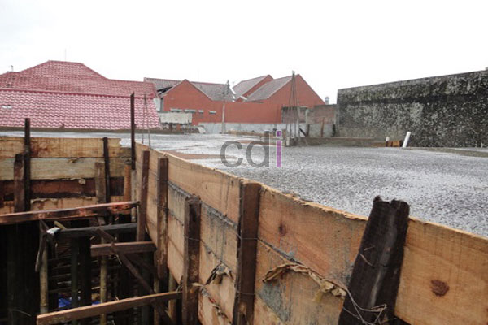

**Bongkar Bekisting Kolom Berapa Hari? Tips dan Penjelasan Lengkap** - Hai Mitra CDI! Pernahkah Anda bertanya-tanya, kapan waktu yang tepat untuk melepas bekisting kolom? Terutama jika Anda sedang membangun di (not detected) dan sekitarnya, memahami teknik dan momen yang pas itu penting sekali untuk memastikan kekuatan dan ketahanan bangunan. Yuk, kita kupas tuntas soal ini!

Kesalahan dalam menentukan waktu bongkar bekisting kolom bisa menimbulkan masalah serius – entah kolom retak karena tergesa-gesa, atau proyek jadi terlambat karena menunggu terlalu lama. Kami sering menemukan kedua situasi ini di lapangan, padahal sebenarnya bisa dihindari jika Mitra CDI memahami apa yang sebenarnya dipertaruhkan.

Mungkin terdengar mengejutkan, tapi seringkali kedua masalah ini berakar pada tujuan yang sama: mempercepat penyelesaian proyek. Hanya saja, satu opsi berpotensi membahayakan struktur, sementara yang lain berdampak pada biaya dan efisiensi waktu.

## Memahami Peran Bekisting Kolom

Bekisting kolom adalah cetakan sementara yang digunakan untuk membentuk, menahan, dan menyangga beton selama proses pengerasan. Dalam konstruksi, bekisting ini krusial karena memastikan beton memiliki bentuk dan dimensi yang akurat sesuai desain. 

Material bekisting umumnya terbuat dari kayu, baja, atau plastik. Kayu dan baja adalah pilihan populer karena kekuatan dan kemudahan penggunaannya. Namun, perlu diingat, waktu pembongkaran bekisting ini tidak boleh sembarangan. Terlalu cepat bisa menyebabkan beton retak, sedangkan terlalu lama justru mengurangi efisiensi kerja.

## Apa yang Terjadi Jika Terlalu Cepat Membongkar Bekisting?

Ini adalah skenario yang paling berisiko. Jika bekisting dilepas sebelum beton mencapai kekuatan minimal (biasanya di bawah 70% dari mutu rencana), beberapa masalah bisa muncul:

- **Kolom Melendut atau Bengkok** — Beton yang belum sepenuhnya mengeras tidak mampu menahan bebannya sendiri, apalagi jika ada beban tambahan dari struktur di atasnya.
- **Retak Rambut hingga Retak Struktural** — Tekanan internal yang belum stabil dapat menyebabkan permukaan beton pecah saat penyangga dilepas.
- **Permukaan Keropos (Honeycomb)** — Bagian beton yang belum mengeras sempurna bisa rontok ketika bekisting dicongkel secara paksa.

Perbaikan atas kerusakan ini seringkali lebih mahal dan memakan waktu daripada jika Mitra CDI sedikit lebih bersabar. Dalam kasus terparah, kolom yang sudah rusak strukturnya mungkin harus dibongkar dan dicor ulang sepenuhnya.

## Dampak Membiarkan Bekisting Terpasang Terlalu Lama

Sebaliknya, membiarkan bekisting tetap terpasang terlalu lama juga memiliki konsekuensi:

- **Bekisting Kayu Menempel** pada permukaan beton, terutama jika tidak diberi minyak bekisting sebelum pengecoran. Akibatnya, permukaan kolom bisa rusak saat bekisting dipaksa dilepas.
- **Penundaan Jadwal Proyek**, karena tahap finishing dan pekerjaan selanjutnya biasanya harus menunggu sampai bekisting dibongkar.
- **Biaya Sewa Bekisting Meningkat** jika menggunakan sistem sewa harian, terutama untuk proyek dengan banyak kolom yang jadwal pembongkarannya seragam.

## Rekomendasi Waktu Pembongkaran di Wilayah (not detected)

Berdasarkan pengalaman proyek-proyek Kami di wilayah (not detected), kolom dengan campuran beton standar umumnya aman dibongkar setelah **7 hari** untuk memastikan kekuatan optimal. Namun, pada kondisi cuaca kering dan beton berkemampuan tinggi, 2-3 hari mungkin sudah cukup untuk kolom-kolom kecil yang tidak menanggung beban struktural utama.

Perbedaan waktu ini bukan tanpa alasan. Musim hujan di (not detected) bisa memperlambat proses pengerasan beton secara signifikan dibandingkan musim kemarau. Oleh karena itu, jangan gunakan jangka waktu yang sama untuk kedua kondisi cuaca tersebut.

## Strategi Meminimalkan Risiko

Solusi terbaik bukanlah menghafal satu angka pasti, melainkan mengombinasikan estimasi waktu dengan pemeriksaan langsung – seperti uji ketukan, alat pengukur sederhana, atau evaluasi visual kondisi cuaca dalam beberapa hari terakhir. Pastikan juga untuk mencatat tanggal pengecoran setiap kolom secara akurat, agar tim lapangan dapat menentukan jadwal pembongkaran yang tepat tanpa menebak-nebak.

## Pengaruh Musim Kemarau dan Musim Hujan

Dari pengalaman Kami mengerjakan proyek di (not detected), perbedaan waktu pembongkaran antara musim kemarau dan musim hujan dapat mencapai 2-3 hari untuk kolom berukuran standar. Selama musim hujan, Kami merekomendasikan waktu tunggu minimal 5 hari sebelum pembongkaran. Sebaliknya, di musim kemarau dengan paparan sinar matahari yang konsisten, 3 hari umumnya cukup untuk memberikan margin keamanan yang memadai – tetap dengan melakukan verifikasi ketukan sebelum pembongkaran dilakukan.

## Pentingnya Dokumentasi Waktu Pengecoran

Dalam proyek yang melibatkan banyak kolom dengan tanggal pengecoran yang berbeda, pencatatan tanggal pengecoran setiap kolom secara sistematis sangat membantu tim lapangan untuk menentukan jadwal pembongkaran yang tepat, menghindari perkiraan yang tidak akurat, dan mengurangi ketergantungan pada ingatan.

## Kesimpulan

Jadi, berapa hari waktu yang ideal untuk membongkar bekisting kolom? Jawabannya tergantung pada tingkat risiko yang siap Anda ambil. Terburu-buru berpotensi membahayakan struktur, sementara menunggu terlalu lama dapat menaikkan biaya dan memperlambat proyek. Keseimbangan adalah kuncinya, dan verifikasi langsung selalu lebih bisa diandalkan daripada sekadar menebak-nebak. 

Jika proyek konstruksi Mitra CDI di (not detected) membutuhkan bantuan untuk memastikan timing yang tepat, jangan ragu untuk menghubungi Kami melalui tombol **Telepon** atau **WhatsApp** yang tersedia di halaman bawah ini.  Mari kita wujudkan proyek impian Anda dengan aman dan efisien! [1 Kubik Air Berapa Kg? Penjelasan Lengkap dan Contoh Perhitungan](/blog/1-kubik-air-berapa-kg/)