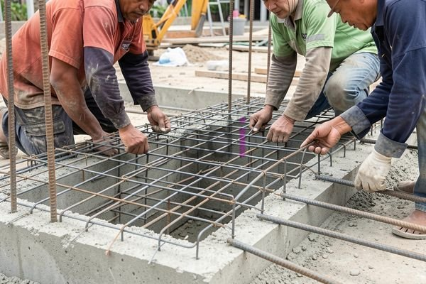

**Borongan Pasang Wiremesh: Estimasi Biaya, Tips, & Hal Penting 2026** - Hai Mitra CDI! Sedang merencanakan konstruksi di (not detected) dan mempertimbangkan *wiremesh* untuk memperkuat struktur beton? Pilihan cerdas! Tapi, sebelum lanjut, mari kita bahas tuntas soal borongan pemasangan *wiremesh* – biaya, tips memilih penyedia jasa, dan hal-hal penting lainnya yang perlu Mitra tahu.

## Kenapa Jasa Borongan Pasang Wiremesh Lebih Praktis?

Mitra, kenapa sih sebaiknya memilih jasa borongan pemasangan *wiremesh*? Ada beberapa alasan menariknya. Pertama, urusan waktu jadi lebih efisien. Tim profesional bisa bekerja lebih cepat daripada kalau Mitra mengerjakan sendiri. Kedua, kualitas pemasangan terjamin. Mereka paham betul standar yang berlaku, jadi kekuatan struktur beton Mitra lebih terjamin. Ketiga, risiko kesalahan minimal. Pemasangan yang kurang tepat bisa mengurangi efektivitas *wiremesh*, dan kontraktor berpengalaman akan menghindari kesalahan ini.

Selain itu, jasa borongan biasanya mencakup semuanya – pengadaan material sampai selesai pemasangan. Jadi, Mitra bisa fokus ke bagian lain dari proyek. Nah, di Creative Design Interior (CDI) kami paham betul bagaimana pentingnya kelancaran proyek konstruksi Mitra. Yuk, temukan Distributor Wiremesh Terbaik untuk mendapatkan material berkualitas!

## Kisaran Biaya Borongan Pasang Wiremesh di 2026

Oke, sekarang kita bahas soal biaya. Estimasi biaya borongan pemasangan *wiremesh* itu bisa naik turun, tergantung beberapa faktor. Luas area yang akan dicor adalah yang utama, begitu juga dengan ketebalan *wiremesh* yang dibutuhkan. Spesifikasi *wiremesh* – seperti diameter kawat dan ukuran lubangnya – juga mempengaruhi harga. Kondisi akses ke lokasi proyek dan kondisi lapangan juga bisa menambah biaya.

Untuk gambaran, di tahun 2026, biaya borongan pemasangan wiremesh di (not detected) dan wilayah sekitarnya diperkirakan berkisar antara Rp 40.000 hingga Rp 70.000 per meter persegi. Perlu diingat, ini masih estimasi, ya. Untuk penawaran yang lebih akurat sesuai kebutuhan proyek Mitra CDI, silakan hubungi Kami. Biaya ini umumnya sudah termasuk upah tukang, biaya transportasi material, dan biaya pemasangan.

## Faktor Penentu Harga Borongan: Apa Saja?

Selain luas area dan spesifikasi *wiremesh*, ada beberapa faktor lain yang memengaruhi harga borongan. Misalnya, kepadatan tulangan *wiremesh* yang diinginkan. Semakin padat, semakin banyak material yang dibutuhkan, dan harga juga akan lebih tinggi. Kondisi bangunan yang sudah ada juga berpengaruh. Kalau perlu pembongkaran atau persiapan khusus sebelum pemasangan *wiremesh*, biayanya akan bertambah.

Desain proyek juga jadi pertimbangan. Semakin rumit desainnya, semakin banyak waktu dan tenaga kerja yang dibutuhkan, yang otomatis mempengaruhi harga borongan. Kami sarankan Mitra CDI untuk selalu meminta penawaran dari beberapa kontraktor berbeda dan bandingkan rinciannya sebelum memutuskan. Ini penting supaya Mitra dapat harga yang paling kompetitif dan sesuai dengan kebutuhan.

## Tips Memilih Jasa Borongan Pasang Wiremesh Terbaik

Memilih kontraktor borongan pemasangan *wiremesh* yang tepat itu penting banget, Mitra. Pastikan kontraktor punya pengalaman yang cukup dan reputasi yang baik di (not detected). Cek portofolio proyek-proyek mereka sebelumnya untuk melihat kualitas pekerjaannya.

Jangan lupa periksa legalitas kontraktor. Pastikan mereka punya izin usaha yang sah dan terdaftar secara resmi. Minta referensi dari klien sebelumnya dan hubungi mereka untuk menanyakan pengalaman mereka dengan kontraktor tersebut. Kontraktor yang profesional akan memberikan penawaran yang transparan, rinci, dan bersedia menjawab pertanyaan Mitra dengan jelas. Pastikan juga mereka punya asuransi yang memadai untuk melindungi Mitra dari risiko selama pemasangan. Kami di Creative Design Interior siap membantu Mitra CDI menemukan partner yang tepat! [Cek juga panduan lengkap tentang Atap Bondek Cor](/blog/atap-bondek-cor/) untuk menambah informasi proyek Mitra.

Butuh bantuan langsung untuk proyek Mitra CDI? Jangan ragu klik tombol **WhatsApp** atau **Telepon** di bawah dan tim Kami siap membantu!