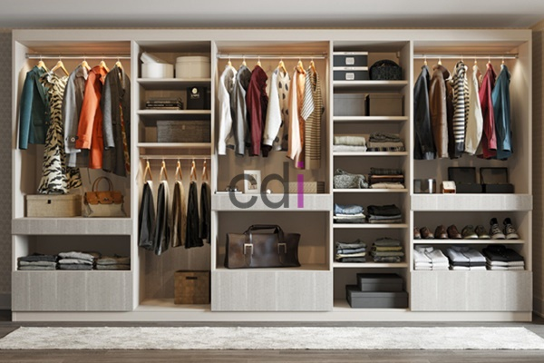

**Buat Lemari Gantung Dapur: Solusi Ruang Rapi & Estetis** - Hai Mitra CDI! Ruang dapur sering jadi pusat kegiatan di rumah, ya? Tapi, sering juga jadi tantangan urusan kerapian. Peralatan masak berserakan, bumbu susah dicari, bikin dapur terasa sempit dan kurang nyaman. Nah, solusi tepatnya? Membuat lemari gantung dapur yang pas dengan kebutuhan dan desain dapur Anda! Kami di Creative Design Interior siap membantu mewujudkannya.

## Manfaatkan Ruang Vertikal dengan Lemari Gantung

Pernah merasa ruang dapur terbatas? Jangan khawatir! Lemari gantung dapur adalah ide brilian untuk memaksimalkan ruang vertikal yang sering terlewatkan. Dengan memasang lemari di dinding, Anda dapat menambah area penyimpanan tanpa memakan tempat di lantai. Ini solusi sempurna untuk menata peralatan masak, piring, bahan makanan kering, dan perlengkapan dapur lainnya.

Lebih dari sekadar fungsi penyimpanan, lemari gantung juga bisa jadi elemen dekoratif yang mempercantik dapur. Tentu saja, pilih desain yang selaras dengan gaya interior dapur Anda untuk menciptakan suasana yang harmonis. Creative Design Interior menawarkan beragam pilihan desain lemari gantung dapur, dari minimalis modern hingga klasik elegan—semuanya bisa Kami kustomisasi sesuai keinginan Mitra.

## Pemilihan Material dan Desain Lemari yang Ideal

Memilih material lemari gantung dapur itu krusial, lho! Tujuannya? Memastikan lemari awet, tahan lama, dan tentu saja, cantik. Material yang umum digunakan antara lain kayu solid, multiplek, MDF (Medium Density Fiberboard), dan HPL (High-Pressure Laminate). Masing-masing punya kelebihan minusnya sendiri. Kayu solid kuat dan alami, tapi butuh perawatan ekstra. Multiplek dan MDF lebih terjangkau dan mudah dibentuk, tapi kurang tahan lembap. HPL praktis dan tahan lama, meski tampilannya kurang menyerupai kayu asli.

Desain lemari gantung juga perlu diperhatikan. Pertama, sesuaikan tinggi lemari dengan tinggi langit-langit dapur. Lemari terlalu tinggi sulit dijangkau, terlalu rendah bisa mengganggu pergerakan. Kedua, perhatikan posisi peralatan dapur lain—kompor, *sink*, kulkas. Pastikan lemari tidak menghalangi akses. Ketiga, pikirkan kebutuhan penyimpanan Anda. Kalau banyak peralatan masak, pilih lemari dengan rak banyak dan luas. Kalau lebih dominan menyimpan bahan makanan, pertimbangkan lemari pintu kaca agar isinya mudah terlihat.

## Creative Design Interior: Mitra Terbaik untuk Lemari Gantung Dapur

Creative Design Interior berpengalaman lebih dari 10 tahun dalam pembuatan furniture *custom*, termasuk lemari gantung dapur. Kami tawarkan layanan lengkap—mulai dari desain, pembuatan, pengiriman, hingga pemasangan. Mitra dapat memilih beragam material, desain, dan finishing sesuai selera dan anggaran. Daftar Harga tersedia untuk informasi lebih detail. Kami juga memberikan gratis ongkir untuk area tertentu di (not detected).

Kami paham bahwa setiap dapur itu unik. Itulah mengapa Kami sediakan konsultasi gratis untuk membantu Anda menentukan desain lemari yang paling pas dengan kebutuhan dan anggaran. Tim ahli Kami akan memastikan setiap lemari gantung dapur yang Kami buat berkualitas tinggi dan dikerjakan dengan rapi. Plus, Kami berikan garansi produk dan layanan purna jual demi kenyamanan Anda.

Tertarik mempercantik dapur dengan lemari gantung berkualitas? Jangan ragu untuk menghubungi Kami! Dapatkan penawaran terbaik dan konsultasi gratis dengan tim ahli Kami. Yuk, wujudkan dapur impian Anda bersama Creative Design Interior di (not detected)! Untuk informasi lebih lanjut, Mitra bisa klik tombol **WhatsApp** atau **Telepon** di halaman ini. Kami siap membantu! [Lemari Kayu 3 Pintu: Solusi Penyimpanan Optimal untuk Ruang Tidur Modern](/blog/lemari-kayu-3-pintu/) bisa jadi inspirasi tambahan untuk desain interior rumah Anda.