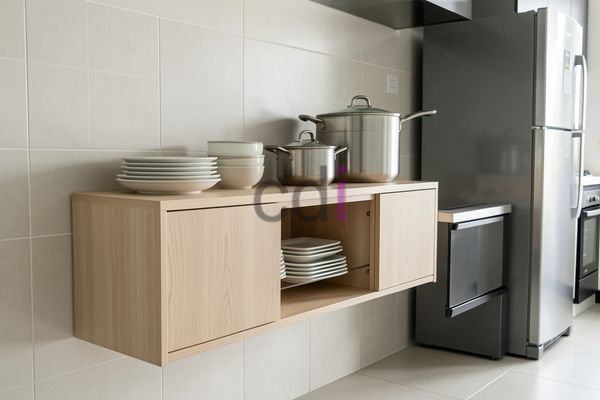

**Bufet Dapur Gantung Minimalis: Pilihan Hemat Ruang & Estetika Modern** - Hai Mitra CDI! Punya dapur yang terasa sempit? Atau ingin tampilan dapur yang lebih ringkas dan modern? Bufet dapur gantung minimalis bisa jadi jawabannya! Solusi ini nggak cuma menghemat ruang, tapi juga bikin dapur terlihat lebih rapi dan estetik. Yuk, simak lebih lanjut!

### Mengapa Bufet Dapur Gantung Minimalis Jadi Pilihan?

Banyak banget alasan kenapa bufet dapur gantung minimalis lagi jadi favorit. Selain membebaskan area lantai, desainnya yang simpel dan bersih bisa memberikan kesan luas pada dapur. Fleksibilitasnya juga juara—ukuran dan desainnya bisa disesuaikan dengan kebutuhan dan gaya dapur Mitra. Apalagi, barang-barang yang sering dipakai jadi lebih mudah dijangkau. Nah, di Creative Design Interior, Kami paham betul pentingnya perencanaan yang matang dalam desain interior. Bufet dapur gantung minimalis adalah salah satu solusi cerdas yang bisa Kami tawarkan.

### Material yang Tepat untuk Bufet Dapur Gantung Minimalis

Pemilihan material kunci banget biar bufet dapur gantung minimalis awet dan sesuai budget. Ada beberapa opsi yang sering digunakan:

*   **Multipleks:** Harganya terjangkau dan mudah dibentuk. Tapi, perlu diperhatikan ketahanannya terhadap kelembapan.
*   **Kayu Solid:** Memberikan kesan mewah dan tahan lama, misalnya jati atau mahoni. Tapi, dari segi harga memang lebih tinggi.
*   **Particle Board:** Pilihan yang paling ekonomis, tapi kurang tahan lama dibandingkan material lain.
*   **MDF (Medium Density Fiberboard):** Permukaannya halus dan cocok untuk finishing cat. Ketahanannya sedang dan harganya cukup bersahabat.

Sebagai perusahaan yang sudah berkecimpung lebih dari 10 tahun di dunia furniture interior, Kami merekomendasikan penggunaan multipleks berkualitas tinggi dengan finishing *melamine* atau *HPL*. Perpaduan ini memberikan keseimbangan terbaik antara harga dan durabilitas. Material ini cukup kuat menahan beban, tahan terhadap goresan, dan perawatannya juga mudah. Untuk informasi lebih lanjut mengenai harga bufet dapur gantung minimalis, silahkan lihat  atau hubungi Kami untuk mendapatkan penawaran khusus sesuai dengan kebutuhan proyek Mitra.

### Panduan Memilih & Mendesain Bufet Dapur Gantung Minimalis

Sebelum memesan atau membuat bufet dapur gantung minimalis, ada beberapa hal yang perlu diperhatikan. Pertama, ukur ruang dapur dengan teliti. Pastikan ukuran bufet pas dan tidak mengganggu aktivitas di dapur. Kedua, sesuaikan desain bufet dengan gaya dapur secara keseluruhan.

Berikut adalah perbandingan beberapa pilihan material untuk bufet dapur gantung minimalis:

<table class="table">
  <caption>Perbandingan Material Bufet Dapur Gantung</caption>
  <thead>
    <tr><th>Material</th><th>Kelebihan</th><th>Kekurangan</th><th>Estimasi Harga</th></tr>
  </thead>
  <tbody>
    <tr><td>Multipleks</td><td>Ekonomis, mudah diproses</td><td>Kurang tahan lembab</td><td>Rp 1.500.000 - Rp 3.000.000</td></tr>
    <tr><td>Kayu Solid</td><td>Tahan lama, mewah</td><td>Mahal</td><td>Rp 3.000.000 - Rp 8.000.000</td></tr>
    <tr><td>Particle Board</td><td>Sangat ekonomis</td><td>Kurang tahan lama</td><td>Rp 800.000 - Rp 1.500.000</td></tr>
    <tr><td>MDF</td><td>Permukaan halus, mudah dicat</td><td>Ketahanan sedang</td><td>Rp 1.200.000 - Rp 2.500.000</td></tr>
  </tbody>
</table>

Kami di Creative Design Interior melayani pembuatan bufet dapur gantung minimalis *custom*. Mitra bisa tentukan sendiri ukuran, desain, dan materialnya. Kami juga menyediakan konsultasi desain gratis untuk membantu Mitra menemukan bufet yang paling pas dengan kebutuhan dan budget. Selain itu, kami juga melayani pembuatan [Lemari Buku Gantung](https://creative-design-interior.com/blog/contoh-rak-buku-gantung/) bagi Anda yang membutuhkan solusi penyimpanan yang serupa.

### Creative Design Interior: Partner Terpercaya untuk Bufet Dapur Gantung Minimalis

Sebagai penyedia jasa desain interior dan furniture custom, Kami berkomitmen untuk memberikan solusi bufet dapur gantung minimalis berkualitas dengan harga yang kompetitif. Kami hanya menggunakan material terbaik dan pengerjaan oleh tim yang ahli. Harga yang Kami tawarkan sudah *all-in*, termasuk material, pengiriman, dan pemasangan. Selain itu, tersedia juga gratis ongkos kirim untuk wilayah tertentu. Untuk kemudahan pembayaran, Kami menawarkan beberapa opsi, mulai dari COD, transfer bank, DP 50%, hingga cicilan. Kami melayani wilayah (not detected), Jakarta, Bogor, Depok, Tangerang, Bekasi, Cikarang, Karawang, Bandung, Serang, Purwakarta, Cilegon, Cikampek, Subang, dan Rangkasbitung. Jangan ragu untuk menghubungi Kami untuk mendapatkan penawaran terbaik dan mewujudkan dapur impian Mitra.

Tim Kami siap membantu merealisasikan proyek Mitra CDI — silakan hubungi melalui tombol **Telepon** atau **WhatsApp** yang tersedia di bawah. Kami juga menyediakan layanan pembuatan [Etalase Rak Piring Minimalis](https://creative-design-interior.com/blog/etalase-rak-piring-minimalis/) bagi Anda yang ingin desain dapur yang lengkap.