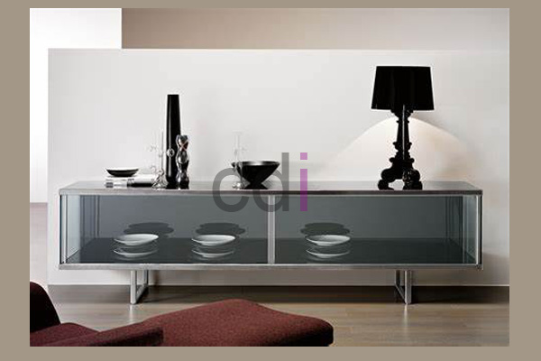
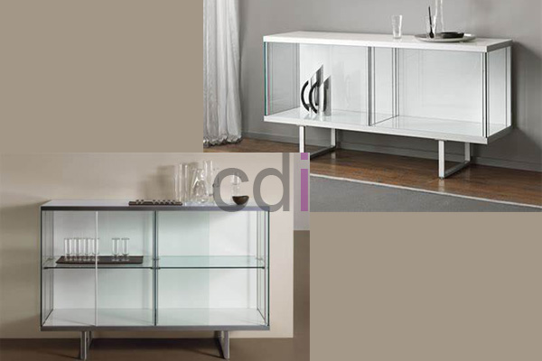

**Bufet TV Kaca Desain Minimalis [Terbaru]** - Hai Mitra CDI! Sedang mencari cara untuk menyempurnakan ruang keluarga Anda? Bufet TV kaca minimalis bisa jadi jawabannya! Furniture ini bukan cuma fungsional, tapi juga bisa jadi statement desain yang bikin ruangan terasa lebih istimewa. Nah, sebelum memutuskan, yuk kita kupas tuntas kenapa memilih bufet TV kaca itu ide yang brilian, terutama buat Mitra di (not detected). Jangan sampai salah pilih, ya!

*Bufet TV Kaca Minimalis: Sentuhan Elegan untuk Ruang Keluarga Anda*

Sebagai produsen mebel terpercaya, kami hadir untuk menawarkan bufet TV kaca minimalis berkualitas tinggi. Kualitas adalah prioritas utama kami, jadi Mitra nggak perlu ragu. Kalau Anda ingin melihat langsung bahan dan modelnya, silakan kunjungi lokasi penjualan kami di (not detected). Meskipun kaca butuh penanganan ekstra hati-hati, ada banyak keunggulan yang bikin bufet kaca istimewa dibanding material lain. Simak ulasan lengkapnya berikut ini.

## Mengapa Bufet TV Kaca Minimalis?

Apa saja sih kelebihan memiliki bufet TV kaca minimalis? Berikut adalah beberapa alasan kenapa banyak Mitra CDI yang memilihnya:

### Tampilan Lebih Elegan dan Modern

Bayangkan ruang keluarga Anda dengan bufet TV kaca yang berkilau. Bukankah langsung terasa lebih mewah dan berkelas? Desain minimalisnya juga pas banget buat yang suka gaya modern. Bufet kaca ini bukan cuma bikin ruangan lebih menarik, tapi juga bisa jadi pusat perhatian tamu yang datang. Ini adalah investasi yang tepat untuk mempercantik interior rumah Anda.

### Fleksibilitas Desain yang Tak Terbatas

Salah satu keunggulan utama kaca adalah sifatnya yang tembus pandang. Artinya, bufet TV kaca ini mudah banget dipadukan dengan berbagai gaya desain interior. Mau tema modern, minimalis, industrial, atau bahkan bohemian? Dijamin serasi! Anda bisa bebas berkreasi tanpa khawatir bufet TV ini malah terlihat *mismatch*. Poin pentingnya adalah penempatan yang tepat—pastikan stabil dan mudah dijangkau.

### Perawatan Mudah dan Praktis

Nggak banyak waktu buat membersihkan rumah? Bufet TV kaca ini solusi tepat! Permukaan kaca cenderung sulit ditempeli kotoran. Debu dan noda mudah dibersihkan dengan kain lap basah. Selain itu, kaca juga tahan terhadap serangan rayap dan hama lainnya, jadi Anda nggak perlu khawatir soal kerusakan jangka panjang. Cukup bersihkan secara rutin, maka bufet kaca Anda akan tetap kinclong.

### Ilusi Ruang yang Lebih Luas

Buat Anda yang punya rumah minimalis, bufet TV kaca bisa jadi trik jitu menciptakan ilusi ruangan yang lebih luas. Sifat tembus pandangnya memberikan kesan lapang dan terbuka, sehingga ruangan terasa lebih lega. Dengan tips pengaturan yang tepat, bufet ini bisa menjadi solusi cerdas untuk memaksimalkan ruang.

### Pilihan Desain yang Beragam

Kami menyediakan beragam pilihan desain bufet TV kaca minimalis yang bisa Anda pilih sesuai selera. Semua produk kami terbuat dari bahan kaca berkualitas tinggi, jadi Mitra nggak perlu khawatir soal keawetannya. Bingung mau pilih yang mana? Jangan ragu untuk berkonsultasi dengan tim kami. Kami siap membantu Anda menemukan bufet TV kaca yang paling cocok untuk rumah Anda di (not detected). Silakan hubungi kami untuk pemesanan atau informasi lebih lanjut! [Bufet Dapur Gantung Minimalis: Pilihan Hemat Ruang & Estetika Modern](/blog/bufet-dapur-gantung-minimalis/) – Jika Mitra juga tertarik dengan pilihan hemat ruang, artikel ini mungkin bisa jadi inspirasi.