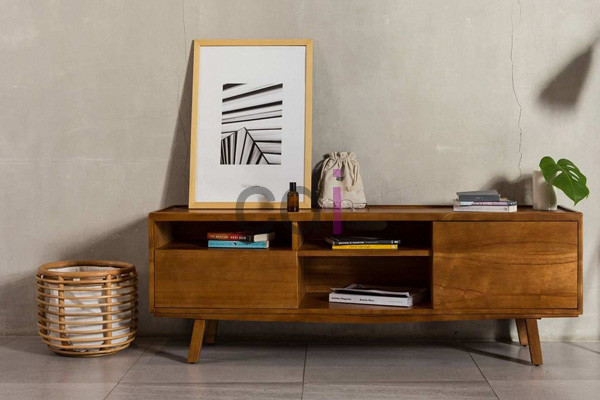
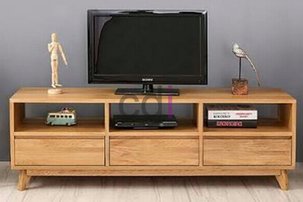

**Bufet Tv Minimalis dari Bahan Kayu Jati** - Hai Mitra CDI! Ingin ruang keluarga tampak lebih rapi dan nyaman? Bufet TV minimalis dari kayu jati bisa jadi solusi tepat! Kayu jati memang primadona dalam pembuatan furniture di Indonesia. Kenapa? Karena kekuatannya sudah teruji, tahan lama, dan minim risiko dimakan rayap. Nah, dari sekian banyak pilihan furniture jati, bufet TV minimalis ini sering jadi favorit. Dengan bufet yang pas, pengalaman menonton TV di rumah jadi makin menyenangkan. Tapi, memilih bufet TV minimalis kayu jati yang benar-benar berkualitas itu perlu triknya. Yuk, simak beberapa hal penting yang perlu Anda perhatikan sebelum membeli!

## Tips Cerdas Memilih Bufet Tv Minimalis Kayu Jati Berkualitas

### Utamakan Produsen Terpercaya

Membedakan kayu jati asli, palsu, tua, atau muda memang tricky, terutama setelah jadi furniture.  Nah, cara paling aman adalah membeli dari produsen yang namanya sudah dikenal dan terpercaya. Produsen terpercaya biasanya punya reputasi baik dan berkomitmen memberikan produk berkualitas. Kalau Anda sudah khatam ciri-ciri kayu jati asli, proses seleksi jadi lebih mudah.  Tapi jika belum, serahkan saja pada ahlinya!  Di CDI, kami hanya menggunakan kayu jati pilihan dari sumber terpercaya.

### Kayu Jati Tua Lebih Berharga

Kayu jati tua punya kualitas yang jauh lebih baik dibandingkan kayu jati muda. Usia kayu berpengaruh pada kekokohan, kepadatan serat, dan beratnya. Kayu jati tua lebih stabil, awet, dan minim risiko melengkung atau retak.  Jangan ragu untuk bertanya pada produsen mengenai usia kayu yang mereka gunakan.  Beli bufet di CDI, Anda pasti dapat kayu jati tua yang sudah teruji kualitasnya.

### Perhatikan Kekokohan Konstruksi

Kunjungi langsung workshop atau toko furniture untuk mengecek kualitas bufet secara langsung. Perhatikan konstruksi bufet: apakah kokoh, stabil, dan tidak goyah?  Coba pegang kayu tersebut, rasakan kekuatannya. Ketuk perlahan untuk mendengar suaranya – kayu jati berkualitas akan menghasilkan bunyi yang padat. Bufet TV minimalis kayu jati dari CDI dirakit oleh tukang kayu berpengalaman, menjamin konstruksi yang solid dan tahan lama.

### Hindari Bufet Berlubang atau Bertambal

Lubang atau tambalan pada kayu jati bisa mengurangi kekuatannya.  Beberapa produsen mungkin mencoba menutupi lubang tersebut, tapi tetap saja keawetan kayu akan terganggu. Serangga bisa dengan mudah menembus bekas lubang dan menyebabkan kayu cepat keropos.  Di CDI, kami hanya menggunakan kayu jati tanpa cacat, memastikan bufet Anda awet bertahun-tahun.

### Finishing yang Rapi, Tampilan yang Memukau

Finishing yang rapi akan membuat bufet terlihat lebih elegan dan menambah estetika ruangan Anda. Perhatikan detail finishing: apakah halus, rata, dan tidak ada cacat?  Finishing yang baik juga melindungi kayu dari kelembapan dan serangga.  Bufet TV minimalis kayu jati dari CDI dikerjakan dengan teliti, menghasilkan finishing yang sempurna dan nyaman dipandang.

Kesimpulannya, memilih bufet TV minimalis kayu jati yang berkualitas adalah investasi jangka panjang.  Dengan memilih produsen terpercaya, kayu jati tua, konstruksi kokoh, dan finishing rapi, Anda akan mendapatkan furniture yang awet, fungsional, dan mempercantik rumah Anda. Butuh bufet TV minimalis kayu jati berkualitas?  Ayo hubungi tim kami sekarang juga untuk mendapatkan penawaran terbaik! Jangan lupa cek juga  untuk inspirasi desain interior lainnya.  Kami siap membantu mewujudkan ruang keluarga impian Anda di (not detected)!

<table class="table">
  <caption>Pilihan Ukuran Bufet TV Minimalis Kayu Jati</caption>
  <thead>
    <tr><th>Ukuran (PxLxT)</th><th>Cocok untuk TV</th><th>Harga (Estimasi)</th></tr>
  </thead>
  <tbody>
    <tr><td>120x40x50 cm</td><td>TV 32-43 inch</td><td>Info harga via tombol Telepon/WhatsApp</td></tr>
    <tr><td>160x40x50 cm</td><td>TV 43-55 inch</td><td>Info harga via tombol Telepon/WhatsApp</td></tr>
    <tr><td>200x40x50 cm</td><td>TV 55-65 inch</td><td>Info harga via tombol Telepon/WhatsApp</td></tr>
  </tbody>
</table>
