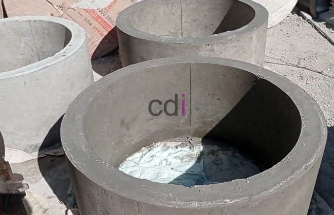

**Buis Beton U 30: Panduan Lengkap Ukuran, Harga, dan Aplikasi Terbaik** - Halo Mitra CDI! Pernahkah Anda menghadapi masalah drainase yang menghambat kelancaran proyek? Atau mungkin kesulitan menemukan solusi yang tepat untuk saluran air yang kuat dan tahan lama? Nah, artikel ini hadir untuk memberikan panduan lengkap mengenai buis beton U 30 – solusi cerdas untuk sistem drainase yang efektif. Yuk, kita bahas lebih dalam!

## Mengenal Lebih Dekat Ukuran dan Spesifikasi Buis Beton U 30

Buis beton U 30 adalah elemen penting dalam merancang sistem drainase yang handal. Tahukah Anda, angka "U 30" ini merujuk pada diameter bagian dalam buis, yaitu 30 sentimeter. Panjang standar biasanya berkisar antara 2 hingga 3 meter, namun Kami bisa menyesuaikannya dengan kebutuhan spesifik proyek Anda di (not detected). Sementara itu, ketebalan dindingnya umumnya antara 8 hingga 12 sentimeter, bergantung pada mutu beton dan beban yang akan ditanggung.

Untuk memastikan kekuatan dan umur panjang, Kami merekomendasikan penggunaan buis beton U 30 dengan mutu minimal K-250. Mutu ini sudah memenuhi standar SNI dan dirancang untuk menahan tekanan serta abrasi dalam lingkungan drainase. Jangan lupa, selalu periksa sertifikasi mutu dari produsen sebelum membeli, ya!

## Manfaat dan Aplikasi Buis Beton U 30 di Berbagai Proyek

Buis beton U 30 sangat fleksibel dan bisa digunakan dalam beragam proyek konstruksi. Penggunaan paling umum tentu saja sebagai saluran drainase air hujan untuk perumahan, perkantoran, atau area publik. Bentuk U-nya dirancang untuk mengalirkan air dengan lancar dan mencegah penumpukan lumpur atau sampah. Selain itu, buis beton U 30 juga sering dimanfaatkan dalam proyek irigasi pertanian sebagai saluran pengairan yang efektif.

Bahkan, Kami sering melihatnya digunakan sebagai gorong-gorong di bawah jalan atau area parkir. Dalam kasus ini, penting untuk memastikan buis beton mampu menahan beban lalu lintas. Untuk proyek industri, buis beton U 30 juga bisa menjadi saluran pembuangan air limbah, namun perlu ditambahkan lapisan pelindung untuk mencegah korosi akibat bahan kimia.

## Menentukan Biaya: Estimasi Harga dan Faktor yang Mempengaruhi

Berbicara soal biaya, harga buis beton U 30 bisa bervariasi. Secara umum, Anda bisa memperkirakan harga per meter mulai dari Rp 150.000 hingga Rp 250.000, tergantung mutu beton, ketebalan dinding, dan lokasi Anda di (not detected). Harga ini hanya sebagai gambaran, dan bisa berubah sewaktu-waktu. Untuk mendapatkan penawaran paling akurat sesuai kebutuhan proyek Mitra CDI, hubungi Kami sekarang juga!

Beberapa faktor lain yang memengaruhi biaya adalah biaya transportasi, biaya pemasangan, dan jumlah pesanan. Semakin besar jumlah pesanan, biasanya semakin kompetitif harganya. Lokasi proyek juga berperan, terutama jika aksesnya sulit. Jangan lupakan biaya pemasangan saat menyusun anggaran proyek, ya.

## Membandingkan Buis Beton U 30 dengan Pilihan Lainnya

Mungkin Anda bertanya-tanya, apakah ada alternatif lain selain buis beton U 30? Tentu saja ada! Misalnya, pipa PVC atau saluran beton tertutup. Namun, buis beton U 30 memiliki keunggulan tersendiri. Pipa PVC memang ringan dan mudah dipasang, tetapi kurang kuat menahan beban berat dan tekanan tanah. Sementara, saluran beton tertutup menawarkan kekuatan yang lebih tinggi, tetapi harganya lebih mahal dan pemasangannya lebih rumit.

Mari kita lihat perbandingan lengkapnya dalam tabel berikut:

<table class="table">
  <caption>Perbandingan Sistem Drainase</caption>
  <thead>
    <tr><th>Fitur</th><th>Buis Beton U 30</th><th>Pipa PVC</th><th>Saluran Beton Tertutup</th></tr>
  </thead>
  <tbody>
    <tr><td>Kekuatan</td><td>Tinggi</td><td>Sedang</td><td>Sangat Tinggi</td></tr>
    <tr><td>Harga</td><td>Sedang</td><td>Rendah</td><td>Tinggi</td></tr>
    <tr><td>Ketahanan</td><td>Tinggi</td><td>Rendah</td><td>Tinggi</td></tr>
    <tr><td>Kemudahan Pemasangan</td><td>Sedang</td><td>Tinggi</td><td>Sedang</td></tr>
    <tr><td>Aplikasi</td><td>Drainase air hujan, irigasi, gorong-gorong</td><td>Drainase air ringan</td><td>Drainase berat, terowongan</td></tr>
  </tbody>
</table>

Dengan mempertimbangkan semua kelebihan dan kekurangannya, buis beton U 30 adalah pilihan yang tepat untuk proyek konstruksi yang membutuhkan sistem drainase yang kuat, tahan lama, dan ekonomis di (not detected). [Analisa Beton K 300: Panduan Lengkap Kekuatan, Aplikasi, dan Biaya di 2026](/blog/analisa-beton-k-300/) bisa menjadi referensi tambahan untuk memastikan kekuatan konstruksi Anda.

Butuh konsultasi lebih lanjut? Jangan ragu untuk menghubungi Kami! Tombol **Telepon** dan **WhatsApp** di bawah ini siap membantu.