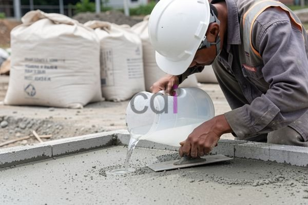

**Cairan Pengeras Beton: Panduan Lengkap Jenis, Fungsi, dan Aplikasinya** - Hai Mitra CDI! Mencari cara terbaik untuk memastikan beton proyek Anda sekuat mungkin dan tahan lama? Kondisi beton yang kurang optimal memang bikin proyek jadi kurang maksimal, kan? Nah, kami punya solusinya! Dalam artikel ini, kita akan membahas tuntas mengenai cairan pengeras beton – mulai dari apa itu, jenis-jenisnya, fungsinya, sampai tips aplikasi yang benar. Yuk, simak lebih lanjut!

Beton adalah material krusial dalam setiap pembangunan, dari pondasi rumah sederhana hingga proyek infrastruktur berskala besar. Tapi, kekuatan dan daya tahannya gak datang begitu saja. Perawatan yang tepat itu kunci. Salah satu cara jitu untuk meningkatkan kualitas beton adalah dengan menggunakan cairan pengeras beton. Artikel ini akan mengupas tuntas semua yang perlu Anda ketahui tentang cairan pengeras beton, termasuk memilih jenis yang tepat untuk kebutuhan proyek di (not detected).

## Apa Saja Manfaat Utama Cairan Pengeras Beton?

Cairan pengeras beton – atau *concrete hardener* – adalah aditif yang dirancang untuk mempercepat proses pengerasan dan secara signifikan meningkatkan kekuatan beton. Proses hidrasi semen, yaitu reaksi antara semen dan air yang membentuk beton yang mengeras, memang butuh waktu. Di sinilah cairan pengeras beton berperan penting, mengoptimalkan proses tersebut.

Bagaimana cara kerjanya? Cairan ini bekerja dengan mengurangi tegangan permukaan air, sehingga penetrasi air ke partikel semen jadi lebih mudah. Hasilnya? Reaksi hidrasi lebih cepat, struktur beton jadi lebih padat dan kuat. Penggunaan cairan ini juga bisa membantu meminimalisir risiko retak akibat penyusutan.  1 m3 beton berapa m2 bekisting: Panduan Praktis Menghitung dan Mengoptimalkan bisa jadi referensi tambahan untuk perhitungan material proyek Anda.

Yang penting banget diingat, cairan ini *bukan* pengganti air dalam campuran beton. Cairan pengeras beton diaplikasikan *setelah* beton dicampur dan dituang – biasanya saat proses finishing.

## Jenis-Jenis Cairan Pengeras Beton: Mana yang Paling Cocok untuk Proyek Anda?

Di pasaran ada berbagai macam cairan pengeras beton, masing-masing punya kelebihan dan kekurangan. Secara garis besar, mereka terbagi jadi dua kategori utama:

* **Cairan Pengeras Beton Berbasis Silikat:** Pilihan populer karena efektif meningkatkan kekuatan dan ketahanan beton terhadap abrasi atau gesekan. Silikat bekerja dengan bereaksi terhadap kalsium hidroksida, menciptakan kalsium silikat hidrat yang mengisi pori-pori beton dan membuatnya lebih padat.
* **Cairan Pengeras Beton Berbasis Akrilat:** Jenis ini lebih fokus pada perlindungan permukaan. Cairan ini membentuk lapisan yang melindungi beton dari debu, noda, dan berbagai bahan kimia. Selain itu, akrilat juga memberikan tampilan mengkilap yang menarik.
* **Cairan Pengeras Beton Berbasis Litium:** Menawarkan penetrasi lebih dalam dibandingkan silikat. Efeknya? Perlindungan yang lebih komprehensif terhadap serangan sulfat dan korosi, ideal untuk lingkungan yang keras.

<table class="table">
  <caption>Perbandingan Jenis Cairan Pengeras Beton</caption>
  <thead>
    <tr><th>Jenis</th><th>Keunggulan</th><th>Kekurangan</th><th>Aplikasi Umum</th></tr>
  </thead>
  <tbody>
    <tr><td>Silikat</td><td>Meningkatkan kekuatan &amp; ketahanan abrasi</td><td>Kurang efektif pada beton yang sudah tua</td><td>Lantai industri, gudang, parkiran</td></tr>
    <tr><td>Akrilat</td><td>Perlindungan permukaan, tampilan mengkilap</td><td>Kurang tahan terhadap abrasi berat</td><td>Lantai dekoratif, showroom, garasi</td></tr>
    <tr><td>Litium</td><td>Penetrasi dalam, tahan sulfat &amp; korosi</td><td>Harga relatif lebih mahal</td><td>Pelabuhan, jembatan, area terpapar air asin</td></tr>
  </tbody>
</table>

## Panduan Aplikasi Cairan Pengeras Beton yang Benar

Aplikasi yang tepat adalah kunci keberhasilan. Berikut langkah-langkahnya:

1. **Persiapan Permukaan:** Pastikan permukaan beton bersih dari kotoran, debu, minyak, atau lapisan apapun yang bisa menghalangi penetrasi cairan.
2. **Aplikasi:** Aplikasikan cairan pengeras beton secara merata menggunakan sprayer, roller, atau kuas. Pilih metode yang paling sesuai dengan luas area dan jenis cairan yang digunakan.
3. **Jumlah Lapisan:** Jumlah lapisan yang dibutuhkan bervariasi tergantung jenis cairan dan porositas beton. Umumnya, 2-3 lapisan dengan interval waktu tertentu (sesuai instruksi produk) direkomendasikan. Kita juga menjual [Cairan Perekat Cor Beton: Jenis, Fungsi, dan Tips Penggunaannya](/blog/cairan-perekat-cor-beton/) jika Anda membutuhkan solusi untuk menyambungkan beton lama dengan yang baru.
4. **Penyimpanan:** Setelah aplikasi, jaga agar beton tetap lembap selama beberapa hari untuk memaksimalkan proses hidrasi.

Sebagai ilustrasi, pada beton mutu K-300, penggunaan cairan pengeras silikat bisa meningkatkan kekuatan tekan hingga 10-15% setelah 28 hari. Perlu diingat, hasil ini bisa bervariasi tergantung kualitas semen, rasio air-semen, dan suhu lingkungan. Untuk informasi harga produk dan penawaran spesial di (not detected), hubungi tim ahli Kami melalui tombol **WhatsApp** atau **Telepon** di halaman ini.

## Tips Memilih Cairan Pengeras Beton yang Tepat untuk Proyek Anda di (not detected)

Memilih produk yang sesuai itu penting banget. Beberapa hal yang harus Anda perhatikan:

* **Jenis Beton:** Pastikan cairan pengeras beton yang dipilih kompatibel dengan jenis beton yang digunakan di proyek Anda.
* **Kondisi Lingkungan:** Pertimbangkan lingkungan tempat beton akan digunakan. Apakah terpapar air asin? Apakah sering terkena bahan kimia?
* **Anggaran:** Harga bisa bervariasi. Sesuaikan pilihan dengan budget proyek Anda.
* **Kualitas Produk:** Pilih merek yang terpercaya dan memiliki reputasi baik seperti CDI!

Butuh konsultasi lebih lanjut? Jangan sungkan untuk menghubungi Kami. Tim Kami siap membantu Anda menemukan solusi terbaik untuk proyek konstruksi Anda di (not detected). Segera hubungi Kami melalui tombol **WhatsApp** atau **Telepon** di halaman ini untuk mendapatkan penawaran terbaik!  Jangan lupa juga untuk melihat layanan jasa pengecoran profesional yang kami tawarkan, untuk memastikan beton Anda benar-benar berkualitas tinggi. 