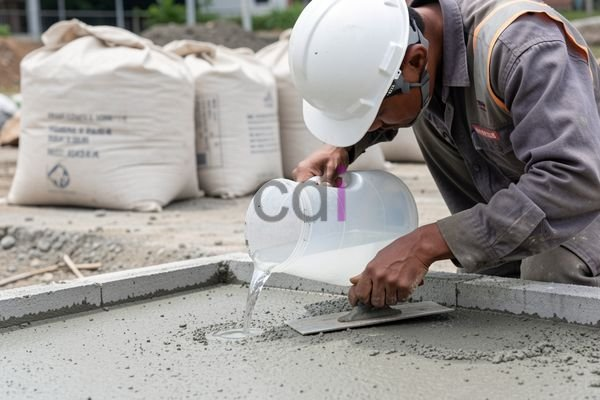

**Cairan Penguat Beton: Panduan Lengkap Memilih dan Menggunakannya** - Hai Mitra CDI! Apakah Anda ingin memastikan beton di proyek Anda sekuat mungkin dan tahan lama?

Beton adalah fondasi dari banyak proyek konstruksi, tapi tahukah Anda bahwa kekuatannya bisa ditingkatkan secara signifikan? Kuncinya ada pada penggunaan *cairan penguat beton*. Baik Anda membangun rumah minimalis di (not detected), gedung perkantoran megah, atau infrastruktur penting, memahami jenis, aplikasi, dan manfaatnya sangatlah penting. Nah, Kami akan mengupas tuntas topik ini supaya Anda bisa membuat pilihan terbaik untuk proyek Anda.

## Mengapa Cairan Penguat Beton Penting? Fungsi dan Manfaatnya

*Cairan penguat beton*, atau *concrete admixture* seperti yang sering disebut, adalah bahan kimia yang dicampurkan ke adukan beton saat proses pembuatan. Fungsinya adalah memodifikasi karakteristik beton—baik saat masih lunak maupun setelah mengeras. Dengan kata lain, cairan ini membantu kita mendapatkan beton yang lebih kuat, lebih tahan lama, dan lebih mudah dikerjakan.

Manfaatnya banyak sekali! Selain meningkatkan kekuatan tekan, cairan penguat beton juga bisa mengurangi permeabilitas (kemampuan beton untuk ditembus air), mempercepat atau memperlambat pengerasan, dan meningkatkan kualitas permukaan akhir beton.  Mencapai mutu beton yang lebih tinggi, misalnya dari K-300 ke K-400 atau lebih, jadi lebih mudah. Ini penting untuk struktur yang menahan beban berat atau berada di lingkungan yang keras. Cairan penguat beton juga meningkatkan ketahanan terhadap retak, abrasi, dan bahan kimia, sehingga investasi konstruksi Anda lebih awet.

## Mengenal Ragam Jenis Cairan Penguat Beton dan Kegunaannya

Ada banyak pilihan cairan penguat beton di pasaran, masing-masing punya keunggulan unik. Berikut beberapa jenis yang umum digunakan:

*   **Superplasticizer:**  Membuat beton lebih mudah dikerjakan tanpa menambah air. Cocok untuk beton kepadatan tinggi dan kekuatan maksimal.
*   **Retarder:** Memperlambat pengerasan beton. Berguna saat cuaca panas atau saat kita perlu waktu lebih lama untuk pengecoran di lokasi yang jauh.
*   **Accelerator:**  Mempercepat pengerasan beton.  Ideal saat cuaca dingin atau proyek membutuhkan penyelesaian cepat. [Cairan Untuk Mempercepat Pengeringan Beton](/blog/mempercepat-pengeringan-beton/) bisa jadi solusi praktis.
*   **Air-Entraining Agent:** Membentuk gelembung udara mikroskopis yang meningkatkan ketahanan beton terhadap pembekuan-pencairan dan serangan garam. Penting untuk daerah dengan musim dingin ekstrem.
*   **Corrosion Inhibitor:** Melindungi tulangan baja dari karat, terutama di struktur yang terpapar air laut atau bahan kimia korosif.

Memilih jenis yang tepat tergantung kebutuhan proyek Anda. Pertimbangkan kondisi lingkungan, jenis bangunan, dan mutu beton yang diharapkan. Setiap proyek di (not detected) tentu memiliki kebutuhan unik.

## Tips Teknis: Cara Menggunakan Cairan Penguat Beton dengan Benar

Menggunakan cairan penguat beton membutuhkan perhatian ekstra. Pertama, selalu ikuti dosis yang disarankan oleh produsen. Terlalu banyak atau terlalu sedikit bisa berdampak buruk. Kedua, pastikan pencampuran dilakukan secara merata agar cairan tersebar sempurna dalam adukan. Ketiga, cek kompatibilitasnya dengan semen dan bahan tambahan lain yang Anda gunakan.

Sebagai contoh, anggaplah Anda ingin meningkatkan mutu beton dari K-300 menjadi K-350 dengan superplasticizer. Jika data teknis produk menunjukkan dosis 0,5% dari berat semen, dan Anda menggunakan 300 kg semen per meter kubik beton, maka Anda memerlukan 1,5 kg superplasticizer per meter kubik.  Perhitungan yang cermat sangat membantu.

## Perkiraan Biaya dan Faktor Penentu Harga

Harga cairan penguat beton bervariasi. Jenis, merek, dan jumlah pembelian menjadi faktor utama. Sebagai gambaran, harga per liter bisa berkisar antara Rp 20.000 hingga Rp 150.000.  Perlu diingat bahwa angka ini hanyalah estimasi. Untuk informasi harga terbaik dan sesuai dengan kebutuhan proyek Anda di (not detected), hubungi Kami.

Beberapa faktor lain yang mempengaruhi harga:

*   **Jenis cairan penguat beton:** Superplasticizer dan corrosion inhibitor biasanya lebih mahal daripada retarder atau accelerator.
*   **Merek:** Merek yang terkenal dan terpercaya mungkin harganya lebih tinggi.
*   **Jumlah pembelian:** Beli dalam jumlah besar biasanya dapat diskon khusus.
*   **Lokasi geografis:** Biaya transportasi dan distribusi bisa memengaruhi harga di (not detected).

Butuh informasi lebih lanjut atau ingin konsultasi gratis? Silakan klik tombol **Telepon** atau **WhatsApp** di bawah ini untuk langsung terhubung dengan tim ahli Kami. Kami siap membantu Anda menemukan solusi beton terbaik untuk proyek Anda!  Kami juga melayani jasa pengecoran di (not detected) dengan kualitas terjamin.