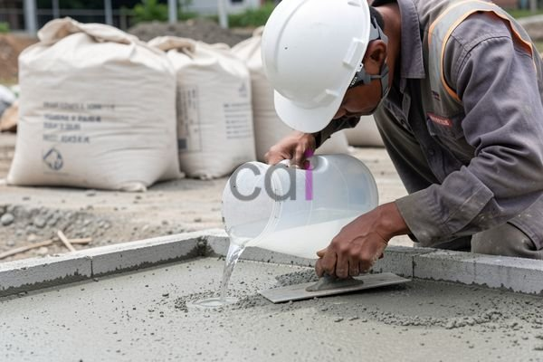

**Cairan Perekat Beton Retak: Solusi Efektif dan Panduan Penggunaannya** - Hai Mitra CDI! Apakah Anda sering menemukan masalah retakan pada struktur beton di proyek-proyek di (not detected)? Retakan ini kerap jadi perhatian karena memengaruhi kekuatan dan tampilan bangunan. Nah, kabar baiknya, ada solusi efektif yang bisa Anda andalkan: cairan perekat beton retak. Artikel ini akan membahas tuntas mengenai solusi ini, mulai dari jenis-jenisnya, cara aplikasi, hingga perkiraan biayanya. Yuk, simak selengkapnya!

## Mengenal Lebih Dekat Cairan Perekat Beton Retak

Mitra, cairan perekat beton retak hadir dalam berbagai pilihan, dirancang untuk mengatasi beragam situasi kerusakan. Secara garis besar, ada dua jenis utama yang perlu Anda ketahui: formula berbasis epoksi dan berbasis polimer. Epoksi dikenal dengan daya lekatnya yang superior dan ketahanan terhadap bahan kimia yang kuat. Ideal untuk retakan struktural yang krusial, misalnya pada fondasi, kolom, dan balok bangunan di (not detected). Sementara itu, alternatif berbasis polimer menawarkan fleksibilitas lebih tinggi dan lebih cocok untuk perbaikan retakan yang tidak memengaruhi struktur utama, seperti pada lantai, dinding, atau area yang rentan pergerakan kecil. 

Perbedaan tak hanya pada bahan dasarnya, lho. Metode aplikasinya pun bervariasi. Beberapa produk dirancang khusus untuk disuntikkan ke dalam retakan menggunakan peralatan khusus, sementara yang lain cukup diaplikasikan langsung menggunakan kuas atau spatula. Pemilihan jenis perekat yang paling tepat bergantung pada ukuran retakan, lokasi kerusakan, dan seberapa besar beban yang diterima struktur beton tersebut. Misalnya, retakan rambut (ukuran kurang dari 0,5 mm) umumnya cukup efektif ditangani dengan cairan perekat polimer. Akan tetapi, untuk retakan yang lebih lebar (lebih dari 2 mm), cairan perekat epoksi yang dilengkapi dengan pengisi (filler) akan memberikan kekuatan dan daya tahan yang lebih optimal.

## Langkah-Langkah Aplikasi Cairan Perekat Beton Retak

Mitra, agar hasil perbaikan retakan beton maksimal, persiapan yang matang itu kunci. Pertama, bersihkan area di sekitar retakan dari debu, kotoran, maupun material yang tidak menempel. Selanjutnya, perlebar sedikit retakan (dengan teknik V-groove) untuk menciptakan permukaan yang lebih baik agar perekat dapat menempel dengan sempurna. Setelah itu, campurkan cairan perekat sesuai petunjuk yang tertera pada kemasan dan aplikasikan ke dalam retakan dengan alat yang sesuai. Pastikan cairan perekat mengisi seluruh ruang retakan tanpa menyisakan rongga udara.

Setelah diaplikasikan, cairan perekat memerlukan waktu untuk mengering dan mengeras. Durasi pengeringan berbeda-beda tergantung pada jenis produk dan kondisi lingkungan. Secara umum, cairan perekat epoksi membutuhkan waktu pengeringan lebih lama dibandingkan dengan jenis polimer. Selama proses ini, lindungi area perbaikan dari paparan sinar matahari langsung dan kelembaban berlebih agar hasilnya lebih optimal.

## Perkiraan Biaya dan Faktor-Faktor yang Mempengaruhinya

Mitra, biaya penggunaan cairan perekat beton retak bisa bervariasi, dipengaruhi oleh beberapa faktor penting seperti jenis produk yang dipilih, ukuran retakan, dan luas area yang perlu diperbaiki. Harga cairan perekat epoksi berkualitas tinggi biasanya berkisar antara Rp 300.000 hingga Rp 800.000 per kilogram. Sementara itu, opsi berbasis polimer umumnya lebih ekonomis, dengan harga antara Rp 150.000 hingga Rp 400.000 per kilogram. 

Selain harga material, jangan lupakan biaya tenaga kerja untuk persiapan permukaan, aplikasi perekat, dan pekerjaan finishing. Estimasi biaya tenaga kerja akan tergantung pada tingkat kesulitan pekerjaan dan tarif yang berlaku di wilayah (not detected). Sebagai gambaran, biaya material dan tenaga kerja untuk memperbaiki retakan pada lantai beton seluas 10 meter persegi dengan lebar retakan rata-rata 1 mm diperkirakan berada di kisaran Rp 1.000.000 hingga Rp 3.000.000. Perlu diingat, angka ini hanyalah estimasi dan dapat berubah sewaktu-waktu. Untuk penawaran resmi dan paling akurat sesuai kebutuhan proyek Mitra CDI, silakan hubungi Kami.

## Membandingkan: Epoksi vs. Polimer – Mana yang Tepat untuk Anda?

Untuk membantu Mitra CDI memilih solusi yang paling sesuai, berikut adalah perbandingan antara cairan perekat beton retak berbasis epoksi dan polimer:

<table class="table">
  <caption>Perbandingan Cairan Perekat Beton Retak</caption>
  <thead>
    <tr><th>Fitur</th><th>Cairan Perekat Epoksi</th><th>Cairan Perekat Polimer</th></tr>
  </thead>
  <tbody>
    <tr><td>Kekuatan Adhesi</td><td>Sangat Tinggi</td><td>Cukup Tinggi</td></tr>
    <tr><td>Fleksibilitas</td><td>Rendah</td><td>Tinggi</td></tr>
    <tr><td>Ketahanan Kimia</td><td>Sangat Baik</td><td>Baik</td></tr>
    <tr><td>Waktu Pengeringan</td><td>Lebih Lama</td><td>Lebih Cepat</td></tr>
    <tr><td>Harga</td><td>Lebih Mahal</td><td>Lebih Terjangkau</td></tr>
    <tr><td>Aplikasi</td><td>Retakan Struktural</td><td>Retakan Non-Struktural</td></tr>
  </tbody>
</table>

Dengan memahami perbedaan utama di antara kedua jenis perekat ini, Mitra dapat membuat keputusan yang lebih tepat berdasarkan kebutuhan spesifik proyek konstruksi Anda. Jangan ragu untuk berkonsultasi dengan tim ahli Kami – kami siap membantu!

Untuk informasi lebih lanjut atau jika ada pertanyaan seputar penggunaan cairan perekat beton retak, jangan sungkan untuk menghubungi Kami melalui tombol **WhatsApp** atau **Telepon** yang tersedia di halaman ini. [Adhimix Karawang: Solusi Beton Instan untuk Proyek Konstruksi Anda](/blog/adhimix-karawang/) — Mungkin artikel ini juga bisa memberikan informasi tambahan seputar solusi beton untuk proyek Anda.