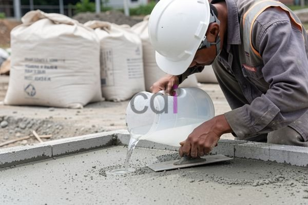

**Cairan Perekat Cor Beton: Jenis, Fungsi, dan Tips Penggunaannya** - Hai Mitra CDI! Punya kendala saat menyambung beton lama dengan yang baru? Seringkali, kurangnya ikatan yang kuat jadi masalah utama – berisiko menimbulkan retakan dan kerusakan struktural. Nah, cairan perekat cor beton hadir sebagai solusi jitu!

Cairan perekat cor beton – sering disebut juga *bonding agent* – berperan penting dalam menjembatani dan memperkuat daya rekat antara beton lama dan beton baru. Dengan penerapan yang tepat, Mitra bisa memastikan konstruksi beton lebih kokoh, awet, dan minim risiko kerusakan. Di artikel ini, kami akan mengulas tuntas berbagai jenis cairan perekat beton, fungsi utamanya, plus tips aplikasinya agar Mitra meraih hasil yang optimal.

## Mengapa Cairan Perekat Cor Beton Sangat Penting dalam Pengecoran?

Fungsi utama cairan perekat beton adalah meningkatkan daya rekat antara beton lama dan baru. Latar belakangnya begini: permukaan beton lama seringkali licin dan tertutup debu atau kotoran, sehingga menghambat pengikatan dengan beton baru. Tanpa perekat yang memadai, beton baru berpotensi terkelupas, retak, atau bahkan runtuh seiring waktu. Penggunaan cairan perekat beton sangat direkomendasikan dalam situasi-situasi berikut:

*   **Perbaikan Beton:** Ideal saat Mitra melakukan tambal cor atau perbaikan struktur beton yang sudah ada.
*   **Pengecoran Lantai:** Terutama untuk pengecoran lantai bertingkat atau penambahan lantai baru di atas struktur beton yang sudah mapan.
*   **Pengecoran Balok dan Kolom:** Saat memperpanjang atau memperkuat elemen struktural beton yang telah ada.
*   **Peningkatan Kekuatan:** Untuk meningkatkan ketahanan terhadap beban dinamis dan perubahan suhu, khususnya pada area yang rentan terhadap getaran atau tekanan.

## Mengenal Berbagai Jenis Cairan Perekat Cor Beton

Di pasaran, tersedia beragam jenis cairan perekat beton dengan karakteristik dan aplikasi yang berbeda-beda. Memilih jenis yang tepat akan sangat mempengaruhi kualitas hasil pengecoran. Mari kita kupas tuntas beberapa jenis yang paling umum digunakan:

*   **Epoxy-Based Bonding Agent:** Menawarkan daya rekat super kuat dan tahan terhadap berbagai bahan kimia. Cocok untuk aplikasi yang membutuhkan kekuatan ekstra, seperti perbaikan struktur beton rusak parah atau area yang terpapar lingkungan korosif. Perlu diingat, epoxy umumnya memiliki waktu pengeringan lebih lama dan harganya relatif lebih mahal.
*   **Acrylic-Based Bonding Agent:** Pilihan yang lebih ekonomis dengan waktu pengeringan yang lebih cepat dibandingkan epoxy. Cocok untuk perbaikan retakan kecil atau pengecoran lantai ringan. Meskipun kekuatan rekatnya tidak setinggi epoxy, namun tetap memadai untuk banyak proyek.
*   **Cementitious Bonding Agent:** Campuran semen khusus yang diperkaya dengan aditif polimer. Mudah diaplikasikan dan kompatibel dengan berbagai jenis beton. Ideal untuk perbaikan beton yang membutuhkan tampilan seragam dengan struktur yang sudah ada.
*   **Lateks Modifikasi:** Aditif yang dicampurkan ke dalam campuran beton untuk meningkatkan fleksibilitas dan daya rekat. Sering digunakan pada aplikasi yang membutuhkan ketahanan terhadap retak dan pergerakan struktural.

## Panduan Aplikasi Cairan Perekat Cor Beton yang Benar

Aplikasi cairan perekat beton yang tepat adalah kunci untuk memastikan daya rekat yang optimal. Berikut beberapa tips yang wajib diperhatikan:

1.  **Persiapan Permukaan:** Bersihkan permukaan beton lama dari debu, kotoran, minyak, dan material lepas lainnya. Gunakan sikat kawat atau *pressure washer* untuk memastikan permukaan benar-benar bersih dan memiliki tekstur yang kasar.
2.  **Primer (Opsional):** Beberapa jenis bonding agent memerlukan aplikasi primer terlebih dahulu untuk meningkatkan daya serap. Selalu ikuti instruksi yang tertera pada kemasan produk.
3.  **Penerapan Bonding Agent:** Aplikasikan cairan perekat beton secara merata dengan kuas atau roller. Pastikan seluruh permukaan yang akan dicor tertutup dengan baik.
4.  **Durasi Pengeringan:** Biarkan cairan perekat beton mengering sepenuhnya sesuai dengan instruksi pada kemasan. Jangan lanjutkan pengecoran sebelum permukaan benar-benar kering dan tidak terasa lengket.
5.  **Proses Pengecoran Beton:** Cor beton baru di atas permukaan yang sudah diaplikasikan bonding agent. Pastikan beton baru dipadatkan dengan sempurna untuk menghilangkan rongga udara dan memaksimalkan daya rekat.

Nah, misalnya Mitra berencana memperbaiki lantai beton seluas 100 m². Dengan estimasi kebutuhan cairan perekat beton 0,2 liter/m², maka total yang dibutuhkan adalah 100 m² x 0,2 liter/m² = 20 liter. Untuk informasi harga cairan perekat beton epoxy, biasanya berkisar antara Rp 300.000 hingga Rp 600.000 per liter. Data ini bersifat estimasi dan bisa sewaktu-waktu berubah — hubungi Kami untuk mendapatkan penawaran harga terkini dan paling akurat sesuai kebutuhan proyek Mitra CDI di (not detected).

## Tips Memilih Cairan Perekat Beton yang Tepat

Pemilihan cairan perekat beton yang tepat perlu disesuaikan dengan jenis proyek, kondisi lingkungan, dan anggaran yang Mitra miliki. Perhatikan faktor-faktor penting berikut:

*   **Kekuatan Rekat:** Pilih jenis bonding agent dengan kekuatan rekat yang sesuai dengan beban dan tekanan yang akan diterima oleh struktur beton.
*   **Ketahanan Kimia:** Jika struktur beton akan terpapar bahan kimia korosif, pilih bonding agent yang punya ketahanan terhadap bahan kimia tersebut.
*   **Waktu Pengeringan:** Pertimbangkan waktu pengeringan yang dibutuhkan, terutama jika Mitra punya tenggat waktu proyek yang ketat.
*   **Kemudahan Penggunaan:** Pilih bonding agent yang mudah diaplikasikan dan tidak memerlukan keahlian khusus.
*   **Anggaran:** Sesuaikan pilihan dengan anggaran yang tersedia.

Untuk mendapatkan konsultasi yang lebih mendalam, jangan ragu menghubungi Kami melalui tombol **Telepon** atau **WhatsApp** yang tersedia di bawah ini. Kami siap membantu Mitra CDI memilih solusi terbaik untuk proyek Anda! [Cairan Pengeras Beton: Panduan Lengkap Jenis, Fungsi, dan Aplikasinya](/blog/cairan-pengeras-beton/) — artikel kami sebelumnya membahas secara detail bagaimana memperkuat beton secara keseluruhan, yuk dibaca juga! 
<table class="table">
  <caption>Perbandingan Jenis Bonding Agent</caption>
  <thead>
    <tr><th>Jenis</th><th>Kekuatan Rekat</th><th>Waktu Pengeringan</th><th>Harga</th><th>Aplikasi Umum</th></tr>
  </thead>
  <tbody>
    <tr><td>Epoxy</td><td>Sangat Kuat</td><td>Lambat</td><td>Mahal</td><td>Perbaikan Struktural, Area Korosif</td></tr>
    <tr><td>Acrylic</td><td>Sedang</td><td>Cepat</td><td>Terjangkau</td><td>Perbaikan Ringan, Lantai</td></tr>
    <tr><td>Cementitious</td><td>Sedang</td><td>Sedang</td><td>Terjangkau</td><td>Perbaikan yang Seragam</td></tr>
    <tr><td>Lateks Modifikasi</td><td>Fleksibel</td><td>Sedang</td><td>Sedang</td><td>Ketahanan Retak</td></tr>
  </tbody>
</table>
