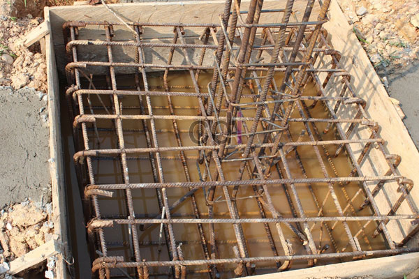

**Cakar Ayam untuk Rumah 2 Lantai: Panduan Lengkap, Kelebihan, dan Biaya** - Hai Mitra CDI! Punya rencana membangun rumah dua lantai di (not detected)? Tahukah Anda bahwa fondasi yang tepat adalah kunci utama keberhasilan proyek Anda? Sekitar 70% masalah struktur bangunan berasal dari perencanaan pondasi yang kurang matang, lho. Salah satu solusi yang banyak dipilih karena ekonomis dan efektif adalah pondasi cakar ayam. Yuk, kita bahas tuntas!

## Apa Itu Pondasi Cakar Ayam untuk Rumah 2 Lantai?

Pondasi cakar ayam, atau pondasi tapak, adalah sistem pondasi yang terdiri dari sloof (balok beton) yang saling terhubung. Sloof ini ditopang oleh pilar-pilar beton bertulang yang berfungsi mendistribusikan beban bangunan secara merata ke tanah. Nah, untuk rumah dua lantai di (not detected), perencanaan pondasi cakar ayam ini memerlukan perhitungan yang lebih detail dibandingkan rumah satu lantai karena menerima beban yang lebih besar. 

Sistem pondasi ini ideal untuk lahan dengan kondisi tanah yang stabil dan keras. Tapi, ingat ya, kekuatan pondasi cakar ayam sangat bergantung pada perhitungan yang akurat dari tenaga ahli. Perhitungan ini mencakup analisis beban bangunan, daya dukung tanah, dan dimensi struktur pondasi yang tepat.

## Keunggulan dan Kekurangan Pondasi Cakar Ayam

Setiap jenis pondasi punya plus minusnya masing-masing. Salah satu kelebihan utama cakar ayam adalah efisiensinya dari segi biaya. Dibandingkan dengan pondasi menerus atau bored pile, cakar ayam seringkali lebih hemat, apalagi jika kondisi tanah di (not detected) mendukung. Waktu pengerjaannya pun relatif lebih cepat.

Hati-hati juga ya, Mitra. Pondasi cakar ayam kurang ideal jika tanahnya lunak atau rawan banjir. Dalam kondisi seperti itu, perbaikan tanah atau sistem pondasi yang lebih kuat mungkin diperlukan. Proses pengerjaan cakar ayam juga butuh presisi tinggi agar tidak mengurangi kekuatan struktur rumah Anda.

## Perhitungan Biaya dan Estimasi Harga Cakar Ayam

Biaya pemasangan cakar ayam untuk rumah 2 lantai di (not detected) bisa berbeda-beda, tergantung luas bangunan, kondisi tanah, harga material, dan upah tukang. Untuk gambaran, perkiraan harga per titik cakar ayam berkisar antara Rp 3.000.000 hingga Rp 6.000.000. Perlu diingat, ini hanya estimasi dan harga bisa berubah sewaktu-waktu — silakan hubungi Kami untuk mendapatkan penawaran terbaru dan paling akurat sesuai dengan kebutuhan proyek Anda.

Misalnya, Anda membangun rumah 2 lantai seluas 100 meter persegi dan membutuhkan 10 titik cakar ayam. Total biaya pemasangan pondasi bisa berkisar antara Rp 30.000.000 hingga Rp 60.000.000. Biaya ini belum termasuk material tambahan seperti besi beton, semen, dan pasir.

Berikut adalah tabel estimasi biaya material untuk satu titik cakar ayam (ukuran standar):

<table class="table">
  <caption>Estimasi Biaya Material Cakar Ayam (Per Titik)</caption>
  <thead>
    <tr><th>Material</th><th>Satuan</th><th>Harga (Estimasi)</th></tr>
  </thead>
  <tbody>
    <tr><td>Semen</td><td>Sak (50 kg)</td><td>Rp 80.000</td></tr>
    <tr><td>Pasir</td><td>m³</td><td>Rp 350.000</td></tr>
    <tr><td>Besi Beton</td><td>kg</td><td>Rp 15.000</td></tr>
    <tr><td>Batu Split</td><td>m³</td><td>Rp 400.000</td></tr>
    <tr><td>Kayu</td><td>m³</td><td>Rp 1.200.000</td></tr>
  </tbody>
</table>

## Tips Memilih Jasa Pemasangan Cakar Ayam yang Tepat

Memilih penyedia jasa pemasangan cakar ayam yang terpercaya dan berpengalaman akan memastikan kualitas dan keamanan fondasi rumah Anda di (not detected). Pastikan kontraktor memiliki sertifikasi yang relevan dan pengalaman dalam membangun rumah 2 lantai. Cek juga portofolio proyek-proyek sebelumnya dan minta referensi dari klien lain.

Selain itu, pastikan kontraktor memberikan rincian biaya yang detail dan transparan. Jangan ragu untuk bertanya mengenai spesifikasi material yang digunakan dan metode pengerjaan yang diterapkan. Bandingkan beberapa penawaran dari kontraktor berbeda untuk mendapatkan harga yang paling bersaing.

Butuh bantuan untuk mewujudkan rumah impian Anda? Tim Kami siap membantu. Silakan hubungi melalui tombol **Telepon** atau **WhatsApp** di bawah ini. Jangan tunda lagi, yuk konsultasikan proyek Anda sekarang!