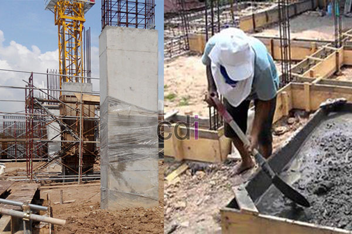

**Campuran Beton K175 Manual: Panduan Lengkap untuk Proyek Anda** - Hai Mitra CDI! Punya proyek konstruksi skala kecil di (not detected)? Bingung gimana caranya bikin beton berkualitas tanpa ribet? Nah, mari kita bahas tuntas soal campuran beton K175 manual. Seringkali, kebutuhan beton dalam jumlah terbatas membuat opsi *ready mix* terasa kurang praktis. Di sinilah kemampuan membuat campuran sendiri jadi sangat berguna, bahkan bisa menghemat biaya!

## Mengenal Lebih Dekat Beton K175 dan Manfaatnya

Beton K175 adalah pilihan populer untuk berbagai aplikasi konstruksi ringan hingga menengah. Angka 175 menunjukkan kekuatan tekan yang dicapai beton setelah 28 hari pengujian, sekitar 175 kg/cm². Ini menjadikannya ideal untuk pondasi sederhana, lantai kerja, trotoar, atau bahkan pekerjaan cor-coran kecil lainnya. Membuat beton K175 manual memerlukan perpaduan yang tepat antara semen, pasir, kerikil, dan air.

Kualitas bahan baku sangat menentukan kekuatan dan daya tahan beton. Pastikan semen Portland yang Anda gunakan memiliki standar SNI, pasirnya bersih dari tanah dan lumpur, serta kerikil dengan gradasi ukuran yang baik. Material berkualitas akan menghasilkan beton yang lebih awet dan memenuhi kebutuhan proyek Anda di (not detected).

## Panduan Rasio Campuran K175 yang Tepat

Rasio standar campuran beton K175 manual adalah 1 : 2 : 3, mewakili perbandingan volume antara semen, pasir, dan kerikil. Artinya, untuk setiap 1 bagian semen, Anda butuh 2 bagian pasir dan 3 bagian kerikil. Penting diingat, ini adalah acuan dasar. Kondisi lapangan dan spesifikasi material bisa memengaruhi penyesuaian rasio.

Misalnya, untuk menghasilkan sekitar 1 meter kubik campuran K175, kebutuhannya kira-kira: 350 kg semen, 700 kg pasir, dan 1050 kg kerikil. Jumlah air yang ditambahkan berkisar antara 160-200 liter, disesuaikan dengan tingkat kelembapan material kering yang digunakan. Tambahkan air secara bertahap sambil terus diaduk sampai konsistensi yang diinginkan tercapai. [Campuran Beton K125 Manual: Panduan Lengkap untuk Proyek Konstruksi Anda](/blog/campuran-beton-k125-manual/) bisa jadi referensi tambahan untuk pemahaman proporsi campuran.

## Proses Pembuatan Campuran Beton K175 Manual Langkah Demi Langkah

Membuat campuran beton K175 manual sebenarnya tidak terlalu sulit. Pertama, campurkan semen dan pasir hingga membentuk adonan yang merata. Selanjutnya, masukkan kerikil secara bertahap sambil terus diaduk hingga tercampur sempurna. Tahap terakhir, tambahkan air sedikit demi sedikit sambil diaduk terus-menerus sampai konsistensi yang tepat tercapai.

Konsistensi yang ideal adalah adonan beton mudah dituang, tidak terlalu cair (encer), dan tidak terlalu kering (padat). Beton yang terlalu encer akan mengurangi kekuatannya, sementara beton yang terlalu kering akan sulit dipadatkan dan rentan retak. Penggunaan molen manual sangat disarankan untuk memastikan pencampuran yang homogen. Jika menggunakan aduk manual, usahakan semua material tercampur merata.

### Tips Tambahan untuk Hasil yang Optimal

Beberapa tips ini akan membantu Anda mendapatkan hasil campuran beton K175 manual yang terbaik:

*   Lakukan pencampuran di area yang bersih dan datar.
*   Tambahkan air secara bertahap sambil terus diaduk.
*   Pastikan semua material tercampur sempurna sebelum digunakan.
*   Gunakan alat pelindung diri seperti sarung tangan dan masker untuk menghindari iritasi kulit dan gangguan pernapasan.
*   Perhatikan cuaca. Hindari membuat beton saat hujan deras atau suhu terlalu panas.

## Perkiraan Biaya dan Hal-Hal yang Perlu Dipertimbangkan

Biaya pembuatan campuran beton K175 manual sangat dipengaruhi oleh harga material di (not detected). Secara umum, harga semen per sak (50 kg) berkisar antara Rp 50.000 hingga Rp 70.000, harga pasir per meter kubik sekitar Rp 150.000 hingga Rp 250.000, dan harga kerikil per meter kubik antara Rp 100.000 hingga Rp 180.000. Perlu diingat, harga ini bisa berfluktuasi. Untuk informasi harga terkini dan sesuai kebutuhan proyek Anda, silakan hubungi Kami.

Selain biaya material, pertimbangkan juga biaya tenaga kerja jika Anda menggunakan jasa tukang. Jangan lupakan biaya transportasi material ke lokasi proyek. Untuk proyek dengan skala besar, mengandalkan beton *ready mix* mungkin lebih efisien dari segi waktu dan biaya.

Butuh bantuan lebih lanjut? Jangan ragu untuk menghubungi Kami! Tombol **Telepon** dan **WhatsApp** di bawah ini siap membantu Anda. Kami siap menjawab pertanyaan dan memberikan solusi terbaik untuk proyek konstruksi Anda di (not detected).