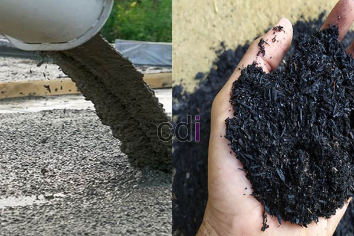

**Campuran Beton K200 Manual: Panduan Lengkap untuk Proyek Konstruksi Anda** - Hai Mitra CDI! Sedang merencanakan proyek konstruksi dan ingin tahu seluk-beluk membuat campuran beton K200 secara manual? Memilih beton yang tepat itu penting banget, lho, demi kekuatan dan ketahanan bangunan Anda. Nah, di sini Kami akan membahas tuntas soal ini.

Kami akan kupas tuntas mulai dari bahan-bahan yang dibutuhkan, cara mencampur yang benar, sampai perkiraan biayanya. Dengan panduan ini, Anda bisa lebih yakin dalam membangun impian Anda di (not detected). Yuk, simak selengkapnya!

## Mengapa K200? Kekuatan dan Kegunaan Campuran Beton K200

Apa sih yang membuat K200 begitu populer di kalangan Mitra CDI? Sederhana saja, beton K200 punya kekuatan tekan karakteristik 200 kg/cm² setelah 28 hari. Kekuatan ini cocok untuk berbagai aplikasi non-struktural berat, seperti lantai kerja, pondasi untuk bangunan sederhana, atau bahkan jalan setapak. 

Tapi ingat ya, kekuatan K200 ada batasnya. Kalau proyek Anda membutuhkan struktur yang menahan beban besar — misalnya kolom atau balok utama — sebaiknya pertimbangkan campuran yang lebih kuat seperti K225 atau K300. Untuk perbandingan lebih detail, Anda bisa intip artikel Campuran Beton K225: Panduan Lengkap Kekuatan, Aplikasi, dan Biaya Kami.

## Resep Rahasia: Proporsi Campuran Beton K200 Manual yang Akurat

Mau coba bikin sendiri? Tentu saja! Tapi, proporsi yang tepat itu kunci, supaya betonnya nggak gampang retak atau kurang kuat. Secara umum, proporsi yang Kami rekomendasikan adalah:

*   **Semen:** 1 bagian (gunakan semen Portland biasa/OPC berkualitas)
*   **Pasir:** 2 bagian (pastikan pasirnya bersih dari lumpur dan kotoran lainnya)
*   **Kerikil:** 3 bagian (kerikil juga harus bersih dan ukurannya proporsional)
*   **Air:** 0,5 - 0,6 bagian (air bersih itu syarat mutlak, ya)

Contohnya, kalau Anda butuh 1 m³ beton K200, perhitungan kasarnya seperti ini:

*   Semen: 1 x 0,15 m³ = 0,15 m³ (sekitar 150 kg, tergantung berat jenis semen)
*   Pasir: 2 x 0,15 m³ = 0,3 m³
*   Kerikil: 3 x 0,15 m³ = 0,45 m³
*   Air: 0,55 x 0,15 m³ = 0,0825 m³ (sekitar 82,5 liter)

Ingat, ini cuma acuan. Kondisi material di (not detected) mungkin beda-beda. Jadi, selalu lakukan uji coba kecil dulu untuk memastikan proporsinya pas.

## Perkiraan Biaya: Berapa Dana yang Harus Anda Siapkan?

Biaya pembuatan beton K200 manual itu relatif, tergantung harga bahan di wilayah Anda. Tapi, ini perkiraan kasar untuk tahun 2026:

*   **Semen:** Rp 800.000 – Rp 1.000.000
*   **Pasir:** Rp 150.000 – Rp 250.000
*   **Kerikil:** Rp 200.000 – Rp 300.000
*   **Air:** Rp 50.000 – Rp 100.000
*   **Upah Tenaga Kerja:** Rp 200.000 – Rp 300.000

Jadi, total biaya per m³ beton K200 manual bisa berkisar antara Rp 1.400.000 hingga Rp 1.950.000.  Untuk harga yang lebih akurat dan sesuai dengan proyek Anda di (not detected), silakan hubungi Kami untuk mendapatkan penawaran terbaik!

## Sukses Membuat Beton K200: Tips Penting yang Wajib Diperhatikan

Biar makin mantap, perhatikan tips ini saat membuat campuran beton K200 manual:

*   **Aduk Rata:** Pastikan semua bahan tercampur sempurna. Pakai cangkul atau mixer kalau ada.
*   **Kualitas Air:** Air bersih adalah kunci beton yang kuat dan tahan lama.
*   **Simpan Semen dengan Benar:** Hindari kelembaban agar semen tidak menggumpal.
*   **Cetak dan Padatkan:** Langsung cetak beton setelah dicampur dan padatkan dengan baik.
*   **Perawatan:** Siram beton secara rutin selama 7 hari setelah pengecoran agar tidak retak.

Butuh bantuan atau ada pertanyaan lain? Jangan sungkan untuk menghubungi Kami melalui tombol **WhatsApp** atau **Telepon** yang ada di halaman ini. Kami siap membantu Anda! 
<table class="table">
  <caption>Perbandingan Jenis-Jenis Beton</caption>
  <thead>
    <tr><th>Jenis Beton</th><th>Kekuatan Tekan (kg/cm²)</th><th>Aplikasi Umum</th></tr>
  </thead>
  <tbody>
    <tr><td>K200</td><td>200</td><td>Lantai kerja, pondasi ringan, jalan setapak</td></tr>
    <tr><td>K225</td><td>225</td><td>Kolom, balok, plat lantai</td></tr>
    <tr><td>K300</td><td>300</td><td>Struktur yang menahan beban besar</td></tr>
  </tbody>
</table>

Selain itu, jangan lewatkan artikel Kami tentang [Adhimix Karawang: Solusi Beton Instan untuk Proyek Konstruksi Anda](/blog/adhimix-karawang/) untuk opsi beton ready mix yang praktis dan berkualitas.