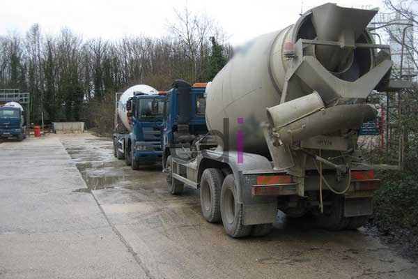

**Campuran Beton K300: Panduan Lengkap Kekuatan, Penggunaan, dan Aplikasi Terbaik** - Hai Mitra CDI! Tahukah Anda, seringkali memilih campuran beton yang tepat adalah kunci keberhasilan sebuah proyek konstruksi? Nah, kali ini kita akan membahas tuntas tentang campuran beton K300—solusi yang populer dan andal untuk kebutuhan bangunan Anda di (not detected). Kekuatan tekan yang luar biasa, yakni 300 kg/cm², menjadikannya ideal untuk beragam aplikasi yang menuntut kekuatan dan daya tahan tinggi.

### Memahami Campuran Beton K300: Apa Saja Keunggulannya?

Campuran beton K300 ditandai dengan kekuatan tekan karakteristik (f'c) sebesar 300 kilogram per sentimeter persegi (kg/cm²).  Nilai ini merepresentasikan kemampuan beton untuk menahan beban tekan, dan merupakan metrik krusial dalam memastikan ketahanan struktur bangunan.  Standar nasional Indonesia (SNI) menjadi acuan utama dalam menentukan kualitas dan kemampuan beban beton K300 ini. Semakin tinggi nilai K, semakin andal pula beton tersebut dalam menahan beban. Jadi, apakah Anda sedang membangun fondasi bangunan bertingkat, kolom, balok, atau lantai, campuran ini bisa menjadi pilihan yang tepat.

### Resep Rahasia: Komposisi Campuran Beton K300 yang Ideal

Mencapai mutu K300 memerlukan perpaduan material yang presisi. Campuran beton K300 biasanya terdiri dari semen, agregat kasar (kerikil), agregat halus (pasir), air, dan bahan tambahan (*admixture*). Ini dia takaran yang umum digunakan:

*   **Semen:** 1 bagian
*   **Pasir:** 2 bagian
*   **Kerikil:** 4 bagian
*   **Air:** 0,4 – 0,5 bagian (sesuaikan dengan tingkat kelembaban agregat)
*   **Admixture (Opsional):** Gunakan sesuai dengan rekomendasi produsen.

Namun, perlu diingat bahwa rasio ini bisa sedikit berbeda tergantung pada jenis semen, karakteristik material agregat, dan kondisi lingkungan saat pengecoran. Untuk hasil yang optimal, sangat disarankan agar campuran beton Anda diuji di laboratorium sebelum digunakan.

### Di Mana Saja Beton K300 Bisa Digunakan?

Beton K300 memiliki cakupan aplikasi yang luas dalam berbagai proyek konstruksi, termasuk:

*   **Fondasi Bangunan:**  Daya tahan dan kekuatannya membuatnya sangat cocok untuk fondasi bangunan bertingkat, terutama di area dengan kondisi tanah yang kurang stabil.
*   **Kolom dan Balok:**  Komponen struktural ini membutuhkan kekuatan tekan tinggi untuk menopang beban bangunan secara keseluruhan.
*   **Lantai:**  Ideal untuk lantai bangunan yang memerlukan kemampuan menahan beban berat dan abrasi — misalnya, lantai gudang atau pabrik.
*   **Pavement (Perkerasan):**  Pilihan yang tepat untuk perkerasan jalan, area parkir, dan permukaan industri yang harus tahan terhadap lalu lintas padat.
*   **Struktur Penahan Air:**  Ketahanannya terhadap tekanan hidrostatik menjadikannya cocok untuk pembangunan tangki air, dinding penahan, dan instalasi hidrolik lainnya.

Sebagai gambaran perbandingan, beton K300 jelas lebih unggul kekuatannya dibandingkan beton K125 atau K150. Berikut tabel perbandingan sederhana:

<table class="table">
  <caption>Perbandingan Mutu Beton</caption>
  <thead>
    <tr><th>Mutu Beton</th><th>Kekuatan Tekan (kg/cm²)</th><th>Aplikasi Umum</th></tr>
  </thead>
  <tbody>
    <tr><td>K125</td><td>125</td><td>Pekerjaan non-struktural, lantai ringan</td></tr>
    <tr><td>K150</td><td>150</td><td>Fondasi rumah sederhana, trotoar</td></tr>
    <tr><td>K300</td><td>300</td><td>Fondasi bangunan bertingkat, kolom, balok</td></tr>
  </tbody>
</table>

### Biaya Campuran Beton K300: Apa Saja Faktor yang Mempengaruhi?

Estimasi biaya campuran beton K300 di (not detected) bervariasi, dipengaruhi oleh beberapa hal seperti lokasi, jumlah pesanan, dan penyedia beton.  Secara umum, harga per meter kubik di wilayah Jabodetabek pada tahun 2026 diperkirakan berkisar antara Rp 800.000 hingga Rp 1.200.000.  Ini hanyalah perkiraan—untuk mengetahui harga yang paling akurat sesuai dengan skala proyek Anda, hubungi tim Kami untuk mendapatkan penawaran khusus!

Faktor-faktor yang memengaruhi harga meliputi:

*   **Harga Semen:**  Perubahan harga semen akan langsung memengaruhi biaya produksi beton.
*   **Biaya Transportasi:**  Semakin jauh jarak pengiriman dari pabrik beton, semakin tinggi pula biayanya.
*   **Biaya Material Tambahan:** Penggunaan *admixture* tertentu dapat meningkatkan biaya produksi.
*   **Ketersediaan Material:** Kelangkaan material dasar bisa menyebabkan kenaikan harga.
*   **Skala Pemesanan:** Pesanan dalam jumlah besar umumnya mendapatkan harga yang lebih kompetitif.

Butuh informasi lebih lanjut atau ingin berkonsultasi mengenai kebutuhan proyek Anda di (not detected)? Jangan ragu untuk menghubungi Kami melalui tombol **WhatsApp** atau **Telepon** yang tersedia. Kami siap membantu! [Campuran Beton K150: Panduan Lengkap Kekuatan, Penggunaan, dan Biaya](/blog/campuran-beton-k150/)