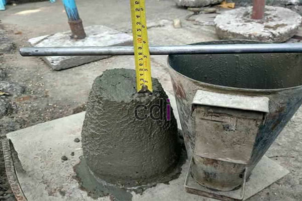

**Campuran Beton SNI: Panduan Lengkap untuk Konstruksi Berkualitas di Jabodetabek** - Hai Mitra CDI! Punya rencana membangun di Jabodetabek dan ingin memastikan kualitas konstruksi maksimal? Kualitas campuran beton adalah kunci utama! Faktanya, lebih dari 80% masalah konstruksi berasal dari kualitas beton yang kurang tepat. Artikel ini akan memandu Anda memahami campuran beton SNI, mengapa penting, dan bagaimana memilih yang terbaik untuk proyek Anda.

## Mengapa Standar Nasional Indonesia (SNI) Penting untuk Campuran Beton?

Campuran beton SNI adalah pedoman penting dalam setiap proyek konstruksi di Indonesia. Standar ini tidak sekadar memenuhi regulasi, melainkan jaminan untuk kekuatan, daya tahan, dan keamanan bangunan Anda jangka panjang. Dengan mengikuti SNI, Anda berinvestasi pada properti yang lebih terjamin kualitasnya. Tersedia beragam campuran beton SNI, masing-masing didesain untuk kebutuhan spesifik. Beberapa yang paling umum adalah K125, K150, K175, K225, dan K300.  Angka 'K' mengindikasikan kekuatan tekan beton dalam kilogram per sentimeter persegi (kg/cm²), semakin tinggi angkanya, semakin kuat materialnya.

Standar SNI mencakup detail penting seperti jenis semen yang digunakan, kualitas agregat (pasir dan kerikil), kualitas air, dan bahkan penggunaan bahan tambahan (*admixture*). Misalnya, untuk mencapai beton K225, biasanya digunakan semen tipe Portland, pasir dengan modulus halus 2,5-3,0, dan kerikil dengan diameter maksimal 20 mm.  Rasio umum yang diterapkan adalah 1 semen : 2 pasir : 4 kerikil. Perlu diingat, rasio ini sebagai panduan; kondisi lapangan dan hasil uji laboratorium tetap perlu menjadi pertimbangan.

## Faktor Penentu Kualitas Campuran Beton SNI yang Optimal

Kualitas campuran beton SNI tidak hanya soal takaran material saja. Ada beberapa elemen krusial lain yang perlu diperhatikan. Air adalah yang pertama – pastikan air yang Anda gunakan bersih, bebas dari lumpur, minyak, garam, atau bahan organik yang dapat mengganggu proses pengerasan semen. Selanjutnya adalah teknik pencampuran. Pencampuran yang menyeluruh akan menghasilkan campuran beton yang homogen. Penggunaan *concrete mixer* sangat disarankan untuk mencapai hasil terbaik. Jangan lupakan proses pemadatan, yang bertujuan menghilangkan udara yang terperangkap dalam campuran, meningkatkan kerapatan, dan akhirnya meningkatkan kekuatannya. Alat pemadat seperti *vibrator* sangat membantu dalam proses ini.

Faktor lingkungan juga berpengaruh, lho! Suhu dan kelembaban bisa memengaruhi proses pengerasan. Pada cuaca panas, beton cepat mengering dan perlu disiram secara berkala untuk mencegah retakan. Sementara itu, cuaca dingin cenderung memperlambat proses pengerasan. Pemilihan *admixture* yang tepat, seperti *water reducer* atau *retarder*, bisa menjadi solusi cerdas untuk mengatasi perubahan cuaca ini.

## Perkiraan Biaya Campuran Beton SNI di Jabodetabek: Apa yang Perlu Anda Ketahui?

Harga campuran beton SNI di wilayah Jabodetabek dapat bervariasi. Faktor-faktor seperti mutu beton yang dipilih, volume pesanan, lokasi proyek, dan penyedia jasanya akan memengaruhi harga akhir. Sebagai gambaran, harga per meter kubik (m³) untuk campuran beton siap pakai (*ready mix*) umumnya berada di kisaran Rp 800.000 hingga Rp 1.500.000. Harga ini bersifat estimasi dan dapat berubah sewaktu-waktu — Kami sarankan untuk menghubungi Kami agar mendapatkan penawaran harga terbaru dan paling sesuai dengan kebutuhan proyek Anda.

Berikut perkiraan biaya untuk beberapa jenis campuran beton SNI, sebagai referensi:

<table class="table">
  <caption>Estimasi Biaya Campuran Beton SNI (per m³)</caption>
  <thead>
    <tr><th>Jenis Beton</th><th>Harga Estimasi (Rp)</th><th>Aplikasi Umum</th></tr>
  </thead>
  <tbody>
    <tr><td>K125</td><td>800.000 - 900.000</td><td>Lantai kerja, dasar jalan</td></tr>
    <tr><td>K150</td><td>900.000 - 1.000.000</td><td>Pondasi rumah sederhana, trotoar</td></tr>
    <tr><td>K225</td><td>1.100.000 - 1.300.000</td><td>Kolom, balok, plat lantai rumah</td></tr>
    <tr><td>K300</td><td>1.300.000 - 1.500.000</td><td>Struktur bangunan tinggi, jembatan</td></tr>
  </tbody>
</table>

Perlu diingat bahwa biaya ini belum termasuk biaya transportasi dan jasa pemasangan. Anda juga bisa mempertimbangkan pembuatan campuran beton secara manual, tetapi ini membutuhkan keahlian khusus untuk memastikan kualitas dan kekuatan beton sesuai standar yang ditetapkan.

## Memilih Jasa Campuran Beton SNI Terpercaya di Jabodetabek: Panduan Penting

Memastikan kualitas proyek Anda dengan memilih jasa campuran beton SNI yang kredibel adalah hal yang sangat penting. Periksa reputasi penyedia jasa, pengalaman mereka di lapangan, dan sertifikasi yang relevan. Jangan ragu meminta referensi proyek sebelumnya dan melakukan inspeksi langsung ke fasilitas pencampuran beton mereka. Pastikan juga mereka memiliki laboratorium pengujian mutu beton yang lengkap dan terakreditasi.

Kami di Creative Design Interior (CDI) siap menjadi mitra Anda dalam memilih campuran beton SNI yang paling sesuai untuk proyek konstruksi di Jabodetabek. Kami telah menjalin kerjasama dengan berbagai penyedia jasa beton terpercaya dan berpengalaman. Tim ahli kami siap memberikan konsultasi teknis komprehensif untuk memastikan fondasi dan struktur bangunan Anda kokoh dan berkualitas. Dengan pengalaman bertahun-tahun dalam desain interior dan konstruksi di Jabodetabek, Kami memiliki pemahaman mendalam tentang kebutuhan proyek Anda.

Tertarik untuk berdiskusi lebih lanjut? Jangan sungkan untuk menghubungi Kami melalui tombol **Telepon** atau **WhatsApp** yang tersedia di bawah ini. Kami siap membantu!  [Campuran Beton K125 Manual: Panduan Lengkap untuk Proyek Konstruksi Anda](/blog/campuran-beton-k125-manual/) — Pelajari lebih lanjut tentang campuran beton K125 untuk aplikasi yang tepat di proyek Anda.